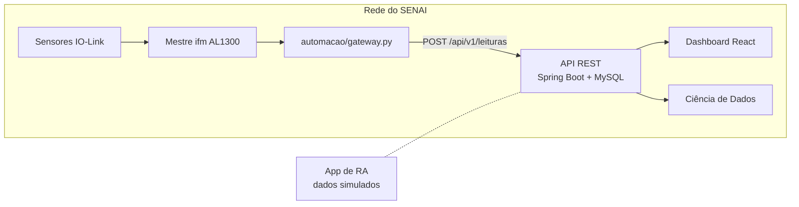

# MetalTech Monitoramento Industrial

Plataforma de monitoramento de uma esteira de triagem de peças, desenvolvida no **Projeto Interdisciplinar II** ([enunciado](docs/projeto.md)). Sensores IO-Link reais classificam cada peça e medem o nível do reservatório; um gateway envia as leituras para uma API REST em Spring Boot, consumida pelo dashboard React e pela análise de Ciência de Dados.

O [app de Realidade Aumentada](https://rafarubia7.github.io/manufatura-metaltech/realidade-aumentada/) reconhece a esteira pela câmera e mostra contagem e nível com **dados simulados** ([por quê](#restrição-de-rede-e-o-ra)).

<p align="center">
  <a href="https://rafarubia7.github.io/manufatura-metaltech/realidade-aumentada/">
    
  </a>
</p>



## Entregáveis

| Entregável | Onde está |
|---|---|
| Back-end (API REST) | [backend/](backend/) · [contrato da API](backend/README.md#contrato-da-api-v1) · Swagger em `/swagger-ui.html` |
| Front-end (React) | [frontend/](frontend/) |
| Automação Industrial | [automacao/](automacao/) |
| Realidade Aumentada | [realidade-aumentada/](realidade-aumentada/) |
| Relatório de Ciência de Dados | [docs/relatorio_ciencia_dados.md](docs/relatorio_ciencia_dados.md) · scripts e gráficos em [dados/](dados/) |
| Arquitetura de nuvem | [docs/arquitetura_nuvem.md](docs/arquitetura_nuvem.md) |

## Situação da entrega

Todas as unidades curriculares foram atendidas, com estas ressalvas:

- **Automação:** o sensor de nível (porta X01) falha com `IO-Link code 530` por defeito físico do equipamento do laboratório ([detalhes](automacao/README.md#problema-conhecido-porta-x01-com-io-link-code-530)).
- **Nuvem:** sem login nem HTTPS na rede local; a `X-API-Key` existe e é testada, mas está desativada porque a API só é acessível na rede isolada do laboratório.
- **Realidade Aumentada:** usa dados simulados por restrição de rede (abaixo).

### Restrição de rede e o R.A

A bancada e o servidor ficam na rede do SENAI, inacessível ao celular. Por isso o R.A simula localmente o mesmo formato de `GET /api/v1/esteira/status` (endpoint já implementado e testado), com os mesmos limiares do back-end. O professor aceitou essa solução. Na arquitetura de produção, a API fica pública via HTTPS e o R.A passa a consumi-la ([detalhes](docs/arquitetura_nuvem.md#27-isolamento-da-rede-do-laboratório)).

## Stack

- **Back-end:** Java 17, Spring Boot 3.2, JPA, MySQL 8.0, Flyway, Springdoc OpenAPI, JUnit 5, Testcontainers, JaCoCo
- **Front-end:** React 19, React Router 7, Bootstrap 5, Recharts, Vite
- **Automação:** Python 3, mestre IO-Link ifm AL1300
- **Ciência de Dados:** Python 3.11+, pandas, numpy, scipy, matplotlib
- **Realidade Aumentada:** A-Frame 1.6, MindAR 1.2.5, GitHub Pages
- **Infra:** Docker Compose

## Execução rápida

Requer Docker Desktop. Na raiz do repositório:

```powershell
Copy-Item .env.example .env      # defina as senhas
docker compose up -d --build
docker compose ps                # db, backend e frontend "healthy"
```

| O quê | Endereço |
|---|---|
| Dashboard | http://localhost:3000 |
| API | http://localhost:8080/api/v1 (Swagger em `/swagger-ui.html`) |
| MySQL | `localhost:3307` |

Cada módulo tem seu próprio README com execução local e solução de problemas: [backend](backend/README.md), [frontend](frontend/README.md), [automacao](automacao/README.md), [dados](dados/README.md), [realidade-aumentada](realidade-aumentada/README.md).

## Regras de negócio

- Reservatório: baixo < 20%, normal 20–80%, alto > 80%, crítico ≥ 95%.
- Enchimento rápido: mais de 5 %/min na janela de 3 min.
- Indutivo e capacitivo acionados juntos indicam peça metálica.
- O back-end recalcula tipo da peça e status a partir dos sensores.

## Qualidade

- **72 testes automatizados** (unitários e de integração com H2 e MySQL via Testcontainers).
- **90,8% de cobertura de linhas** (JaCoCo); o build falha abaixo de 70%.
- Migrações versionadas com Flyway.
