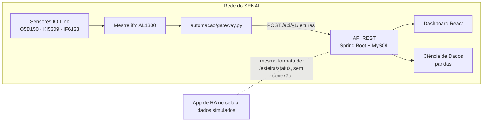

# MetalTech Monitoramento Industrial

Plataforma de monitoramento de uma esteira de triagem de peças, desenvolvida no **Projeto Interdisciplinar II** (enunciado em [docs/projeto.md](docs/projeto.md)). Sensores IO-Link reais (distância, indutivo e capacitivo) classificam cada peça e medem o nível do reservatório. Um gateway envia as leituras para uma API REST em Spring Boot. O dashboard React e a análise de Ciência de Dados consomem essa API.

O aplicativo de Realidade Aumentada ([abrir no celular](https://rafarubia7.github.io/manufatura-metaltech/realidade-aumentada/)) reconhece a esteira pela câmera e mostra contagem e nível com **dados simulados**. A bancada e a API ficam na rede do SENAI, à qual o celular não tem acesso ([detalhes](#restrição-de-rede-e-o-ra)).

<p align="center">
  <a href="https://rafarubia7.github.io/manufatura-metaltech/realidade-aumentada/">
    
  </a>
  <br>
  <sub>Aponte a câmera do celular para abrir o app de Realidade Aumentada</sub>
</p>



## Entregáveis (seção 7 do enunciado)

| Entregável | Onde está |
|---|---|
| Código-fonte do back-end (API REST) | [backend/](backend/): contrato da API no [backend/README.md](backend/README.md#contrato-da-api-v1), Swagger em `/swagger-ui.html` |
| Código-fonte do front-end (React) | [frontend/](frontend/) |
| Firmware/software da Automação Industrial | [automacao/gateway.py](automacao/gateway.py): circuito e sensores no [automacao/README.md](automacao/README.md) |
| Aplicativo de Realidade Aumentada | [realidade-aumentada/](realidade-aumentada/), publicado em https://rafarubia7.github.io/manufatura-metaltech/realidade-aumentada/ (dados simulados) |
| Relatório de Ciência de Dados | [docs/relatorio_ciencia_dados.md](docs/relatorio_ciencia_dados.md): scripts e gráficos em [dados/](dados/) |
| Documento de arquitetura de nuvem | [docs/arquitetura_nuvem.md](docs/arquitetura_nuvem.md) |

## O que cada unidade curricular entrega

| Unidade curricular | Implementação |
|---|---|
| Automação Industrial | Leitura dos 3 sensores pelo mestre IO-Link, histerese, classificação em janela de 0,5 s, envio HTTP com fila e reenvio quando a API cai |
| Ciência de Dados | Estatística descritiva (média, mediana, moda, desvio, quartis), gráficos de linha, barras, dispersão, histograma e boxplot, outliers e critério de alerta (enchimento > 5 %/min), validados contra a API |
| Computação em Nuvem | Implantação atual em servidor local com Docker Compose (healthchecks, reinício automático, volume persistente, segredos no `.env`) e arquitetura PaaS proposta para produção (Elastic Beanstalk + RDS + S3/CloudFront), com segurança, disponibilidade, escalabilidade e custos justificados |
| Desenvolvimento Back-end | Modelagem orientada a objetos (hierarquia `Sensor` → `SensorIndutivo`/`SensorCapacitivo` com polimorfismo, `Usuario` encapsulado com perfis), CRUD de leituras e de usuários, alertas, estatísticas, 72 testes automatizados e 90,8% de cobertura de linhas |
| Frameworks Front-end | React + React Router (4 rotas), componentes com props e estado, Bootstrap 5, tema claro/escuro, atualização automática |
| Realidade Aumentada | WebAR com A-Frame e MindAR, publicado no GitHub Pages: reconhece a esteira real pela câmera e sobrepõe contagem metálica/não metálica e nível do reservatório, com cores de alerta (80% e 95%) e faixa de enchimento acima do padrão. Usa dados simulados por restrição de rede |

## Situação da entrega

Situação em 16/11/2026, conforme os critérios de avaliação (seção 8 do enunciado). ✅ atendido · ⚠️ atendido com ressalva

| Unidade curricular | Status | Evidência e ressalvas |
|---|---|---|
| Automação Industrial | ✅ | Leitura dos 3 sensores, classificação, envio com fila (testado em 12/11), circuito documentado. ⚠️ O sensor de nível (porta X01) falha com `IO-Link code 530`: problema físico, ver [automacao/README.md](automacao/README.md#problema-conhecido-porta-x01-com-io-link-code-530) |
| Ciência de Dados | ✅ | Estatística descritiva, 10 gráficos, 4 famílias de detectores de outliers, validação API × pandas 23/23 |
| Computação em Nuvem | ✅ | Servidor local em Docker em operação e AWS justificada para produção. ⚠️ Sem login nas rotas e sem HTTPS na rede local (limitações documentadas na arquitetura) |
| Desenvolvimento Back-end | ✅ | OO com herança, polimorfismo e encapsulamento; 72 testes; 90,8% de cobertura; Swagger e contrato documentados |
| Frameworks Front-end | ✅ | Responsivo, 4 rotas, componentes com props e estado, Bootstrap 5, integração com a API |
| Eletiva I — Realidade Aumentada | ⚠️ | Reconhecimento, rastreamento e usabilidade atendidos. **A integração com dados reais não foi possível, por restrição de rede** (abaixo) |

### Restrição de rede e o R.A

- **Fato:** a bancada (mestre IO-Link `10.110.12.41`) e o servidor da plataforma ficam na rede do SENAI. O celular que abre o R.A fica fora dessa rede, e a equipe não tem acesso à rede nem aos servidores da faculdade. A restrição foi confirmada com o professor.
- **Consequência:** o R.A não consegue consumir `GET /api/v1/esteira/status`, como pedem as seções 5.5 e 6 do enunciado.
- **Decisão:** o R.A usa uma simulação local no mesmo formato de `/esteira/status`, com os mesmos limiares do back-end (80% e 95%), o critério de enchimento da Ciência de Dados e o selo "DADOS DE TESTE (SIMULADOS)". O endpoint já existe e é testado (`EsteiraControllerTest`). O mapeamento campo a campo está no [contrato da API](backend/README.md#7-consumidores-da-api).
- **Evolução:** na arquitetura de produção ([docs/arquitetura_nuvem.md](docs/arquitetura_nuvem.md#27-isolamento-da-rede-do-laboratório)), o gateway envia as leituras para uma API pública por HTTPS, e o R.A passa a consumi-la de qualquer rede.

### Pendências

**Realidade Aumentada** (responsável: colega do R.A, plano já enviado): ajustar o limiar "baixo" para 20% (`js/config.js`), tirar "(> 5 %/min)" do rótulo da faixa (`index.html`), trocar `?v=6` por `?v=7`, atualizar o README do R.A, publicar e testar no celular.

**Front-end:** link "Realidade Aumentada" na barra de navegação e, opcionalmente, o QR code no painel ([frontend/README.md](frontend/README.md#relação-com-a-realidade-aumentada)).

**Checklist de entrega:**
- [ ] Aceite do professor, por escrito, sobre o R.A com dados simulados
- [ ] Sensor de nível (X01) realinhado e recalibrado, ou plano B combinado
- [ ] `API_KEY` longa e aleatória no `.env` do servidor
- [ ] Backup do banco antes da apresentação (`mysqldump`, [arquitetura](docs/arquitetura_nuvem.md#24-disponibilidade))
- [ ] `.\mvnw.cmd clean verify` com `BUILD SUCCESS` e `npm run lint; npm run build` sem erros
- [ ] Tag de entrega (por exemplo, `git tag -a v1.0-entrega -m "Entrega final PI II"`)

### Roteiro da apresentação

No laboratório, com o servidor e o gateway na rede do SENAI:

1. **Problema:** contagem manual na esteira.
2. **Automação:** passar peças reais e mostrar o log do gateway (`classificada: METALICA ...`).
3. **Back-end:** Swagger, `POST` recebido, classificação e alertas recalculados, testes e cobertura.
4. **Nuvem:** `docker compose ps` com tudo `healthy`, dashboard aberto pelo IP do servidor em outro computador; depois a arquitetura AWS proposta.
5. **Ciência de Dados:** gráficos do relatório e o critério de 5 %/min, que vira o alerta "Enchimento rápido".
6. **Front-end:** dashboard atualizando sozinho enquanto as peças passam; as 4 rotas.
7. **R.A:** abrir pelo QR code, apontar para a esteira e mostrar os painéis. Explicar a restrição de rede e o mapeamento simulação ↔ `/esteira/status`.
8. **Robustez:** derrubar a API por alguns segundos, passar peças, subir a API de novo e mostrar que nenhuma leitura se perdeu.

| Risco | Mitigação |
|---|---|
| Critério "integração com dados reais" da Eletiva I | Aceite do professor por escrito; explicação e mapeamento na apresentação |
| Sensor de nível instável | Recalibrar antes; em último caso, mostrar o nível com o dataset da Ciência de Dados |
| Rede do laboratório | Rodar `gateway.py --sondar` antes de começar |
| Servidor local único | Manter ligado, fazer backup e apresentar a AWS como evolução |
| R.A não reconhecer a esteira | Testar no ângulo da foto de referência; ter a foto aberta em outra tela como alvo reserva |

## Stack

- **Back-end:** Java 17, Spring Boot 3.2, Spring Data JPA, MySQL 8.0, Flyway, Springdoc OpenAPI, JUnit 5, Testcontainers, JaCoCo
- **Front-end:** React 19, React Router 7, Bootstrap 5, Recharts, Vite
- **Automação:** Python 3, mestre IO-Link ifm AL1300 (HTTP/JSON)
- **Ciência de Dados:** Python 3.11+, pandas, numpy, scipy, matplotlib
- **Realidade Aumentada:** HTML/CSS/JavaScript, A-Frame 1.6, MindAR 1.2.5, GitHub Pages
- **Infra:** Docker Compose (MySQL, API e dashboard; gateway e Ciência de Dados como serviços opcionais)

## Estrutura do repositório

Cada pasta de módulo tem o seu README, com execução, detalhes e solução de problemas.

```text
.
├── backend/                     API REST (Spring Boot)
│   ├── src/main/java/.../       domain · application · api · infrastructure
│   ├── src/main/resources/      application.yml e migrações Flyway (V1 a V3)
│   └── src/test/                72 testes (unitários, integração com H2 e com MySQL)
├── frontend/                    Dashboard (React + Vite, servido por Nginx no Docker)
│   └── src/                     pages/ (telas) · components/ · services/api.js · styles/
├── automacao/                   Gateway IO-Link: gateway.py e config.example.json
├── dados/                       Ciência de Dados
│   ├── scripts/                 gerar_dataset.py · analise_estatistica.py · enviar_para_api.py
│   ├── dataset/                 dataset sintético (CSV)
│   ├── graficos/                gráficos do relatório
│   └── resultados/              indicadores, outliers e validação API × pandas
├── realidade-aumentada/         App WebAR (A-Frame + MindAR), publicado no GitHub Pages
├── docs/
│   ├── projeto.md               enunciado oficial
│   ├── relatorio_ciencia_dados.md   relatório de Ciência de Dados (entregável)
│   ├── arquitetura_nuvem.md     documento de arquitetura de nuvem (entregável)
│   └── img/qrcode-ra.png        QR code do app de RA
├── db/init.sql                  inicialização do MySQL (charset/fuso; tabelas via Flyway)
├── compose.yaml                 stack Docker: db + backend + frontend; profiles "esteira" (gateway) e "dados"
└── .env.example                 modelo das credenciais (copie para .env)
```

## Pré-requisitos

| Ferramenta | Versão | Uso |
|---|---|---|
| Java (JDK) | 17 | Back-end. `JAVA_HOME` precisa apontar para o JDK 17 (o `mvnw` usa essa variável) |
| Docker Desktop | recente | MySQL, contêineres e testes de integração com MySQL |
| Python | 3.11+ | Gateway IO-Link e Ciência de Dados |
| Node.js | 20.19+ ou 22.12+ | Front-end |

Maven não precisa ser instalado: o projeto usa o wrapper (`mvnw`). Os comandos são para o Windows PowerShell; no Linux/macOS, troque `.\.venv\Scripts\python` por `./.venv/bin/python` e `mvnw.cmd` por `./mvnw`.

## Execução rápida

Tudo em contêiner, na raiz do repositório:

```powershell
Copy-Item .env.example .env      # defina as senhas; o .env não vai para o Git
docker compose up -d --build
docker compose ps                # db, backend e frontend "healthy"
```

| O quê | Endereço |
|---|---|
| Dashboard | http://localhost:3000 (de outro PC: `http://<ip-do-servidor>:3000`) |
| API | http://localhost:8080/api/v1 (Swagger em `/swagger-ui.html`) |
| MySQL | `localhost:3307` (só no próprio servidor) |
| Mestre IO-Link | `http://10.110.12.41` (rede do laboratório) |
| App de RA | https://rafarubia7.github.io/manufatura-metaltech/realidade-aumentada/ (qualquer rede) |

Os dados ficam no volume `mysql_data` e sobrevivem a `docker compose down`. O `docker compose down -v` apaga o banco.

Passo a passo de cada parte:

| Parte | Guia |
|---|---|
| Banco, testes, API local e contrato | [backend/README.md](backend/README.md) |
| Dashboard em desenvolvimento | [frontend/README.md](frontend/README.md) |
| Gateway IO-Link (bancada), em Python ou contêiner (`--profile esteira`) | [automacao/README.md](automacao/README.md) |
| Ciência de Dados, em Python ou contêiner (`docker compose run --rm dados`) | [dados/README.md](dados/README.md) |
| Realidade Aumentada | [realidade-aumentada/README.md](realidade-aumentada/README.md) |
| Operação do servidor, segurança e backup | [docs/arquitetura_nuvem.md](docs/arquitetura_nuvem.md) |

## Endpoints principais

| Método | Rota | Descrição |
|---|---|---|
| POST | `/api/v1/leituras` | Registra uma leitura (dispositivo; `X-API-Key` se configurada) |
| GET | `/api/v1/leituras` | Lista leituras com paginação e filtros |
| GET / PUT / DELETE | `/api/v1/leituras/{id}` | Busca, corrige ou exclui uma leitura |
| GET | `/api/v1/leituras/alertas` | Lista alertas pendentes |
| PUT | `/api/v1/leituras/alertas/{id}/resolver` | Resolve um alerta |
| GET | `/api/v1/leituras/estatisticas` | Indicadores operacionais |
| GET | `/api/v1/esteira/status` | Estado atual da esteira em uma chamada (criado para o R.A) |
| GET / POST | `/api/v1/usuarios` | Lista ou cadastra usuários |
| GET / PUT / DELETE | `/api/v1/usuarios/{id}` | Busca, atualiza ou exclui um usuário |

Detalhes, exemplos de JSON e erros no [contrato da API](backend/README.md#contrato-da-api-v1).

## Regras de negócio

- Status do reservatório: baixo < 20%, normal 20–80%, alto > 80%, crítico ≥ 95%.
- Alertas de reservatório: um ativo por tipo e dispositivo, resolvido sozinho quando a condição muda.
- Enchimento rápido (critério da Ciência de Dados): mais de 5 %/min na janela anterior de 3 min.
- Indutivo e capacitivo acionados juntos indicam peça metálica (o capacitivo também reage a metal), não um conflito.
- O back-end recalcula o tipo da peça e o status a partir dos sensores. O que o dispositivo informa é só referência.

## Qualidade

- **72 testes automatizados** (unitários, integração com H2 e integração com MySQL real via Testcontainers).
- Cobertura JaCoCo de **90,8% das linhas**. O build falha abaixo de 70%.
- Migrações versionadas com Flyway. Em `ddl-auto: validate`, o Hibernate confere se as entidades batem com o banco.
