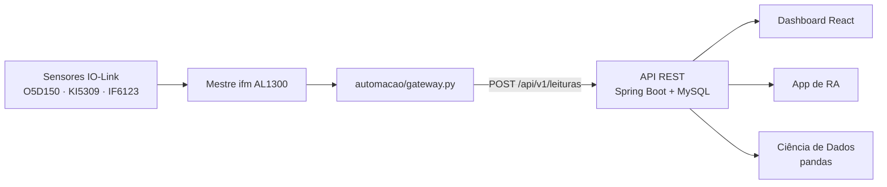

# MetalTech Monitoramento Industrial

Plataforma de monitoramento de uma esteira de triagem de peças, desenvolvida no **Projeto Interdisciplinar II** (situação-problema em [docs/projeto.md](docs/projeto.md)). Sensores IO-Link reais (distância, indutivo e capacitivo) classificam cada peça e medem o nível do reservatório. Um gateway envia as leituras para uma API REST em Spring Boot. Um dashboard React, a análise de Ciência de Dados e o aplicativo de Realidade Aumentada consomem a mesma API.



## Entregáveis (seção 7 do documento oficial)

| Entregável | Onde está |
|---|---|
| Código-fonte do back-end (API REST) | [backend/](backend/) — contrato em [docs/contrato_api.md](docs/contrato_api.md), Swagger em `/swagger-ui.html` |
| Código-fonte do front-end (React) | [frontend/](frontend/) — guia em [docs/guia_frontend.md](docs/guia_frontend.md) |
| Firmware/software da Automação Industrial | [automacao/gateway.py](automacao/gateway.py) — circuito em [docs/documentacao_circuito.md](docs/documentacao_circuito.md) |
| Aplicativo de Realidade Aumentada | *em integração: consome `GET /api/v1/esteira/status`* |
| Relatório de Ciência de Dados | [docs/relatorio_ciencia_dados.md](docs/relatorio_ciencia_dados.md) — scripts e gráficos em [dados/](dados/) |
| Documento de arquitetura de nuvem | [docs/arquitetura_nuvem.md](docs/arquitetura_nuvem.md) |
| Plano de entrega e pendências | [docs/roadmap_projeto.md](docs/roadmap_projeto.md) |

## O que cada unidade curricular entrega

| Unidade curricular | Implementação |
|---|---|
| Automação Industrial | Leitura dos 3 sensores pelo mestre IO-Link, histerese, classificação em janela de 0,5 s, envio HTTP com fila e reenvio quando a API cai |
| Ciência de Dados | Estatística descritiva (média, mediana, moda, desvio, quartis), gráficos de linha, barras, dispersão, histograma e boxplot, outliers e critério de alerta (enchimento > 5 %/min), validados contra a API |
| Computação em Nuvem | Arquitetura PaaS (Elastic Beanstalk + RDS + S3/CloudFront) com segurança, disponibilidade, escalabilidade e custos justificados |
| Desenvolvimento Back-end | Modelagem orientada a objetos (hierarquia `Sensor` → `SensorIndutivo`/`SensorCapacitivo` com polimorfismo, `Usuario` encapsulado com perfis), CRUD de leituras e de usuários, alertas, estatísticas, 72 testes automatizados e 90,8% de cobertura de linhas |
| Frameworks Front-end | React + React Router (4 rotas), componentes com props e estado, Bootstrap 5, tema claro/escuro, atualização automática |
| Realidade Aumentada | Endpoint dedicado `GET /api/v1/esteira/status`, com nível, status, contagens por tipo e alertas ativos |

## Stack

- **Back-end:** Java 17, Spring Boot 3.2, Spring Data JPA, MySQL 8.0, Flyway, Springdoc OpenAPI, JUnit 5, Testcontainers, JaCoCo
- **Front-end:** React 19, React Router 7, Bootstrap 5, Recharts, Vite
- **Automação:** Python 3, mestre IO-Link ifm AL1300 (HTTP/JSON)
- **Ciência de Dados:** Python 3.11+, pandas, numpy, scipy, matplotlib
- **Infra local:** Docker Compose (`compose.yaml`: MySQL, API e dashboard em contêineres, rede interna e volume `mysql_data`; gateway e Ciência de Dados como serviços opcionais)

## Estrutura do repositório

```text
.
├── backend/                     API REST (Spring Boot)
│   ├── src/main/java/...        domain · application · api · infrastructure
│   ├── src/main/resources/      application.yml e migrations Flyway (V1–V3)
│   ├── src/test/                testes unitários e de integração (H2 e MySQL)
│   └── Dockerfile
├── frontend/                    Dashboard web (React + Vite)
│   ├── src/components/          NavBar, PainelAoVivo, GraficosHistorico, TabelaManutencoes, GestaoUsuarios
│   ├── Dockerfile               build com Node e publicação com Nginx
│   └── nginx.conf
├── automacao/                   Gateway IO-Link: lê os sensores reais e envia à API
├── dados/                       Ciência de Dados (CIDA)
│   ├── gerar_dataset.py         geração do dataset sintético
│   ├── analise_estatistica.py   estatísticas, outliers e gráficos (CSV ou API)
│   ├── enviar_para_api.py       envia o dataset para a API e valida API × pandas
│   ├── script_ponte_iolink.py   ponte IO-Link alternativa (o caminho em uso é automacao/gateway.py)
│   ├── graficos/                gráficos do relatório
│   └── resultados/              JSON, CSV, resumo e validação
├── docs/
│   ├── projeto.md               situação-problema oficial
│   ├── contrato_api.md          contrato da API comum
│   ├── arquitetura_nuvem.md     arquitetura de nuvem
│   ├── documentacao_circuito.md circuito e sensores
│   ├── relatorio_ciencia_dados.md
│   ├── guia_execucao.md         passo a passo completo de execução
│   ├── guia_frontend.md         integração do front-end
│   └── roadmap_projeto.md       plano de entrega
├── db/
│   └── init.sql             inicialização do MySQL (charset/fuso; tabelas via Flyway)
├── compose.yaml             stack Docker: db (MySQL) + backend (API) + frontend (dashboard)
└── README.md
```

## Execução rápida

Passo a passo completo em [docs/guia_execucao.md](docs/guia_execucao.md).

### 0. Credenciais

```powershell
Copy-Item .env.example .env
```

Edite o `.env` e defina as senhas. Ele não vai para o Git. O back-end lê o `../.env` sozinho quando roda a partir de `backend/`.

### 1. Banco de dados

```powershell
docker compose up -d db
docker compose ps    # aguarde "healthy" (porta 3307 no host)
```

### 2. Back-end

```powershell
cd backend
.\mvnw.cmd clean verify          # testes + cobertura (o teste MySQL precisa do Docker)
.\mvnw.cmd clean spring-boot:run
```

- Swagger: http://localhost:8080/swagger-ui.html
- Base da API: http://localhost:8080/api/v1

Use sempre `clean` depois de atualizar o código, para recompilar todas as classes.

### 3. Front-end

```powershell
cd frontend
npm install
npm run dev
```

Rotas: `/` (monitoramento ao vivo), `/analise`, `/ocorrencias` e `/usuarios`.

### Tudo em contêiner (alternativa aos passos 1 a 3)

```powershell
docker compose up -d --build
docker compose ps
```

- Dashboard: http://localhost:3000
- API: http://localhost:8080/api/v1 (Swagger em http://localhost:8080/swagger-ui.html)
- MySQL: `localhost:3307`

Os dados ficam no volume `mysql_data` e sobrevivem a `docker compose down`; `docker compose down -v` apaga o banco.

Serviços opcionais (profiles):

```powershell
# Gateway IO-Link: exige automacao/config.json e a rede do mestre IO-Link
docker compose --profile esteira up -d --build
docker compose logs -f gateway

# Ciência de Dados, sob demanda (gráficos e resultados saem em dados/)
docker compose run --rm dados
docker compose run --rm dados analise_estatistica.py --fonte api --url http://backend:8080
```

### 4. Gateway IO-Link (dados reais)

```powershell
cd automacao
python -m venv .venv
.\.venv\Scripts\python -m pip install -r requirements.txt
Copy-Item .\config.example.json .\config.json   # ajuste mestre_url, api_url e a calibração
.\.venv\Scripts\python gateway.py --sondar
.\.venv\Scripts\python gateway.py
```

### 5. Ciência de Dados

```powershell
cd dados
python -m venv .venv
.\.venv\Scripts\python -m pip install -r requirements.txt
.\.venv\Scripts\python gerar_dataset.py
.\.venv\Scripts\python analise_estatistica.py
```

Para analisar as leituras reais gravadas pelo gateway: `.\.venv\Scripts\python analise_estatistica.py --fonte api`.

## Endpoints principais

| Método | Rota | Descrição |
|---|---|---|
| POST | `/api/v1/leituras` | Registra uma leitura (dispositivo; `X-API-Key` se configurada) |
| GET | `/api/v1/leituras` | Lista leituras com paginação e filtros |
| GET / PUT / DELETE | `/api/v1/leituras/{id}` | Busca, corrige ou exclui uma leitura |
| GET | `/api/v1/leituras/alertas` | Lista alertas pendentes |
| PUT | `/api/v1/leituras/alertas/{id}/resolver` | Resolve um alerta |
| GET | `/api/v1/leituras/estatisticas` | Indicadores operacionais |
| GET | `/api/v1/esteira/status` | Estado atual da esteira (dashboard e RA) |
| GET / POST | `/api/v1/usuarios` | Lista ou cadastra usuários |
| GET / PUT / DELETE | `/api/v1/usuarios/{id}` | Busca, atualiza ou exclui um usuário |

## Regras de negócio

- Status do reservatório: baixo < 20%, normal 20–80%, alto > 80%, crítico ≥ 95%.
- Alertas de reservatório: um ativo por tipo e dispositivo, resolvido sozinho quando a condição muda.
- Enchimento rápido (critério da CIDA): mais de 5 %/min na janela anterior de 3 min.
- Indutivo e capacitivo acionados juntos indicam peça metálica (o capacitivo também reage a metal), não um conflito.
- O back-end recalcula o tipo da peça e o status a partir dos sensores. O que o dispositivo informa é só referência.

## Qualidade

- **72 testes automatizados** (unitários, integração com H2 e integração com MySQL real via Testcontainers).
- Cobertura JaCoCo de **90,8% das linhas**. O build falha abaixo de 70%. Relatório em `backend/target/site/jacoco/index.html` depois do `verify`.
- Migrations versionadas com Flyway. Em `ddl-auto: validate`, o Hibernate confere se as entidades batem com o banco.
