**SERVIÇO NACIONAL DE APRENDIZAGEM INDUSTRIAL**

Análise e Desenvolvimento de Sistemas

**RELATÓRIO TÉCNICO**

Projeto Interdisciplinar II — 2º Semestre

Plataforma Inteligente de Monitoramento Industrial com Realidade Aumentada

**Integrantes do Grupo**

- Lucas Nunes Patracão
- Nykolas Guimarães Isler
- Otávio Pinheiro Garcia
- Rafael Rubiá de Oliveira Cardoso

| **Orientadores:** | Prof. Paulo Rodolpho, Prof. André Roberto e Prof. Adriano Alvares |
|-------------------|------------------------------------------------|
| **Turma:**        | CST_ADS2_1º ano \| Semestre: 2/2026            |

São Carlos — SP \| 2026

---

# Ficha de Identificação do Projeto

| **Campo**                  | **Informação**                                                                                                                                         |
|----------------------------|--------------------------------------------------------------------------------------------------------------------------------------------------------|
| **Título do Projeto**      | Plataforma Inteligente de Monitoramento Industrial com Realidade Aumentada                                                                             |
| **Cenário**                | MetalTech Indústria e Manufatura Ltda. (empresa fictícia) — esteira de triagem de peças                                                                |
| **Disciplinas Integradas** | Automação Industrial \| Ciência de Dados \| Computação em Nuvem \| Desenvolvimento Back-end \| Eletiva I — Realidade Aumentada \| Frameworks Front-end |
| **Integrantes**            | Lucas Nunes Patracão, Nykolas Guimarães Isler, Otávio Pinheiro Garcia, Rafael Rubiá de Oliveira Cardoso                                                |
| **Orientadores**           | Prof. Paulo Rodolpho, Prof. André Roberto e Prof. Adriano Alvares                                                                                      |
| **Turma / Período**        | CST_ADS2_1º ano \| 2/2026                                                                                                                              |
| **Repositório Git**        | <https://github.com/rafarubia7/manufatura-metaltech> (back-end, front-end, automação, ciência de dados e RA no mesmo repositório)                       |
| **Data de Entrega**        | 17/11/2026                                                                                                                                             |
| **Versão do Documento**    | 1.1 (inclui a Realidade Aumentada, a dockerização e as telas do dashboard)                                                                            |

---

# Sumário

- [1. Introdução](#1-introdução)
  - [1.1 Contextualização](#11-contextualização)
  - [1.2 Justificativa](#12-justificativa)
  - [1.3 Objetivos](#13-objetivos)
    - [1.3.1 Objetivo Geral](#131-objetivo-geral)
    - [1.3.2 Objetivos Específicos](#132-objetivos-específicos)
  - [1.4 Estrutura do Documento](#14-estrutura-do-documento)
- [2. Referencial Teórico](#2-referencial-teórico)
  - [2.1 Indústria 4.0 e Monitoramento Industrial](#21-indústria-40-e-monitoramento-industrial)
  - [2.2 Automação Industrial: Sensores e Controladores](#22-automação-industrial-sensores-e-controladores)
  - [2.3 Ciência de Dados](#23-ciência-de-dados)
  - [2.4 Computação em Nuvem](#24-computação-em-nuvem)
  - [2.5 Desenvolvimento Back-end e API REST](#25-desenvolvimento-back-end-e-api-rest)
  - [2.6 Realidade Aumentada](#26-realidade-aumentada)
  - [2.7 Frameworks Front-end](#27-frameworks-front-end)
- [3. Metodologia](#3-metodologia)
  - [3.1 Etapas de Desenvolvimento](#31-etapas-de-desenvolvimento)
  - [3.2 Ferramentas e Tecnologias Utilizadas](#32-ferramentas-e-tecnologias-utilizadas)
  - [3.3 Divisão de Responsabilidades](#33-divisão-de-responsabilidades)
- [4. Desenvolvimento](#4-desenvolvimento)
  - [4.1 Arquitetura Geral e Fluxo Integrado](#41-arquitetura-geral-e-fluxo-integrado)
  - [4.2 Automação Industrial — Esteira de Triagem](#42-automação-industrial--esteira-de-triagem)
    - [4.2.1 Circuito e Fluxograma de Funcionamento](#421-circuito-e-fluxograma-de-funcionamento)
    - [4.2.2 Sensores Utilizados](#422-sensores-utilizados)
    - [4.2.3 Lógica de Classificação das Peças](#423-lógica-de-classificação-das-peças)
    - [4.2.4 Envio de Dados para o Back-end](#424-envio-de-dados-para-o-back-end)
  - [4.3 Ciência de Dados — Análise dos Dados da Esteira](#43-ciência-de-dados--análise-dos-dados-da-esteira)
    - [4.3.1 Base de Dados Analisada](#431-base-de-dados-analisada)
    - [4.3.2 Estatística Descritiva](#432-estatística-descritiva)
    - [4.3.3 Visualizações](#433-visualizações)
    - [4.3.4 Outliers e Critério de Alerta](#434-outliers-e-critério-de-alerta)
  - [4.4 Computação em Nuvem — Arquitetura e Segurança](#44-computação-em-nuvem--arquitetura-e-segurança)
    - [4.4.1 Dockerização da Plataforma](#441-dockerização-da-plataforma)
  - [4.5 Desenvolvimento Back-end — API REST](#45-desenvolvimento-back-end--api-rest)
    - [4.5.1 Modelagem Orientada a Objetos](#451-modelagem-orientada-a-objetos)
    - [4.5.2 Modelo do Banco de Dados](#452-modelo-do-banco-de-dados)
    - [4.5.3 Endpoints e Documentação da API](#453-endpoints-e-documentação-da-api)
    - [4.5.4 Testes Automatizados e Versionamento](#454-testes-automatizados-e-versionamento)
  - [4.6 Dashboard Web (React)](#46-dashboard-web-react)
    - [4.6.1 Estrutura de Rotas e Componentes](#461-estrutura-de-rotas-e-componentes)
    - [4.6.2 Telas do Dashboard](#462-telas-do-dashboard)
  - [4.7 Eletiva I — Aplicativo de Realidade Aumentada](#47-eletiva-i--aplicativo-de-realidade-aumentada)
    - [4.7.1 Marcador e Rastreamento](#471-marcador-e-rastreamento)
    - [4.7.2 Sobreposição de Dados e Alertas](#472-sobreposição-de-dados-e-alertas)
    - [4.7.3 Origem dos Dados e Restrição de Rede](#473-origem-dos-dados-e-restrição-de-rede)
- [5. Resultados e Discussão](#5-resultados-e-discussão)
  - [5.1 Funcionamento Integrado do Sistema](#51-funcionamento-integrado-do-sistema)
  - [5.2 Testes de Integração](#52-testes-de-integração)
  - [5.3 Dificuldades Encontradas](#53-dificuldades-encontradas)
  - [5.4 Análise Crítica](#54-análise-crítica)
  - [5.5 Verificação dos Entregáveis](#55-verificação-dos-entregáveis)
- [6. Conclusão](#6-conclusão)
  - [6.1 Considerações Finais](#61-considerações-finais)
  - [6.2 Trabalhos Futuros](#62-trabalhos-futuros)
- [7. Referências Bibliográficas](#7-referências-bibliográficas)
- [Apêndices](#apêndices)
  - [Apêndice A — Código-Fonte](#apêndice-a--código-fonte)
    - [A.1 Firmware de Automação Industrial](#a1-firmware-de-automação-industrial)
    - [A.2 Código do Back-end (Java / Spring Boot)](#a2-código-do-back-end-java--spring-boot)
    - [A.3 Código do Front-end (React)](#a3-código-do-front-end-react)
    - [A.4 Aplicativo de Realidade Aumentada](#a4-aplicativo-de-realidade-aumentada)
    - [A.5 Scripts / Notebook de Ciência de Dados](#a5-scripts--notebook-de-ciência-de-dados)
  - [Apêndice B — Scripts SQL](#apêndice-b--scripts-sql)
  - [Apêndice C — Documentação da API](#apêndice-c--documentação-da-api)

# 1. Introdução

Este relatório documenta a plataforma de monitoramento industrial desenvolvida pela equipe no Projeto Interdisciplinar II. A plataforma acompanha uma esteira de triagem de peças: três sensores industriais reais classificam cada peça e medem o nível do reservatório de saída, um *gateway* envia as leituras a uma API REST, e essas leituras são analisadas estatisticamente e exibidas em um dashboard web. Um aplicativo de Realidade Aumentada (RA) reconhece a esteira pela câmera do celular e sobrepõe a ela a contagem de peças e o nível do reservatório.

## 1.1 Contextualização

A MetalTech Indústria e Manufatura Ltda. (empresa fictícia) opera uma esteira de triagem de peças conferida manualmente. De tempos em tempos, um operador para a esteira para contar as peças, verificar quais são metálicas e quais não são, e olhar o nível do reservatório de saída. Esse procedimento interrompe a produção, depende da atenção de quem conta e só produz informação no momento da conferência.

Na Indústria 4.0, máquinas e sensores passam a gerar dados continuamente, e esses dados são usados para acompanhar o processo em tempo real e decidir com base em indicadores (KAGERMANN; WAHLSTER; HELBIG, 2013). A plataforma desenvolvida reproduz esse cenário em escala acadêmica: os sensores da bancada do laboratório substituem a contagem manual, a API REST centraliza os dados, a análise estatística transforma as leituras em indicadores e critérios de alerta, e o dashboard torna o estado da esteira visível a qualquer computador da rede.

## 1.2 Justificativa

A conferência manual tem três problemas: **atrasos**, porque a esteira precisa parar; **erros de contagem**, porque depende de uma pessoa; e **ausência de indicadores em tempo real**, porque a informação só existe no momento da conferência. A plataforma resolve os três:

- a contagem e a classificação passam a ser automáticas, peça a peça, sem parar a esteira;
- o nível do reservatório é medido continuamente, e o sistema gera alertas quando ele se aproxima da capacidade máxima ou enche mais rápido que o padrão;
- o histórico fica armazenado em banco de dados e pode ser analisado para encontrar padrões, como turnos com mais tempo em nível crítico ou gargalos recorrentes.

O valor da solução está na integração. O mesmo dado, gerado pelo sensor, passa pela API, é persistido, é analisado pela Ciência de Dados, cujo critério de alerta volta para o back-end, e chega ao dashboard. Todas as partes usam um único contrato de API, definido pela equipe no início do projeto.

## 1.3 Objetivos

### 1.3.1 Objetivo Geral

Desenvolver, de forma integrada, uma solução digital de monitoramento industrial para a esteira de triagem da MetalTech que aplique, em um único produto, os conhecimentos de Automação Industrial, Ciência de Dados, Computação em Nuvem, Desenvolvimento Back-end, Realidade Aumentada e Frameworks Front-end, com todas as partes se comunicando por uma API REST comum.

### 1.3.2 Objetivos Específicos

- Coletar automaticamente os dados da esteira de triagem com sensores de distância, indutivo e capacitivo ligados a um mestre IO-Link;

- Classificar as peças (metálica ou não metálica) e enviar uma leitura por peça à API REST, sem perder dados quando a API estiver indisponível;

- Armazenar e disponibilizar os dados de forma segura em um ambiente conteinerizado e projetar a arquitetura de nuvem para produção;

- Analisar estatisticamente os dados coletados, identificando padrões e possíveis anomalias;

- Expor os dados por meio de uma API REST bem estruturada e testada;

- Visualizar os dados em um dashboard web responsivo (React) e em um aplicativo de Realidade Aumentada;

- Propor, a partir da análise de dados, um critério de alerta de enchimento anormal do reservatório e implementá-lo no back-end;

- Permitir o cadastro de usuários com perfis de acesso (administrador, operador e visualizador) e a resolução de alertas pelo dashboard.

## 1.4 Estrutura do Documento

- **Seção 2** apresenta os conceitos que fundamentam cada unidade curricular.
- **Seção 3** descreve as etapas de desenvolvimento, as ferramentas e a divisão de tarefas.
- **Seção 4** é o núcleo técnico: arquitetura integrada, automação, ciência de dados, nuvem, back-end, dashboard e RA.
- **Seção 5** apresenta os resultados, os testes de integração, as dificuldades e uma análise crítica.
- **Seção 6** traz as conclusões e os trabalhos futuros.
- **Seção 7** lista as referências, e os **Apêndices** trazem trechos de código, scripts SQL e a documentação da API.

# 2. Referencial Teórico

## 2.1 Indústria 4.0 e Monitoramento Industrial

A Indústria 4.0 designa a integração entre sistemas físicos de produção e sistemas digitais, com máquinas, sensores e softwares conectados em rede trocando dados de forma contínua (KAGERMANN; WAHLSTER; HELBIG, 2013; SCHWAB, 2016). A aplicação industrial da Internet das Coisas (IIoT) é um de seus pilares: dispositivos de campo coletam dados do processo e os enviam a sistemas que os armazenam, analisam e apresentam.

O ganho principal é passar da inspeção periódica para o monitoramento contínuo. Indicadores atualizados em tempo (quase) real permitem reagir a desvios antes que virem perdas. No caso da esteira, isso significa abrir a comporta do reservatório antes do transbordo, identificar gargalos de produção e medir a qualidade da classificação sem interromper a linha.

## 2.2 Automação Industrial: Sensores e Controladores

Os sensores de proximidade usados no projeto funcionam por princípios físicos diferentes (THOMAZINI; ALBUQUERQUE, 2011):

- **Indutivo:** gera um campo eletromagnético de alta frequência. Um material condutor próximo induz correntes parasitas que alteram a oscilação, e o sensor detecta essa alteração. Por isso **só detecta metal**.
- **Capacitivo:** mede a variação de capacitância causada por qualquer material com constante dielétrica diferente da do ar. Por isso **detecta materiais metálicos e não metálicos** (plástico, madeira etc.).
- **Distância (óptico):** emite luz e calcula a distância até o alvo pelo reflexo. No projeto, mede a altura da pilha de peças no reservatório.

A combinação indutivo + capacitivo permite classificar a peça: se o indutivo aciona, a peça é metálica; se só o capacitivo aciona, é não metálica. Como o capacitivo também reage a metal, o indutivo é o sensor que decide.

Os sensores se comunicam por **IO-Link** (IEC 61131-9), um protocolo ponto a ponto que transmite valores de processo digitais, além de identificação e parâmetros do dispositivo, por um cabo padrão de 3 fios. O **mestre IO-Link** concentra os sensores e expõe os dados na rede Ethernet. No projeto, um programa em Python (*gateway*) faz o papel do controlador que lê o mestre e conversa com os sistemas de TI por HTTP, o que é a ponte entre a camada de automação e a camada de TI.

## 2.3 Ciência de Dados

A **estatística descritiva** resume um conjunto de dados por medidas de tendência central (média, mediana e moda) e de dispersão (desvio padrão, amplitude, quartis e intervalo interquartil, IQR) (MORETTIN; BUSSAB, 2017). A média é sensível a valores extremos. A mediana e os quartis são **robustos**, por isso descrevem melhor distribuições assimétricas. Assimetria e curtose descrevem a forma da distribuição.

Dados de sensores formam **séries temporais**, em que a ordem importa: interessa a tendência, a periodicidade (por exemplo, ciclos de enchimento) e a taxa de variação. A **correlação de Pearson** mede a associação linear entre duas variáveis, como a distância da peça ao sensor e a intensidade do sinal.

Na **visualização**, cada gráfico serve a um propósito: linha para evolução temporal, barras para comparar categorias, dispersão para relação entre duas variáveis, histograma para a forma de uma distribuição e *boxplot* para comparar distribuições e destacar valores atípicos (TUKEY, 1977).

**Outliers** são observações muito distantes do padrão. Dois métodos usados no projeto:

- **Regra do IQR** (TUKEY, 1977): valores abaixo de Q1 − 1,5·IQR ou acima de Q3 + 1,5·IQR;
- **z-score robusto** (IGLEWICZ; HOAGLIN, 1993): (x − mediana) / (1,4826·MAD), com limite |z| > 3,5. Usar mediana e desvio absoluto mediano (MAD) evita que os próprios outliers distorçam a referência.

## 2.4 Computação em Nuvem

Segundo o NIST, computação em nuvem é um modelo de acesso sob demanda, pela rede, a um conjunto compartilhado de recursos computacionais configuráveis (MELL; GRANCE, 2011). Os modelos de serviço são:

- **IaaS** (infraestrutura como serviço): o provedor entrega máquinas virtuais, rede e armazenamento, e o cliente cuida do sistema operacional para cima;
- **PaaS** (plataforma como serviço): o provedor também gerencia o sistema operacional e o ambiente de execução, e o cliente entrega apenas a aplicação;
- **SaaS** (software como serviço): o cliente usa um software pronto.

A **virtualização** é a base da nuvem. Hipervisores criam máquinas virtuais, e contêineres (como os do Docker) isolam processos compartilhando o kernel do sistema operacional, com menor custo de memória e inicialização. A **segurança** envolve controle de identidade e acesso, privilégio mínimo, criptografia em trânsito (TLS/HTTPS) e em repouso, e gestão de segredos. **Disponibilidade** é obtida com redundância (várias zonas de disponibilidade, *failover*), e **escalabilidade** pode ser vertical (máquina maior) ou horizontal (mais instâncias). Os **contratos de nuvem** costumam ser de pagamento por uso, com descontos para compromisso de longo prazo, sob o modelo de responsabilidade compartilhada entre provedor e cliente (AMAZON WEB SERVICES, 2026).

## 2.5 Desenvolvimento Back-end e API REST

A **programação orientada a objetos** organiza o software em classes que reúnem dados e comportamento. Seus princípios são:

- **encapsulamento:** o objeto controla o próprio estado e só o expõe por métodos;
- **herança:** uma classe especializa outra;
- **polimorfismo:** objetos de classes diferentes respondem à mesma mensagem cada um à sua maneira.

As operações fundamentais com banco de dados são o **CRUD**: criar, ler, atualizar e excluir.

**REST** é um estilo arquitetural para sistemas distribuídos baseado em recursos identificados por URIs, manipulados por métodos HTTP padronizados (GET, POST, PUT, DELETE), com comunicação sem estado (FIELDING, 2000). Os códigos de status HTTP (200, 201, 204, 400, 404 etc.) informam o resultado de cada operação.

O **Spring Boot** simplifica a construção de aplicações Java com o Spring Framework: configuração automática, servidor embarcado e integração com Spring Data JPA (acesso a banco), Bean Validation (validação) e Actuator (monitoramento) (SPRING, 2026). **Testes automatizados** (JUnit 5) garantem que o comportamento continue correto a cada mudança, e o **Git** registra o histórico do código e permite o trabalho em paralelo com *branches* e *pull requests*.

**SGBD escolhido:** MySQL 8.0, um banco relacional amplamente usado, com suporte a chaves estrangeiras, transações (InnoDB) e índices. Foi escolhido porque os dados têm estrutura fixa e relacionamentos claros (leitura → alertas), porque a equipe já conhecia a ferramenta e porque há versões gerenciadas em todos os grandes provedores de nuvem (Amazon RDS, Azure Database for MySQL), o que facilita a migração proposta na seção 4.4. O esquema é versionado com **Flyway**, que aplica migrações SQL numeradas.

## 2.6 Realidade Aumentada

**Realidade Aumentada** é a sobreposição de elementos virtuais ao mundo real, vistos ao mesmo tempo que ele. Segundo Azuma (1997), um sistema de RA combina real e virtual, é interativo em tempo real e registra os objetos virtuais em relação ao ambiente físico. No contínuo realidade–virtualidade de Milgram e Kishino (1994), a RA fica perto do extremo real: o ambiente é o físico, e o virtual apenas o complementa. Na indústria, a RA permite consultar indicadores de uma máquina olhando para ela, sem ir até um painel ou computador.

Para saber **onde** desenhar o conteúdo, a aplicação precisa **rastrear** o ambiente. As abordagens mais comuns são:

- **marcador fiducial:** um padrão impresso de alto contraste (como os marcadores quadrados do AR.js), fácil de detectar, mas que precisa ser colado no local;
- **rastreamento de imagem (*natural feature tracking*):** o sistema extrai pontos característicos de uma imagem de referência e os procura no vídeo da câmera. A referência pode ser uma foto do próprio objeto, sem marcador colado;
- **sem marcador (*markerless*):** detecção de planos e superfícies pelo SLAM do ARCore/ARKit, que exige um app nativo ou suporte do navegador.

A **WebAR** executa a RA no navegador do celular, sem instalar aplicativo: o usuário abre um link (ou um QR code) e a página acessa a câmera pela API `getUserMedia`, que os navegadores só liberam em contexto seguro (HTTPS ou `localhost`). O **A-Frame** é um framework declarativo sobre o three.js que descreve cenas 3D com elementos HTML, e o **MindAR** acrescenta o rastreamento de imagem: um compilador transforma as fotos de referência em um arquivo `.mind` com os pontos característicos, e a biblioteca dispara os eventos `targetFound` e `targetLost` quando a imagem aparece ou some da câmera (A-FRAME, 2026; MINDAR, 2026).

## 2.7 Frameworks Front-end

Uma aplicação web usa **HTML** para a estrutura, **CSS** para a apresentação e **JavaScript** para o comportamento. Frameworks como o **React** organizam a interface em **componentes** reutilizáveis (REACT, 2026):

- **props:** dados que o componente pai passa ao filho;
- **estado (*state*):** dados internos que, ao mudarem, fazem o componente ser renderizado de novo;
- **efeitos (`useEffect`):** sincronizam o componente com algo externo, como uma API consultada periodicamente.

O projeto é configurado com o **Vite** (servidor de desenvolvimento e *build*) e as dependências são gerenciadas por pacotes **NPM**. O **React Router** associa URLs a componentes (rotas).

A **responsividade** faz a mesma interface se adaptar a telas de tamanhos diferentes. O framework de CSS **Bootstrap 5** oferece um *grid* de 12 colunas com pontos de quebra (*breakpoints*) predefinidos (sm 576 px, md 768 px, lg 992 px etc.) e componentes prontos, como *cards*, tabelas e modais (BOOTSTRAP, 2026).

# 3. Metodologia

A equipe definiu primeiro o **contrato da API REST**: formato JSON da leitura, endpoints e enums. Cada frente foi desenvolvida em paralelo sobre esse contrato. As mudanças que afetavam o contrato eram combinadas com toda a equipe antes de entrar na branch `main`. O código foi integrado por *pull requests* no GitHub, e cada módulo (`backend/`, `frontend/`, `automacao/`, `dados/`, `realidade-aumentada/`) tem um README próprio com instruções de execução.

## 3.1 Etapas de Desenvolvimento

1.  Levantamento de requisitos a partir do enunciado, definição do escopo e do contrato da API REST (JSON da leitura, endpoints e enums);

2.  Modelagem do domínio e do banco de dados (entidades, enums e migrações Flyway);

3.  Implementação da API REST e dos testes automatizados (Back-end) — 09 e 10/11/2026;

4.  Geração do dataset simulado e análise estatística, com validação contra a API (Ciência de Dados) — 09 e 10/11/2026;

5.  Prototipação do dashboard no Figma e desenvolvimento do dashboard web (Front-end) e, em paralelo, do aplicativo de RA;

6.  Montagem da bancada com o mestre IO-Link e programação do *gateway* de leitura, classificação e envio (Automação Industrial) — testes na bancada em 12/11/2026;

7.  Conteinerização (Docker Compose), implantação no servidor do laboratório e projeto da arquitetura de nuvem para produção;

8.  Testes de integração entre todas as partes e validação dos dados;

9.  Elaboração da documentação técnica e da apresentação final.

## 3.2 Ferramentas e Tecnologias Utilizadas

| **Ferramenta / Tecnologia**                  | **Finalidade (unidade curricular)**                                  | **Versão / Especificação**               |
|----------------------------------------------|----------------------------------------------------------------------|------------------------------------------|
| Sensores de distância, indutivo e capacitivo | Contagem e classificação de peças, nível do reservatório (Automação) | ifm O5D150 (distância óptico), ifm IF6123 (indutivo), ifm KI5309 (capacitivo), todos IO-Link |
| Mestre IO-Link                               | Concentrador dos sensores, expõe os dados por HTTP/JSON (Automação)  | ifm AL1300, firmware `AL1x0x_cn_pn_v2.0.35` |
| Gateway em Python                            | Leitura dos sensores, classificação e envio HTTP (Automação)         | Python 3 + `requests` ≥ 2.31 (`gateway-0.2`) |
| Python + pandas, numpy, scipy, matplotlib    | Estatística descritiva, outliers e gráficos (Ciência de Dados)       | pandas ≥ 2.2, numpy ≥ 2.0, scipy ≥ 1.14, matplotlib ≥ 3.9 |
| Docker / Docker Compose                      | Hospedagem do back-end, do banco e do dashboard (Nuvem)              | Docker Desktop (WSL 2), Compose v2 (`compose.yaml`); servidor local on-premise (nível IaaS); proposta AWS em PaaS |
| Java / Spring Boot                           | API REST (Back-end)                                                  | Java 17, Spring Boot 3.2.0               |
| SGBD                                         | Armazenamento de dados (Back-end)                                    | MySQL 8.0 + Flyway 10.10                 |
| Springdoc OpenAPI (Swagger UI)               | Documentação da API (Back-end)                                       | 2.5.0                                    |
| JUnit 5, Mockito, Testcontainers, JaCoCo     | Testes automatizados e cobertura (Back-end)                          | JUnit 5.10, Testcontainers 1.21, JaCoCo 0.8.11 |
| Git / GitHub                                 | Versionamento do código                                              | —                                        |
| React + NPM                                  | Dashboard web (Front-end)                                            | React 19, React Router 7, Vite 8         |
| Bootstrap                                    | Estilização e responsividade (Front-end)                             | 5.3                                      |
| Recharts                                     | Gráficos do dashboard (Front-end)                                    | 3.x                                      |
| A-Frame + MindAR (WebAR)                     | Aplicativo de Realidade Aumentada (Eletiva I)                        | A-Frame 1.6.0, MindAR 1.2.5 (rastreamento de imagem); HTML, CSS e JavaScript puros |
| GitHub Pages                                 | Hospedagem estática do app de RA com HTTPS (Eletiva I)               | —                                        |
| Mermaid                                      | Diagramas deste relatório (arquitetura, classes, MER, fluxogramas)   | —                                        |

## 3.3 Divisão de Responsabilidades

Cada integrante assumiu a responsabilidade principal por uma ou mais unidades curriculares, com apoio dos demais. O contrato da API foi o ponto de alinhamento entre as frentes.

| **Integrante**                       | **Unidade(s) curricular(es)**                                                | **Responsabilidade(s)**                                                                                                                  |
|--------------------------------------|------------------------------------------------------------------------------|------------------------------------------------------------------------------------------------------------------------------------------|
| **Lucas Nunes Patracão**             | Desenvolvimento Back-end e Ciência de Dados                                  | API REST, modelagem OO, banco de dados, migrações e testes automatizados; dataset simulado, análise estatística, critério de alerta e validação com a API |
| **Nykolas Guimarães Isler**          | Frameworks Front-end e relatório técnico                                     | Dashboard React: protótipo no Figma, rotas, componentes, integração com a API e responsividade; elaboração do relatório                 |
| **Otávio Pinheiro Garcia**           | Automação Industrial e relatório técnico                                     | Montagem da bancada com o mestre IO-Link, calibração dos sensores e *gateway* de leitura, classificação e envio; elaboração do relatório |
| **Rafael Rubiá de Oliveira Cardoso** | Computação em Nuvem e Eletiva I — Realidade Aumentada                        | Dockerização (Dockerfiles, `compose.yaml`) e documento de arquitetura de nuvem; aplicativo de RA (WebAR) e publicação no GitHub Pages; repositório do projeto |

# 4. Desenvolvimento

## 4.1 Arquitetura Geral e Fluxo Integrado

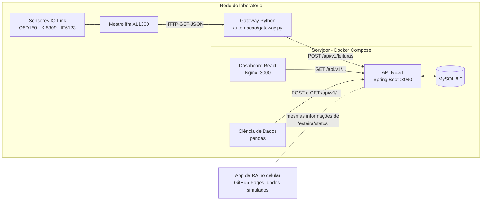

*Figura 1 — Arquitetura geral da plataforma de monitoramento. Fonte: Elaborado pelos autores (2026).*

Fluxo de dados representado:

- **Automação Industrial:** os três sensores ficam ligados ao mestre IO-Link. O *gateway* lê o mestre a cada 0,1 s, detecta a passagem de uma peça, classifica-a e envia **uma leitura por peça** com `POST /api/v1/leituras`, junto com o nível atual do reservatório.
- **Back-end:** a API valida o JSON (Bean Validation), **recalcula** o tipo da peça a partir dos sensores e o status do reservatório a partir do percentual, gera ou resolve alertas e persiste tudo no MySQL.
- **Computação em Nuvem:** API, banco e dashboard rodam em contêineres Docker no servidor do laboratório, com *healthchecks*, reinício automático e volume persistente. A seção 4.4 detalha essa implantação e a arquitetura proposta para produção na AWS.
- **Ciência de Dados:** os scripts em Python enviam o dataset simulado à API, leem os dados persistidos e calculam indicadores. O critério de alerta de enchimento rápido definido pela análise (5 %/min) foi implementado no back-end.
- **Front-end e RA:** o dashboard React consulta a mesma API periodicamente para mostrar contagens, nível, gráficos e alertas. O app de RA roda no celular, fora da rede do laboratório, e por isso gera localmente dados simulados com as mesmas informações de `GET /api/v1/esteira/status` e os mesmos limiares do back-end (seção 4.7.3).

**Contrato de integração** (base `http://<servidor>:8080/api/v1`, JSON UTF-8, datas ISO-8601 em UTC):

| **Endpoint**                        | **Método** | **Descrição**                                                  | **Consumidor**                    |
|-------------------------------------|------------|----------------------------------------------------------------|-----------------------------------|
| `/leituras`                         | POST       | Recebe a leitura dos sensores (uma por peça)                    | Automação (gateway), Ciência de Dados |
| `/leituras`                         | GET        | Lista leituras com paginação e filtros                         | Dashboard, Ciência de Dados       |
| `/leituras/estatisticas`            | GET        | Contagem por tipo de peça, nível atual e estatísticas do nível | Dashboard, Ciência de Dados       |
| `/leituras/alertas`                 | GET        | Alertas não resolvidos                                         | Dashboard, Ciência de Dados       |
| `/leituras/alertas/{id}/resolver`   | PUT        | Marca um alerta como resolvido                                 | Dashboard                         |
| `/usuarios`                         | CRUD       | Cadastro de usuários e perfis                                  | Dashboard                         |
| `/esteira/status`                   | GET        | Estado atual da esteira em uma chamada                         | RA (formato reproduzido na simulação; consumo direto na arquitetura de produção) |

## 4.2 Automação Industrial — Esteira de Triagem

A camada de automação usa sensores industriais reais da bancada do laboratório, todos da ifm e com comunicação IO-Link. Os modelos e versões foram lidos do próprio mestre em 12/11/2026. O indutivo e o capacitivo ficam no mesmo ponto da esteira, com os campos de detecção sobrepostos. O sensor de distância fica sobre o reservatório de saída, apontado para baixo: quanto mais peças acumuladas, menor a distância medida.

### 4.2.1 Circuito e Fluxograma de Funcionamento

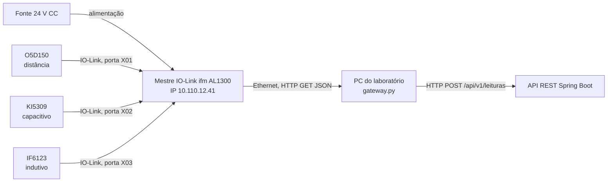

*Figura 2 — Esquema de ligação do sensoriamento. Fonte: Elaborado pelos autores (2026).*

Cada sensor usa um cabo M12 de 3 fios no padrão IO-Link: pino 1 = L+ (24 V), pino 3 = L− (0 V) e pino 4 = C/Q (dados). O mestre alimenta os sensores pela própria porta e se comunica com o PC por Ethernet na rede do laboratório.

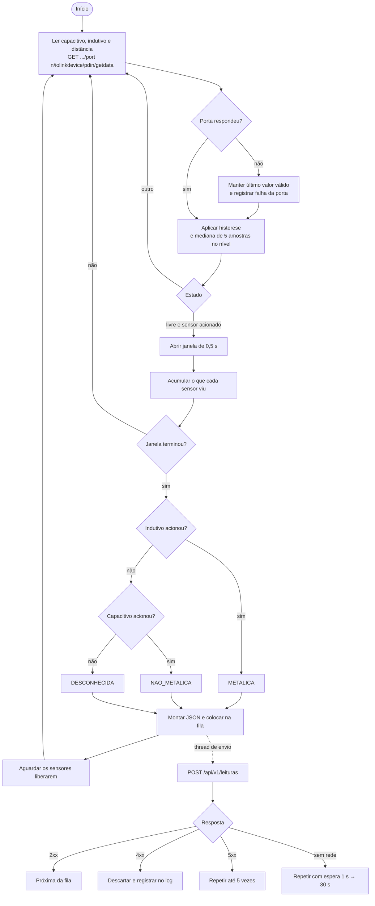

*Figura 3 — Fluxograma do gateway de leitura, classificação e envio. Fonte: Elaborado pelos autores (2026).*

### 4.2.2 Sensores Utilizados

| **Sensor**     | **Função no projeto**                                                                      | **Modelo**                   | **Pino / Entrada**                    |
|----------------|--------------------------------------------------------------------------------------------|------------------------------|---------------------------------------|
| **Distância**  | Medir a distância até o topo da pilha de peças no reservatório → nível (%)                  | ifm O5D150 (óptico, IO-Link) | Porta X01 do mestre AL1300 (M12, pino 4 = C/Q) |
| **Indutivo**   | Identificar a presença de peças metálicas                                                  | ifm IF6123 (IO-Link)         | Porta X03 do mestre AL1300            |
| **Capacitivo** | Identificar a presença de peças não metálicas (detecta qualquer material, condutor ou não) | ifm KI5309 (IO-Link)         | Porta X02 do mestre AL1300            |

**Do sinal ao dado.** O valor de processo (PDin) de cada porta chega em hexadecimal e é convertido para inteiro. Para evitar que o estado fique oscilando perto do limite, os sensores de material usam **histerese**:

| Sensor | Valor bruto | Regra de conversão |
|---|---|---|
| Indutivo (X03) | ~32736 sem metal; cai com metal próximo | Liga em ≤ 20000 e desliga em > 25000 |
| Capacitivo (X02) | Sobe com peça presente | Liga em ≥ 1500 e desliga em < 1000 |
| Distância (X01) | Valor bruto do sensor; calibrado com o reservatório vazio e cheio | `nível % = (vazio − bruto) / (vazio − cheio) × 100`, limitado a 0–100, sobre a mediana das últimas 5 leituras |

### 4.2.3 Lógica de Classificação das Peças

Quando o indutivo ou o capacitivo aciona, o *gateway* abre uma **janela de 0,5 s** e registra tudo o que cada sensor viu nesse intervalo. No fim da janela, ele classifica a peça. Na bancada, verificou-se que o capacitivo **também reage a metal**, porque os dois sensores ficam sobrepostos. Por isso o sensor que decide se a peça é metálica é o indutivo.

| **Indutivo** | **Capacitivo** | **Classificação resultante** |
|--------------|----------------|------------------------------|
| 0            | 0              | `DESCONHECIDA` (nenhum sensor reconheceu a peça)              |
| 0            | 1              | `NAO_METALICA`                                               |
| 1            | 0              | `METALICA`                                                   |
| 1            | 1              | `METALICA` (o capacitivo também reage a metal; o indutivo decide) |

Depois de classificar, o *gateway* só envia uma nova leitura quando os dois sensores liberam. Assim, **uma peça gera exatamente uma leitura**. O back-end refaz a mesma classificação a partir dos sensores (classe `ClassificadorPeca`, seção 4.5.1), então o resultado não depende apenas do *gateway*.

### 4.2.4 Envio de Dados para o Back-end

| **Parâmetro**                                                       | **Valor / Descrição** |
|---------------------------------------------------------------------|-----------------------|
| **Protocolo / método HTTP**                                         | HTTP `POST`, `Content-Type: application/json`. Cabeçalho `X-API-Key` quando a chave estiver configurada |
| **URL do endpoint de destino**                                      | `http://localhost:8080/api/v1/leituras` (gateway no PC) ou `http://backend:8080/api/v1/leituras` (gateway em contêiner) |
| **Periodicidade de envio**                                          | Por evento: um `POST` por peça detectada. Os sensores são lidos a cada 0,1 s. Envio periódico sem peça (*heartbeat*) desativado, para não gerar contagens falsas |
| **Formato da mensagem (ex.: JSON)**                                 | JSON UTF-8, datas ISO-8601 em UTC (exemplo no Apêndice C) |
| **Campos enviados (ex.: tipo da peça, contagem, nível, data/hora)** | `timestamp`; `sensorDistancia {valor, unidade, status}`; `sensorIndutivo {detectouMetal, intensidade, status}`; `sensorCapacitivo {detectouNaoMetal, intensidade, status}`; `peca {id, tipo, timestampDetectado}`; `nivelReservatorio {nivelAtual, capacidadeMaxima, percentual, status}`; `dispositivoId` (`gateway-lab-01`); `versaoFirmware` (`gateway-0.2`) |
| **Tratamento de falhas de envio**                                   | O envio roda em uma *thread* separada, com fila de até 5000 leituras, para não travar a leitura dos sensores. Sem rede: repete indefinidamente, com espera exponencial de 1 s até 30 s. Resposta 4xx: descarta e registra no log, porque repetir não resolve. Resposta 5xx: repete até 5 vezes. Falha em uma porta do mestre: mantém o último valor válido sem parar as outras portas. Teste em 12/11/2026: API fora do ar por 15 s e nenhuma peça perdida |

## 4.3 Ciência de Dados — Análise dos Dados da Esteira

A análise completa está no relatório próprio da frente ([docs/relatorio_ciencia_dados.md](docs/relatorio_ciencia_dados.md)). Esta seção resume a base, as estatísticas, os gráficos e o critério de alerta.

### 4.3.1 Base de Dados Analisada

| **Parâmetro**                                                   | **Valor / Descrição** |
|-----------------------------------------------------------------|-----------------------|
| **Origem dos dados (esteira real/simulada, exportação da API)** | **Simulada.** Dataset sintético gerado por `dados/scripts/gerar_dataset.py`: simulação orientada a eventos com semente fixa (`seed = 42`), que reproduz turnos de produção (T1 06–14h a 1,30 peça/min, T2 14–22h a 1,10, T3 22–06h a 0,60), lotes com mix variável de material, a física dos sensores (intensidade cai exponencialmente com a distância), o ciclo de enchimento e esvaziamento do reservatório e cinco tipos de anomalia rotulada (gargalo, rajada pós-gargalo, falha de conexão, deriva do capacitivo e esvaziamento brusco). O dataset foi enviado à API real e relido dela para a validação |
| **Período coberto**                                             | 7 dias: 02/11/2026 00:01 a 08/11/2026 23:58 (UTC−3) |
| **Número de registros**                                         | 9.965 leituras (uma por peça), mais 26 janelas de eventos simulados em `eventos_simulados.csv` |
| **Variáveis analisadas**                                        | 15 colunas: `timestamp`, `distancia_cm`, `indutivo_detectou_metal`, `indutivo_intensidade`, `capacitivo_detectou_nao_metal`, `capacitivo_intensidade`, `tipo_peca`, `nivel_reservatorio_percentual`, `status_reservatorio`, `dispositivo_id`, `versao_firmware`, `turno`, `material_real`, `comporta_aberta`, `evento_simulado` |
| **Tratamentos aplicados (limpeza, valores ausentes)**           | Verificação de qualidade: 0 valores ausentes, 0 níveis fora de 0–100%, 0 intensidades fora de 0–1 e 0 status inconsistentes com a regra 20/80/95. Os 122 *timestamps* repetidos foram mantidos, porque são peças em rajada, cada uma com distância e nível próprios. O tempo em cada status é ponderado pelo intervalo até a próxima leitura, para não superestimar períodos de produção intensa |

### 4.3.2 Estatística Descritiva

As contagens de peças foram agregadas em **peças por hora** (168 horas). O nível do reservatório usa as 9.965 leituras. Como o nível é contínuo, a moda foi calculada sobre os valores arredondados para inteiro.

| **Variável**                                    | **Média** | **Mediana** | **Moda** | **Desvio padrão** | **Q1**  | **Q3**  |
|-------------------------------------------------|-----------|-------------|----------|-------------------|---------|---------|
| **Peças metálicas (contagem, peças/hora)**      | 35,7      | 37,5        | 42       | 14,1              | 24      | 47      |
| **Peças não metálicas (contagem, peças/hora)**  | 19,7      | 19          | 13       | 8,6               | 13      | 25      |
| **Nível do reservatório (%)**                   | 48,77     | 47,94       | 27       | 23,64             | 28,80   | 68,00   |

Outros indicadores da semana:

| Indicador | Valor |
|---|---|
| Total por tipo | Metálica 5.999 (60,20%) · Não metálica 3.303 (33,15%) · Desconhecida 613 (6,15%) · Ambas 50 (0,50%) |
| Tempo em cada status | Normal 75,15% · Baixo 14,44% · Alto 8,48% · Crítico 1,93% |
| Vazão média por turno | T1 76,3 peças/h · T2 66,1 · T3 35,5 |
| Acurácia da classificação (frente ao material real) | 93,32% |
| Correlação distância × intensidade | r = −0,89 (indutivo e capacitivo) |
| Ciclos de esvaziamento | 44 (6,3 por dia), enchimento médio de 180 min |

> No dataset simulado, `AMBAS` representa a deriva do capacitivo, conforme a regra vigente quando o dataset foi gerado. Com os sensores reais, indutivo + capacitivo passou a ser classificado como metálica (seção 4.2.3), e essas 50 leituras seriam contadas como metálicas.

**Interpretação:**

- **Nível do reservatório:** média e mediana próximas (48,8% e 47,9%), assimetria quase nula (0,14) e curtose negativa (−0,97) indicam uma distribuição **achatada e quase simétrica**. É o comportamento de um processo em "dente de serra": o nível percorre toda a faixa de operação, subindo devagar e caindo quando a comporta abre, em vez de se concentrar num ponto de equilíbrio. O desvio padrão alto (23,6 p.p.) e o IQR de 39,2 p.p. confirmam essa amplitude. A moda (27%) quase empata com vários outros valores e **não é uma boa medida de tendência central** para essa variável.
- **Peças metálicas:** a vazão é quase o dobro da de não metálicas e tem distribuição simétrica (média ≈ mediana).
- **Peças não metálicas:** a distribuição tem cauda à direita. A moda (13) fica abaixo da mediana (19) porque há horas isoladas com muitas peças plásticas.
- **Variação entre turnos:** os coeficientes de variação são altos (39% e 44%), porque a vazão muda muito entre turnos. O T3 produz menos da metade do T1.
- **Turno T1:** é o que mais tempo passa em nível crítico (2,83%, contra cerca de 1,5% nos outros turnos). Ele enche mais rápido, e a margem entre o alerta alto (80%) e o crítico (95%) dura só cerca de 27 min. O risco depende da relação entre a taxa de enchimento e o tempo de reação do operador, não só do nível.

### 4.3.3 Visualizações

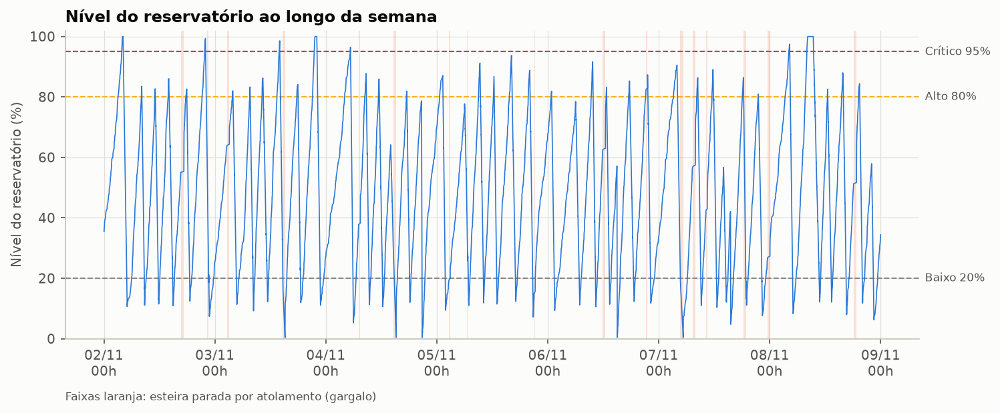

*Figura 4 — Evolução do nível do reservatório ao longo da semana, com as faixas de alerta de 20%, 80% e 95%. Fonte: Elaborado pelos autores (2026).*

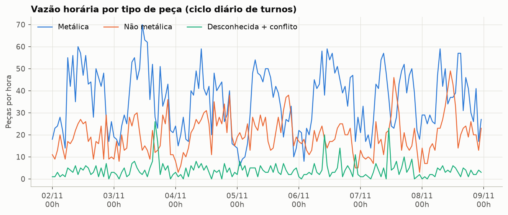

*Figura 5 — Evolução da contagem de peças por hora, por tipo. Fonte: Elaborado pelos autores (2026).*

O **gráfico de linha** é o adequado para séries temporais. A Figura 4 mostra o padrão em dente de serra (44 ciclos), os platôs durante os gargalos (nível parado porque não chegam peças) e os 3 episódios em que o nível chegou a 100%. A Figura 5 mostra a queda de produção no turno noturno e a variação do mix ao longo dos lotes.

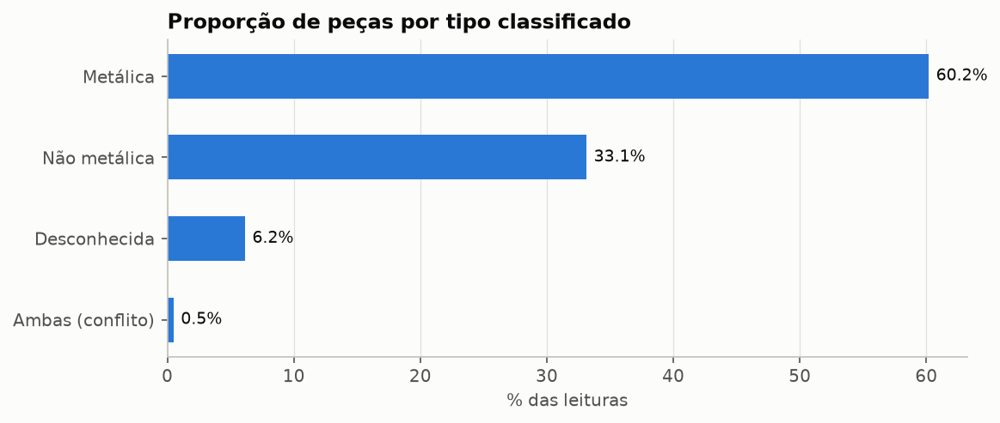

*Figura 6 — Proporção de peças metálicas × não metálicas. Fonte: Elaborado pelos autores (2026).*

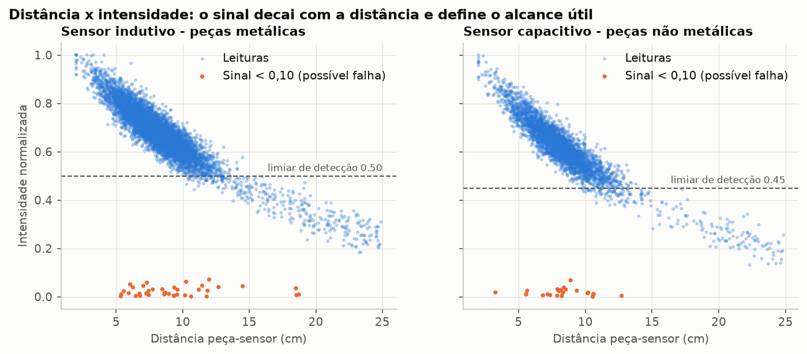

*Figura 7 — Dispersão entre a distância da peça e a intensidade do sinal dos sensores. Fonte: Elaborado pelos autores (2026).*

O **gráfico de barras** compara categorias: na Figura 6, cerca de 60% das peças são metálicas e 6% não são reconhecidas. A **dispersão** (Figura 7) mostra a relação entre duas variáveis contínuas e explica as peças desconhecidas: o sinal cai com a distância (r = −0,89), e 79% das peças desconhecidas passaram a mais de 12 cm dos sensores. É um problema de alinhamento mecânico, não de sensor.

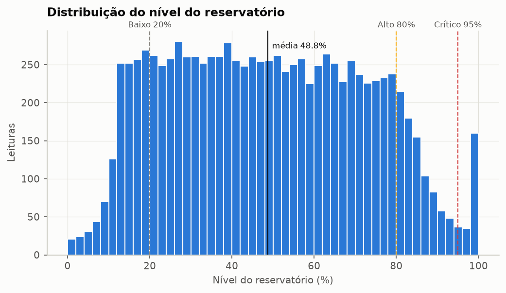

*Figura 8 — Distribuição do nível do reservatório. Fonte: Elaborado pelos autores (2026).*

O **histograma** mostra a forma da distribuição. Ele é largo e sem pico dominante, o que confirma a leitura da seção 4.3.2: o reservatório passa por toda a faixa de operação.

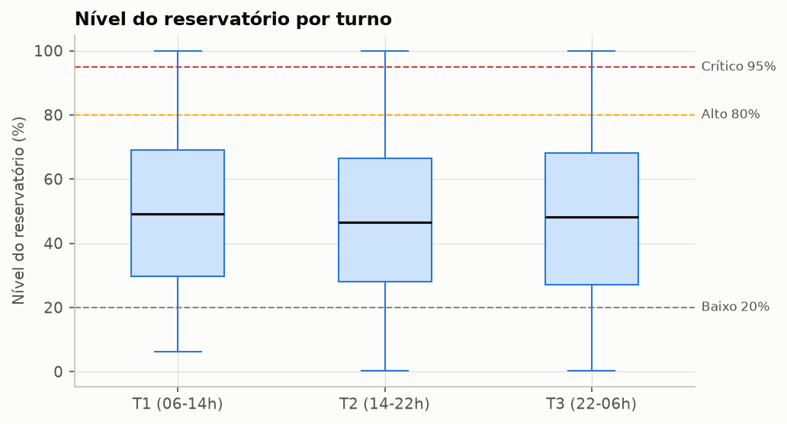

*Figura 9 — Boxplot do nível do reservatório por turno. Fonte: Elaborado pelos autores (2026).*

O **boxplot** resume mediana, quartis e valores extremos e permite comparar grupos lado a lado. As medianas dos três turnos são parecidas (nível médio entre 47,6% e 50,0%). A diferença entre os turnos está na velocidade de enchimento, que aparece na série temporal e no tempo em nível crítico, e não na posição típica do nível.

Gráficos complementares em [dados/graficos/](dados/graficos/): nível em 24 h (`02`), *boxplot* da vazão por turno (`06`), barras de tempo por status (`08`) e taxa de variação com outliers (`10`, Figura 10).

### 4.3.4 Outliers e Critério de Alerta

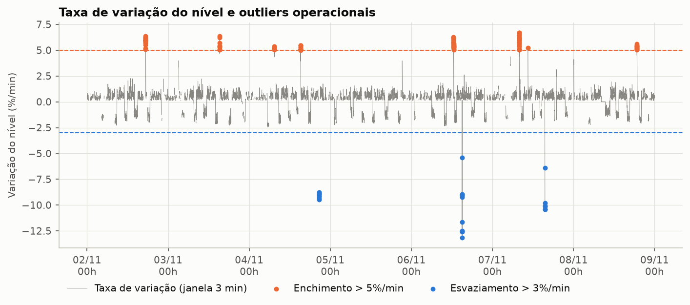

*Figura 10 — Taxa de variação do nível (%/min) com os outliers detectados. Fonte: Elaborado pelos autores (2026).*

Quatro famílias de detectores foram avaliadas contra a verdade-terreno da simulação (coluna `evento_simulado`):

| Detector | Leituras sinalizadas | Evento-alvo | Precisão | Episódios detectados |
|---|---|---|---|---|
| R1 — enchimento > 5 %/min (janela de 3 min) | 97 | Rajada pós-gargalo | 96,9% | 8 / 16 |
| R2 — esvaziamento > 3 %/min | 24 | Esvaziamento brusco | 79,2% | 3 / 3 |
| R3 — indutivo **e** capacitivo com intensidade < 0,10 | 61 | Falha de conexão | 100% | 7 / 7 |
| R4 — tipo AMBAS | 50 | Deriva do capacitivo | 100% | 2 / 2 |
| IQR da vazão (janelas de 10 min, por turno) — alta | 25 janelas | Rajada pós-gargalo | 54,6% | 13 / 16 |
| IQR da vazão (janelas de 10 min, por turno) — baixa | 34 janelas | Gargalo | 88,2% | 15 / 17 |
| z-score robusto da taxa (\|z\| > 3,5) | 1.528 | Rajada ou esvaziamento | 11,4% | — |

| **Parâmetro**                            | **Valor / Descrição** |
|------------------------------------------|-----------------------|
| **Método de identificação de outliers**  | Taxa de variação do nível em %/min, medida contra a primeira leitura dos 3 minutos anteriores. Sobre ela foram aplicados o z-score robusto (mediana e MAD × 1,4826, limite \|z\| > 3,5), a regra do IQR (1,5 × IQR) sobre a vazão em janelas de 10 min por turno e regras de negócio (R1–R4) |
| **Critério de alerta proposto (limite)** | **R1: reservatório enchendo a mais de 5 %/min**, comparando a leitura atual com a primeira dos 3 minutos anteriores (mínimo de 1 min entre elas). Um alerta por episódio, que se resolve sozinho quando a taxa volta ao normal. Os limites de faixa continuam valendo: alto > 80% e crítico ≥ 95% |
| **Justificativa estatística**            | O enchimento normal é de cerca de 0,5 %/min, então 5 %/min fica uma ordem de grandeza acima do padrão. O limite capta as rajadas de peças represadas depois de um gargalo. Com 8 %/min não haveria nenhum alerta, e com 3 %/min seriam 14 falsos ou redundantes. No dataset, R1 sinalizou 97 leituras, agrupadas em **15 alertas**, com **precisão de 96,9%**. Métodos puramente estatísticos tiveram precisão muito menor (z-score 11,4%, IQR 54,6%), porque também marcam os esvaziamentos legítimos |

**Reuso do critério.** O mesmo critério foi implementado no back-end como alerta `ENCHIMENTO_RAPIDO` (constante `LIMITE_ENCHIMENTO_PCT_POR_MIN = 5.0` em `LeituraSensoresService`). Ele aparece no dashboard como ocorrência e alimenta o campo `exibirAlerta` de `GET /api/v1/esteira/status`, usado pela RA. O dashboard também desenha as linhas de 80% e 95% nos gráficos de nível.

## 4.4 Computação em Nuvem — Arquitetura e Segurança

O documento completo está em [docs/arquitetura_nuvem.md](docs/arquitetura_nuvem.md). A solução tem dois cenários, que usam **as mesmas imagens Docker**:

1. **Implantação atual (em operação):** servidor local na rede do laboratório, com Docker Compose.
2. **Arquitetura proposta para produção:** AWS, modelo PaaS, projetada e justificada, mas ainda não contratada.

O *gateway* fica sempre no laboratório, porque precisa estar na mesma rede do mestre IO-Link, que não é acessível pela internet. O app de RA é a única parte publicada fora do laboratório: é uma página estática no **GitHub Pages**, servida por HTTPS, como a câmera do celular exige.

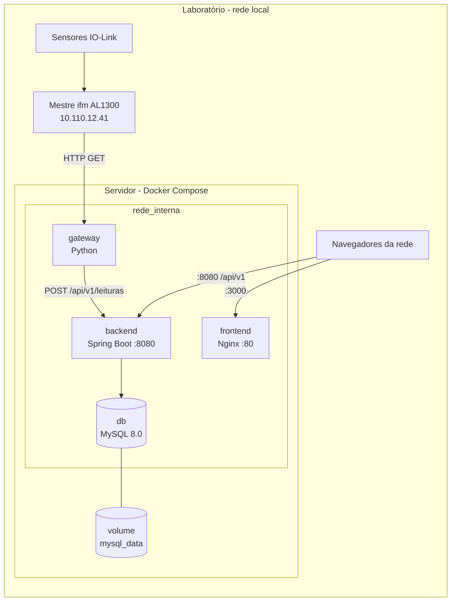

*Figura 11 — Implantação atual: servidor local com Docker Compose. Fonte: Elaborado pelos autores (2026).*

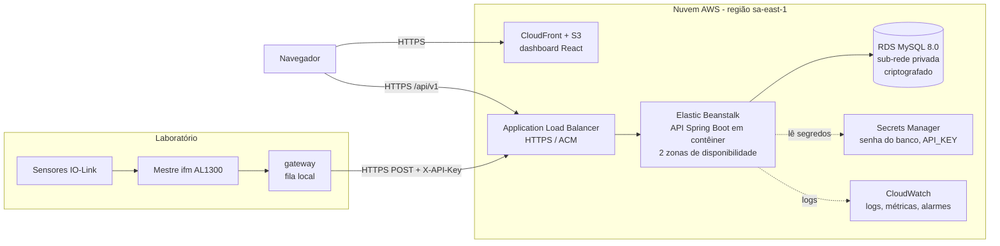

*Figura 12 — Arquitetura de nuvem proposta para produção (AWS, PaaS). Fonte: Elaborado pelos autores (2026).*

| **Aspecto**                                            | **Decisão adotada** | **Justificativa** |
|--------------------------------------------------------|---------------------|-------------------|
| **Modelo de serviço do back-end (IaaS / PaaS / SaaS)** | **Atual:** servidor on-premise autogerenciado com contêineres, equivalente em responsabilidade a um IaaS. **Produção:** PaaS (AWS Elastic Beanstalk com plataforma Docker) | O servidor local tem custo zero e fica na mesma rede dos sensores. Para produção, o PaaS dá o menor esforço de operação: a AWS cuida de sistema operacional, balanceador, escala e *failover*, e a equipe entrega o mesmo contêiner. O IaaS exigiria cuidar de *patches*, backup e TLS. O SaaS não atende, porque as regras de negócio são próprias |
| **Hospedagem do banco de dados**                       | **Atual:** contêiner `mysql:8.0` com volume persistente `mysql_data`. **Produção:** Amazon RDS for MySQL 8.0 Multi-AZ em sub-rede privada | O volume separa os dados do ciclo de vida do contêiner. O RDS traz backup automático (7 dias, restauração para qualquer ponto no tempo), criptografia e réplica síncrona em outra zona |
| **Controle de usuários e de acesso**                   | **Atual:** banco publicado só em `127.0.0.1:3307`; usuário próprio da aplicação (não o root); senhas no `.env`, fora do Git; contêineres sem root; `X-API-Key` disponível para o `POST` do dispositivo; cadastro de usuários com perfis. **Produção:** IAM com MFA e privilégio mínimo para a equipe, login com token (Cognito ou Spring Security + JWT), chave do dispositivo no Secrets Manager, *security groups* restritos e CORS limitado ao domínio do dashboard | Princípio do menor privilégio e segredos fora do código. Ressalva: hoje os perfis existem, mas ainda não são exigidos nas rotas. O risco fica restrito à rede isolada do laboratório, e o login é pré-requisito para expor a API na internet |
| **Criptografia em trânsito**                           | **Atual:** HTTP dentro da LAN do laboratório. **Produção:** HTTPS em tudo que sai do laboratório (certificado do ACM no balanceador, com redirecionamento de HTTP para HTTPS) e TLS na conexão JDBC com o RDS | Na rede isolada, o tráfego não passa pela internet. Em produção, a API fica pública e precisa de TLS |
| **Criptografia em repouso**                            | **Atual:** sem criptografia própria; mitigação por criptografia de disco do sistema operacional (BitLocker). **Produção:** RDS e *snapshots* com AES-256 via KMS, S3 com criptografia padrão, segredos criptografados no Secrets Manager | O banco gerenciado criptografa dados, backups e réplicas sem mudança no código |
| **Disponibilidade do serviço**                         | **Atual:** `restart: unless-stopped`, *healthchecks* (`mysqladmin ping`, `/actuator/health`), ordem de subida por `service_healthy`, volume persistente, fila de 5000 leituras no *gateway* e backup manual com `mysqldump`. **Produção:** mínimo de 2 instâncias da API em zonas diferentes, *health check* no balanceador, RDS Multi-AZ e alarmes do CloudWatch | Localmente, o sistema se recupera sozinho de quedas de contêiner, mas há um único servidor. A produção elimina esse ponto único de falha |
| **Escalabilidade**                                     | **Atual:** escala vertical do servidor; vários *gateways* com `dispositivo_id` próprio; índices por data, tipo, status e dispositivo. **Produção:** *auto scaling* de 2 a 4 instâncias com CPU > 70%; banco com escala vertical e réplica de leitura | O volume atual (cerca de 60 peças/h, ~1.500 leituras/dia) é atendido com folga por um servidor. A API não guarda sessão, então pode escalar horizontalmente na nuvem |
| **Aspectos econômicos (custos / contrato)**            | **Atual:** sem investimento (PC existente), custo de energia. **Produção:** pagamento por uso; fase piloto com 1 instância pequena e RDS Single-AZ dentro do nível gratuito; produção com 2 instâncias e Multi-AZ, que praticamente dobra o custo do banco | Responsabilidade compartilhada: a AWS opera a infraestrutura, e a equipe cuida de código, dados e configuração de segurança. Para reduzir custo: desligar ambientes de teste fora do horário de aula, usar *Savings Plans* e alarmes no AWS Budgets. Estimativa a ser feita na AWS Pricing Calculator antes de contratar |

| **Parâmetro**                | **Valor / Descrição** |
|------------------------------|-----------------------|
| **URL do serviço hospedado** | Rede do laboratório: dashboard em `http://<ip-do-servidor>:3000` e API em `http://<ip-do-servidor>:8080/api/v1`. A API não tem URL pública, porque a rede do SENAI não é acessível de fora. App de RA (público, HTTPS): <https://rafarubia7.github.io/manufatura-metaltech/realidade-aumentada/> |
| **Região / provedor**        | Atual: servidor local no laboratório (São Carlos — SP) e GitHub Pages para o app de RA. Proposta: AWS, região `sa-east-1` (São Paulo), com equivalentes no Azure documentados |

**Isolamento da rede do laboratório.** A bancada e o servidor ficam na rede do SENAI, que a equipe não administra e que dispositivos de fora, como o celular que abre a RA, não alcançam. A vantagem é que a bancada e a API ficam protegidas da internet. A consequência é que a RA não consegue consumir `GET /api/v1/esteira/status` e usa dados simulados (seção 4.7.3), solução aceita pelo professor. Na arquitetura de produção, o *gateway* envia as leituras para a API na nuvem por uma conexão de saída HTTPS, sem abrir a rede do SENAI, e o dashboard e a RA passam a consumir essa API pública.

### 4.4.1 Dockerização da Plataforma

Toda a pilha é descrita em um único arquivo, `compose.yaml`, na raiz do repositório. O passo a passo completo, com pré-requisitos, verificação e solução de problemas, está na seção 2.6 de [docs/arquitetura_nuvem.md](docs/arquitetura_nuvem.md).

Cada serviço próprio tem um `Dockerfile` *multi-stage*: uma etapa compila e a outra executa só o resultado, em uma imagem menor e sem as ferramentas de build.

| **Imagem** | **Dockerfile** | **Etapa de build** | **Etapa de execução** |
|---|---|---|---|
| `metaltech-backend` | `backend/Dockerfile` | `eclipse-temurin:17-jdk-alpine` + Maven Wrapper | `eclipse-temurin:17-jre-alpine`, usuário sem root |
| `metaltech-frontend` | `frontend/Dockerfile` | `node:22-alpine` (`npm ci` + `npm run build`) | `nginx:1.27-alpine` |
| `metaltech-gateway` | `automacao/Dockerfile` | — | `python:3.13-slim`, usuário sem root (profile `esteira`) |
| `metaltech-dados` | `dados/Dockerfile` | — | `python:3.13-slim` com pandas e matplotlib (profile `dados`) |
| `mysql:8.0` | imagem oficial | — | baixada do Docker Hub |

O build do back-end baixa as dependências do Maven antes de copiar o código. Quando só o código muda, o Docker reaproveita essa camada e o build fica bem mais rápido.

Comandos principais, executados na raiz do repositório:

```powershell
Copy-Item .env.example .env              # uma vez; definir MYSQL_PASSWORD e MYSQL_ROOT_PASSWORD
docker compose config --quiet            # valida o compose.yaml com o .env
docker compose up -d --build             # cria imagens, rede, volume e contêineres
docker compose ps                        # db e backend "healthy" (a API leva ~40 s)
docker compose --profile esteira up -d   # sobe também o gateway IO-Link
docker compose --profile dados run --rm dados   # roda a análise de dados e sai
docker compose down                      # remove contêineres e rede; o volume (banco) continua
```

| **Recurso criado** | **Nome** | **Função** |
|---|---|---|
| Rede *bridge* | `manufatura-metaltech_rede_interna` | Rede virtual em que os contêineres se encontram pelo nome do serviço (`db`, `backend`) sem expor portas internas |
| Volume | `manufatura-metaltech_mysql_data` | Guarda os dados do MySQL fora do contêiner. Só `docker compose down -v` apaga o banco |
| Contêineres | `metaltech-db`, `metaltech-backend`, `metaltech-frontend` (e `gateway`/`dados` por profile) | Sobem na ordem `db` → `backend` → `frontend`, cada um depois de o anterior ficar `healthy` |

Na primeira subida, com o volume vazio, o MySQL cria o banco `metaltech` e o usuário da aplicação, e a API aplica as migrações Flyway V1 a V3. As senhas ficam só no `.env`, que não vai para o Git. O `.env.example` versionado traz apenas valores genéricos (`troque-esta-senha`), e o compose se recusa a subir sem as senhas definidas. Para atualizar depois de mudanças no código, basta `git pull` seguido de `docker compose up -d --build`, que reconstrói só as imagens alteradas e preserva o banco.

## 4.5 Desenvolvimento Back-end — API REST

A API foi desenvolvida em Java 17 com Spring Boot 3.2 e organizada em camadas:

- **`domain`:** entidades, enums e a hierarquia de sensores;
- **`application/service`:** regras de negócio (classificação, alertas e estatísticas);
- **`api`:** *controllers*, DTOs, *mapper*, filtro de API key, CORS e tratamento de erros;
- **`infrastructure/repository`:** repositórios Spring Data JPA.

### 4.5.1 Modelagem Orientada a Objetos

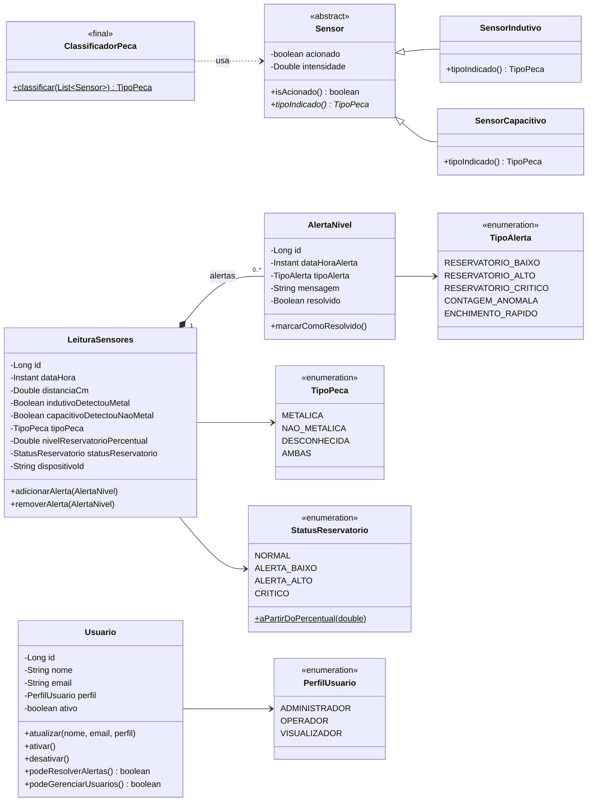

*Figura 13 — Diagrama de classes do domínio do back-end. Fonte: Elaborado pelos autores (2026).*

As classes representam os elementos do enunciado:

- **Esteira e leituras:** `LeituraSensores` é a leitura de uma peça no ponto de sensoriamento, com o nível do reservatório naquele instante. O `dispositivoId` identifica a esteira de origem, o que permite várias esteiras.
- **Sensores:** a hierarquia `Sensor` modela os sensores de material.
- **Peça classificada:** representada pelo enum `TipoPeca`, derivado dos sensores.
- **Alertas:** `AlertaNivel` registra os alertas gerados por uma leitura.
- **Usuários:** `Usuario` e o enum `PerfilUsuario`.

Onde estão os pilares da orientação a objetos:

- **Herança:** `SensorIndutivo` e `SensorCapacitivo` estendem a classe abstrata `Sensor`, que concentra o estado comum (acionado e intensidade).
- **Polimorfismo:** cada subclasse implementa `tipoIndicado()` de um jeito (o indutivo indica `METALICA`; o capacitivo, `NAO_METALICA`). O `ClassificadorPeca` recebe uma `List<? extends Sensor>` e combina os sensores **sem conhecer as subclasses**. Um novo tipo de sensor poderia ser adicionado sem alterar o classificador. Os quatro conversores JPA de enum implementam a interface `AttributeConverter`, outro uso de polimorfismo.
- **Encapsulamento:**
  - `Usuario` não tem *setters* e só muda pelos próprios métodos (`atualizar`, `ativar`, `desativar`). Ele rejeita perfil nulo, normaliza o e-mail e decide as permissões a partir do perfil (um usuário inativo perde todas).
  - `LeituraSensores` controla a lista de alertas por `adicionarAlerta` e `removerAlerta`, mantendo os dois lados do relacionamento consistentes.
  - A regra das faixas do reservatório fica dentro do próprio enum (`StatusReservatorio.aPartirDoPercentual`).

### 4.5.2 Modelo do Banco de Dados

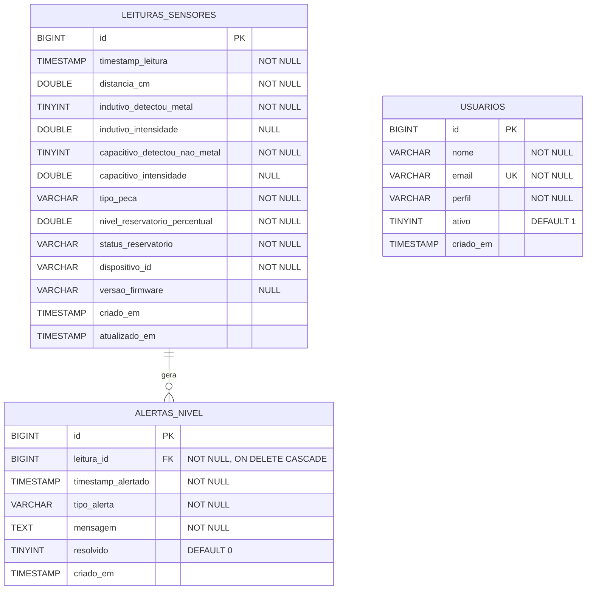

*Figura 14 — Modelo Entidade-Relacionamento (MER). Fonte: Elaborado pelos autores (2026).*

- **Entidades e atributos:**
  - `leituras_sensores` guarda uma leitura por peça. Tem data e hora, distância, acionamento e intensidade de cada sensor, tipo da peça, nível e status do reservatório, dispositivo e versão do firmware.
  - `alertas_nivel` guarda os alertas, com tipo, mensagem e se já foram resolvidos.
  - `usuarios` guarda nome, e-mail, perfil e situação (ativo).
  - Todas as tabelas usam o motor InnoDB, e as datas usam `TIMESTAMP(6)` em UTC.
- **Relacionamentos:** `leituras_sensores` 1 : N `alertas_nivel`. Uma leitura pode gerar zero ou mais alertas, e cada alerta pertence a exatamente uma leitura. `usuarios` é independente.
- **Chaves:**
  - PK `id` (`BIGINT AUTO_INCREMENT`) nas três tabelas;
  - FK `alertas_nivel.leitura_id` → `leituras_sensores.id`, com `ON DELETE CASCADE`;
  - chave única `uk_usuarios_email`.
- **Justificativa das decisões de modelagem:**
  - A leitura foi mantida em **uma tabela desnormalizada**: os três sensores e o nível são capturados juntos e sempre consultados juntos, o que simplifica as consultas por período e as estatísticas.
  - Os alertas ficam em tabela separada, porque têm ciclo de vida próprio (são resolvidos depois). O `CASCADE` garante que excluir uma leitura remove seus alertas.
  - Os enums são gravados como texto (`VARCHAR`), para facilitar a leitura direta no banco e a evolução dos valores.
  - Sete índices (data, tipo de peça, status, dispositivo, leitura do alerta, tipo de alerta e resolvido) atendem aos filtros da API.
  - O esquema é versionado por migrações Flyway:
    - V1: tabelas iniciais;
    - V2: correção de acentuação e reclassificação de `AMBAS` para `METALICA`;
    - V3: usuários.
  - O Hibernate roda em modo `validate`, conferindo que as entidades batem com o banco.

### 4.5.3 Endpoints e Documentação da API

Base: `http://<servidor>:8080/api/v1`. Todos os erros usam o mesmo formato JSON (`dataHora`, `codigoErro`, `mensagem`, `caminho`, `detalhes`), gerado por um tratador global de exceções.

| **Método**   | **Endpoint**                        | **Descrição**                                                                 | **Códigos de resposta** |
|--------------|-------------------------------------|-------------------------------------------------------------------------------|-------------------------|
| POST         | `/leituras`                         | Cadastrar leitura. O back-end recalcula o tipo da peça, o status e os alertas | 201, 400, 401*          |
| GET          | `/leituras`                         | Listar leituras com paginação e filtros `inicio`, `fim`, `tipoPeca`, `statusReservatorio` | 200          |
| GET          | `/leituras/{id}`                    | Buscar leitura por identificador                                              | 200, 404                |
| PUT          | `/leituras/{id}`                    | Corrigir leitura (o *timestamp* não muda; alertas recalculados)               | 200, 400, 404           |
| DELETE       | `/leituras/{id}`                    | Remover leitura e seus alertas                                                | 204, 404                |
| GET          | `/leituras/alertas`                 | Listar alertas não resolvidos, do mais recente ao mais antigo                 | 200                     |
| PUT          | `/leituras/alertas/{id}/resolver`   | Resolver alerta                                                               | 204, 404                |
| GET          | `/leituras/estatisticas`            | Indicadores: totais por tipo, nível atual, média, mediana, desvio, quartis, mínimo, máximo, alertas por tipo | 200, 400 |
| GET          | `/esteira/status`                   | Estado atual da esteira em uma chamada (criado para a RA)                     | 200, 404                |
| GET          | `/usuarios`                         | Listar usuários em ordem alfabética                                           | 200                     |
| GET          | `/usuarios/{id}`                    | Buscar usuário                                                                | 200, 404                |
| POST         | `/usuarios`                         | Cadastrar usuário (e-mail único)                                              | 201, 400                |
| PUT          | `/usuarios/{id}`                    | Atualizar usuário (e ativar/desativar)                                        | 200, 400, 404           |
| DELETE       | `/usuarios/{id}`                    | Remover usuário                                                               | 204, 404                |
| GET          | `/actuator/health` (fora de `/api/v1`) | Saúde da aplicação (usado pelo *healthcheck* do Docker)                     | 200                     |

\* 401 apenas quando a variável `API_KEY` está configurada e o cabeçalho `X-API-Key` falta ou está errado.

**Regras de negócio aplicadas no `POST /leituras`:**

- **Status do reservatório:** baixo < 20%, normal de 20% a 80%, alto > 80% e crítico ≥ 95%.
- **Alertas de faixa:** um alerta ativo por tipo e dispositivo, resolvido automaticamente quando o status muda.
- **Enchimento rápido:** alerta quando o nível sobe mais de 5 %/min (critério da Ciência de Dados).
- **Tipo e status calculados pelo back-end:** o servidor recalcula os dois a partir dos sensores. Os valores enviados pelo dispositivo são apenas informativos, e uma divergência é registrada no log.

| **Parâmetro**                                         | **Valor / Descrição** |
|-------------------------------------------------------|-----------------------|
| **Ferramenta de documentação (ex.: Swagger/OpenAPI)** | Springdoc OpenAPI 2.5 (Swagger UI), com anotações `@Tag` e `@Operation` nos *controllers*. Contrato também descrito em [backend/README.md](backend/README.md#contrato-da-api-v1) |
| **Link da documentação**                              | `http://<servidor>:8080/swagger-ui.html` (especificação JSON em `/v3/api-docs`) |

### 4.5.4 Testes Automatizados e Versionamento

O back-end tem **72 testes automatizados** em 13 classes: 63 métodos `@Test` e 9 casos parametrizados. A execução de `.\mvnw.cmd clean verify` termina com **0 falhas** e `BUILD SUCCESS`.

| **Teste automatizado**                                                                 | **Classe / componente testado**                          | **Resultado** |
|----------------------------------------------------------------------------------------|----------------------------------------------------------|---------------|
| Classificação das peças e polimorfismo das subclasses de sensor (6)                    | `ClassificadorPecaTest` → `ClassificadorPeca`, `Sensor`  | ✓             |
| Limites das faixas do reservatório: 0; 19,99; 20; 50; 80; 80,01; 94,99; 95; 100 (9, parametrizado) | `StatusReservatorioTest` → `StatusReservatorio` | ✓             |
| Normalização de e-mail, permissões por perfil, usuário inativo e perfil nulo (4)       | `UsuarioTest` → `Usuario`                                | ✓             |
| Geração, deduplicação e resolução automática de alertas, enchimento rápido, recálculo do status (13, Mockito) | `LeituraSensoresServiceTest` → `LeituraSensoresService` | ✓ |
| Montagem do estado da esteira, campo `exibirAlerta`, ausência de leituras (4, Mockito) | `EsteiraStatusServiceTest` → `EsteiraStatusService`      | ✓             |
| Respostas 201, 400 e 404, filtros, alertas, estatísticas e período incompleto (11, `@WebMvcTest`) | `LeituraSensoresControllerTest`             | ✓             |
| Respostas 200 e 404 do estado da esteira (2, `@WebMvcTest`)                            | `EsteiraControllerTest`                                  | ✓             |
| Chave ausente, errada e válida; GET não protegido; filtro desligado (5)                | `ApiKeyFilterTest` → `ApiKeyFilter`                      | ✓             |
| Actuator responde `UP` (1, `@SpringBootTest` + H2)                                     | `HealthCheckTest`                                        | ✓             |
| Ciclo completo de alertas, estatísticas, enchimento rápido e paginação sem *mocks* (7, H2) | `LeituraSensoresIntegracaoTest`                      | ✓             |
| PUT, PUT inexistente (404) e DELETE com cascata (3, H2)                                | `LeituraSensoresCrudIntegracaoTest`                      | ✓             |
| CRUD completo de usuários, e-mail duplicado, validação e 404 (5, H2)                   | `UsuarioIntegracaoTest`                                  | ✓             |
| Persistência, consulta por período e estatísticas em MySQL 8.0 real (2, Testcontainers) | `LeituraSensoresMySqlIntegracaoTest`                    | ✓ (requer Docker) |

| **Parâmetro**                        | **Valor / Descrição** |
|--------------------------------------|-----------------------|
| **Cobertura de testes**              | JaCoCo 0.8.11: **90,8% das linhas** (48 de 523 linhas não cobertas), 90% das instruções e 69% dos ramos. O *build* falha se a cobertura de linhas ficar abaixo de 70% (`jacoco:check` na fase `verify`) |
| **Repositório Git (link)**           | <https://github.com/rafarubia7/manufatura-metaltech> |
| **Estratégia de branches / commits** | Branch principal `main`. Desenvolvimento em `feature/*` (`feature/metaltech-monitoramento-backend`, `feature/ra`, `feature/docker-setup`, `feature/nykolas-frontend`, `feature/nuvem`) e `refactor/ra`, com integração em `entrega/integracao-final` e *merge* por *pull request* (PRs #1 a #8). Mensagens no padrão **Conventional Commits** com escopo (`feat(backend)`, `fix(frontend)`, `docs(ra)`, `docs(nuvem)`, `test(backend)`, `refactor(dados)`). Cerca de 115 *commits* entre 09/11 e 16/11/2026 |

## 4.6 Dashboard Web (React)

O dashboard foi construído com React 19, React Router 7 e Vite 8. Ele consome a API REST para exibir, em tempo quase real, a contagem de peças por tipo, o nível do reservatório, os gráficos e indicadores da Ciência de Dados, os alertas e o cadastro de usuários. Em produção, é servido por Nginx em contêiner. O Nginx devolve `index.html` para as rotas do React.

### 4.6.1 Estrutura de Rotas e Componentes

| **Rota**         | **Componente**       | **Props principais** | **Estado (state) utilizado** |
|------------------|----------------------|----------------------|------------------------------|
| (todas)          | `App` (raiz) + `NavBar` | `NavBar`: `qtdAlertas` | `App`: `apiOnline` (verifica a API a cada 5 s), `qtdAlertas`, `tema` (claro/escuro, salvo no `localStorage`) |
| `/`              | `PainelAoVivo`       | —                    | `estatisticas`, `ultimasLeituras`, `carregando` (atualiza a cada 4 s) |
| `/analise`       | `GraficosHistorico`  | `tema`               | `leituras`, `estatisticas`, `carregando` (atualiza a cada 10 s) |
| `/ocorrencias`   | `TabelaManutencoes`  | `aoAlterarAlertas` (avisa o `App` para atualizar o contador da `NavBar`) | `alertas`, `carregando`, `feedback` (atualiza a cada 10 s) |
| `/usuarios`      | `GestaoUsuarios`     | —                    | `usuarios`, `form`, `editandoId`, `carregando`, `salvando`, `erro`, `feedback` |
| `*`              | Redireciona para `/` | —                    | —                            |

Os componentes não acessam a API diretamente: todas as chamadas ficam em `src/services/api.js`, que também normaliza as respostas. A URL da API vem de `VITE_API_URL` ou, se ela não for definida, do próprio endereço da página na porta 8080. Assim, o dashboard funciona pelo IP do servidor sem reconfiguração.

| **Parâmetro**                                  | **Valor / Descrição** |
|------------------------------------------------|-----------------------|
| **Framework de CSS utilizado**                 | Bootstrap 5.3, com variáveis de tema próprias para os modos claro e escuro (`src/styles/index.css`, fontes Inter e JetBrains Mono). Gráficos com Recharts 3 |
| **Estratégia de responsividade (breakpoints)** | *Grid* do Bootstrap com os pontos de quebra padrão (sm 576 px, md 768 px, lg 992 px). Os indicadores ficam em `col-6 col-lg-3` (2 por linha no celular e 4 no desktop) e os painéis em `col-lg-*`, empilhados em telas pequenas. Também são usados `table-responsive` e classes de exibição condicional (`d-none d-sm-inline`) |
| **Intervalo de atualização dos dados da API**  | *Polling*: painel ao vivo a cada **4 s**; análise e ocorrências a cada **10 s**; verificação de disponibilidade da API a cada **5 s** |

### 4.6.2 Telas do Dashboard

As telas abaixo foram capturadas com a pilha Docker no ar e o banco ainda sem leituras. Por isso os indicadores aparecem zerados e o painel mostra "Aguardando envio de leituras pela esteira…". O indicador **Conectado** no cabeçalho confirma que o dashboard está falando com a API.

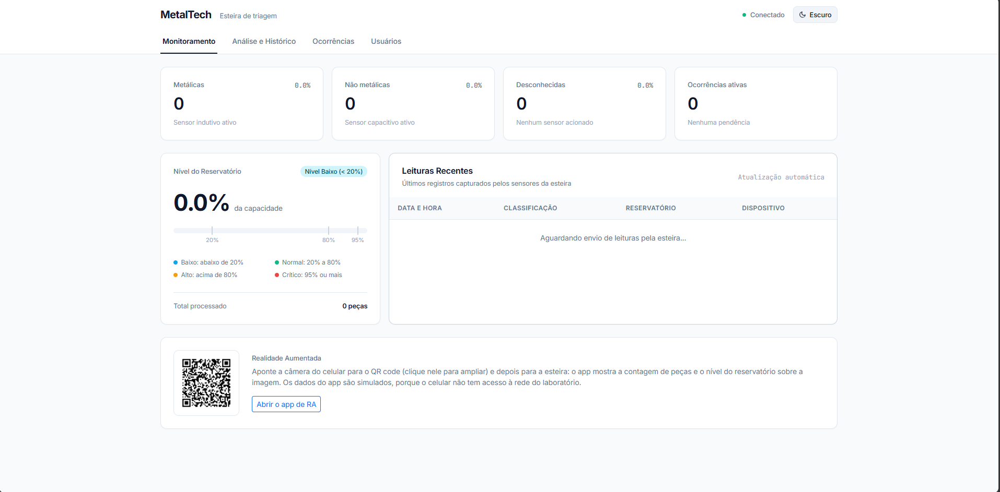

*Figura 15 — Painel de monitoramento ao vivo da esteira (rota `/`). Fonte: Elaborado pelos autores (2026).*

O **painel ao vivo** (`/`) tem:

- quatro cartões de indicadores (KPIs): peças metálicas, não metálicas, desconhecidas e alertas ativos;
- a barra do nível do reservatório, com marcas em 20%, 80% e 95% e cor conforme o status (verde = normal, azul = baixo, amarelo = alto, vermelho = crítico), e o total de peças processadas;
- as últimas 5 leituras recebidas;
- um cartão com link e QR code (ampliável) para abrir o aplicativo de RA no celular.

No cabeçalho, um indicador mostra se a API está conectada, e o contador na aba de ocorrências mostra quantos alertas estão pendentes. O botão de tema alterna entre os modos claro e escuro.

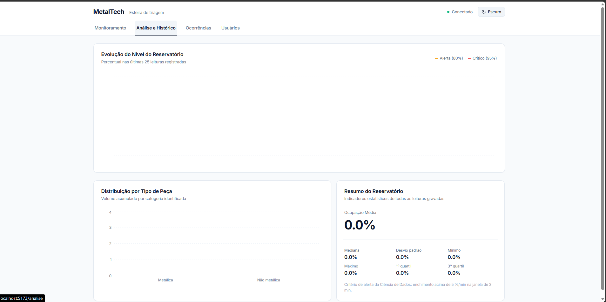

*Figura 16 — Tela de análise com gráficos e indicadores (rota `/analise`). Fonte: Elaborado pelos autores (2026).*

A tela de **análise** (`/analise`) mostra os indicadores da Ciência de Dados calculados pela API:

- gráfico de área com o nível nas últimas 25 leituras e linhas de referência em 80% e 95%;
- gráfico de barras por tipo de peça;
- painel com média, mediana, desvio padrão, mínimo, máximo, Q1 e Q3 do nível;
- explicação do critério de enchimento rápido (5 %/min).

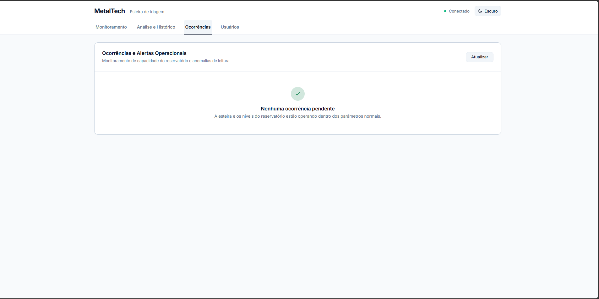

*Figura 17 — Tela de ocorrências e alertas operacionais (rota `/ocorrencias`). Fonte: Elaborado pelos autores (2026).*

A tela de **ocorrências** (`/ocorrencias`) lista os alertas pendentes, como reservatório crítico, alto ou baixo e enchimento rápido, e permite resolvê-los com um clique (`PUT /leituras/alertas/{id}/resolver`). Sem alertas, mostra "Nenhuma ocorrência pendente", como na Figura 17. O botão **Atualizar** força a consulta sem esperar os 10 s.

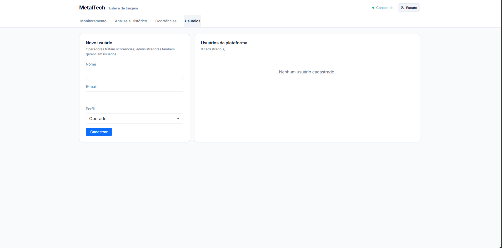

*Figura 18 — Cadastro e lista de usuários da plataforma (rota `/usuarios`). Fonte: Elaborado pelos autores (2026).*

A tela de **usuários** (`/usuarios`) faz o CRUD completo: o formulário à esquerda cadastra ou edita nome, e-mail e perfil (operador, visualizador ou administrador), e a lista à direita mostra os usuários cadastrados, com ações de editar, ativar/desativar e excluir. As mensagens de erro vêm da API (por exemplo, e-mail já cadastrado).

<p align="center">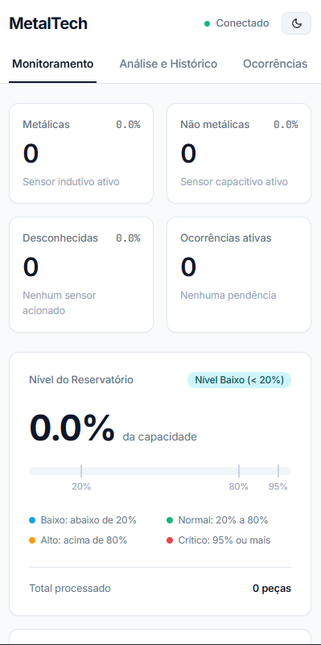</p>

*Figura 19 — Dashboard em tela reduzida (largura de celular). Fonte: Elaborado pelos autores (2026).*

Em tela de celular (Figura 19), os quatro cartões de indicadores passam a ocupar duas colunas (`col-6`), o painel do nível ocupa a largura inteira, o subtítulo "Esteira de triagem" (`d-none d-sm-inline`) e o texto do botão de tema (`d-none d-md-inline`) somem, ficando só o ícone, e as abas de navegação rolam na horizontal (`overflow-x: auto`).

| **Parâmetro** | **Valor / Descrição** |
|---|---|
| **Protótipo no Figma** | [MetalTech — Protótipo Dashboard](https://www.figma.com/design/mNPurE3u30tJpMjsuF7cQo/MetalTech---Prot%C3%B3tipo-Dashboard?node-id=0-1&t=Z1arDtAoYcMi9SQy-1) |

## 4.7 Eletiva I — Aplicativo de Realidade Aumentada

O aplicativo de RA é uma página **WebAR**: o operador abre um link no celular (ou lê o QR code exibido no painel do dashboard, Figura 15), permite o acesso à câmera e aponta para a esteira. Ao reconhecê-la, o app mostra por cima da imagem a contagem de peças e o nível do reservatório, com alerta visual. Não há instalação, build nem dependência de NPM: são HTML, CSS e JavaScript puros, com A-Frame 1.6.0 e MindAR 1.2.5 carregados por CDN, publicados no GitHub Pages.

| **Parâmetro** | **Valor / Descrição** |
|---|---|
| **Tipo de aplicação** | WebAR no navegador (Chrome no Android, Safari no iPhone), sem instalação |
| **Framework / SDK** | A-Frame 1.6.0 (cena) + MindAR 1.2.5 (rastreamento de imagem) |
| **Hospedagem** | GitHub Pages, com HTTPS: <https://rafarubia7.github.io/manufatura-metaltech/realidade-aumentada/> |
| **Alvo rastreado** | A própria esteira de triagem, a partir de foto dela compilada em `assets/target.mind` |
| **Dados exibidos** | Peças metálicas, não metálicas e total; nível do reservatório (%) com status e cor; faixa de enchimento acima do padrão; tempo desde a última leitura |
| **Atualização** | A cada 3 s (`INTERVALO_MS`), só enquanto a esteira está na câmera |
| **Origem dos dados** | Simulados no próprio celular, no formato de `GET /api/v1/esteira/status` (seção 4.7.3) |
| **Código** | [realidade-aumentada/](realidade-aumentada/) — `index.html`, `js/config.js`, `js/dados.js`, `js/main.js`, `js/arrastar.js` |

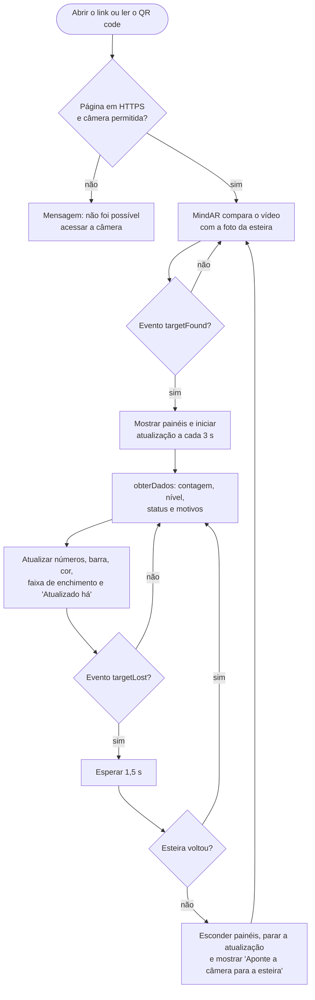

*Figura 20 — Fluxo de funcionamento do aplicativo de RA. Fonte: Elaborado pelos autores (2026).*

### 4.7.1 Marcador e Rastreamento

O enunciado pede um marcador que represente a estação de triagem. A equipe usou a **própria esteira como marcador**, por rastreamento de imagem (*natural feature tracking*), em vez de colar um marcador fiducial impresso. Fotos da esteira tiradas da posição do operador foram compiladas no compilador do MindAR, que gerou o arquivo `assets/target.mind` com os pontos característicos da imagem. Durante o uso, o MindAR procura esses pontos no vídeo da câmera e dispara `targetFound` quando os encontra e `targetLost` quando os perde.

| **Parâmetro** | **Valor** | **Efeito** |
|---|---|---|
| `imageTargetSrc` | `./assets/target.mind` | Foto(s) da esteira usadas como referência |
| `targetIndex` | `0` | Uma entidade por foto compilada. Fotos de outros ângulos podem ser adicionadas como `targetIndex: 1, 2…`; o app conta quantos alvos estão visíveis e só esconde os painéis quando nenhum estiver |
| `warmupTolerance` | `2` | Poucos quadros para confirmar o alvo: reconhece mais rápido |
| `missTolerance` | `15` | Muitos quadros antes de considerar o alvo perdido: não "perde" a esteira a cada tremida do celular |
| `TOLERANCIA_PERDA_MS` | `1500` | Depois de `targetLost`, os painéis ficam mais 1,5 s na tela antes de sumir, para não piscarem |

**Por que a esteira e não um marcador impresso:** o operador aponta para o equipamento real, sem depender de um adesivo que pode ser removido, sujar ou ficar mal posicionado. A contrapartida é que o reconhecimento depende do **ângulo e da iluminação**: o celular precisa estar mais ou menos na mesma posição da foto de referência, e reflexos ou luz forte atrapalham. O README do app traz a foto-guia de posicionamento e dicas de enquadramento. Sem acesso à esteira, dá para testar apontando para a própria foto na tela do computador.

A câmera só abre em contexto seguro, por isso o app é servido por HTTPS. Se a página for aberta por HTTP ou se o usuário negar a permissão, o evento `arError` mostra uma mensagem de erro em vez de uma tela preta.

### 4.7.2 Sobreposição de Dados e Alertas

Os dados são mostrados em **dois painéis HTML sobrepostos à câmera**, e não como objetos 3D presos à esteira. Assim os textos ficam sempre legíveis, de frente para o usuário, sem tremer com o rastreamento. Os painéis só aparecem enquanto a esteira está reconhecida.

| **Painel / elemento** | **O que mostra** |
|---|---|
| **Contagem de peças** | Metálicas, não metálicas e total |
| **Nível do reservatório** | Percentual, barra de preenchimento e texto de status, com cor conforme a faixa |
| **Faixa "Enchimento acima do padrão"** | Faixa vermelha piscando no painel de nível quando há enchimento rápido; some na atualização seguinte |
| **"Atualizado há X s"** | Tempo desde a última leitura, avançando a cada segundo ("Atualizado agora" nos primeiros 2 s) |
| **Selo "⚠ DADOS DE TESTE (SIMULADOS)"** | Fixo no topo, deixa claro que os valores não são da esteira real (`MODO_TESTE = true`) |

O alerta visual atende às duas condições do enunciado, **perto da capacidade máxima** e **fora do padrão identificado pela Ciência de Dados**:

| **Status** | **Faixa** | **Cor e texto no painel** |
|---|---|---|
| `ALERTA_BAIXO` | abaixo de 20% | Verde, "Normal (nível baixo)", apenas informativo |
| `NORMAL` | 20% a 80% | Verde, "Normal" |
| `ALERTA_ALTO` | a partir de 80% | Amarelo, "Atenção: perto da capacidade" |
| `CRITICO` | a partir de 95% | Vermelho, "Crítico: esvaziar o reservatório" |
| `ENCHIMENTO_RAPIDO` | subida acima de 5 pontos percentuais entre duas atualizações | Faixa vermelha piscando, "Enchimento acima do padrão" |

Os limiares ficam centralizados em `js/config.js` e são os mesmos do back-end e do dashboard (20%, 80% e 95%). A única diferença é no valor exato de 80,0%, que a RA já trata como atenção e o back-end ainda como normal (alto é > 80%), sem efeito prático na demonstração. O alerta de nível baixo foi propositalmente tratado como informativo, seguindo a recomendação da análise de dados (seção 5.4): o nível baixo é esperado depois de cada esvaziamento.

**Usabilidade.** Como cada operador segura o celular de um jeito, os painéis podem ser **arrastados com o dedo** e **aumentados ou diminuídos** com os botões − / + ou com pinça de dois dedos. Posição e tamanho ficam salvos no próprio celular (`localStorage`, em fração da tela, para continuar certo ao girar o aparelho), e o botão **↺ Organizar** volta tudo ao lugar inicial. A atualização roda só enquanto a esteira está visível, o que poupa bateria.

<p align="center">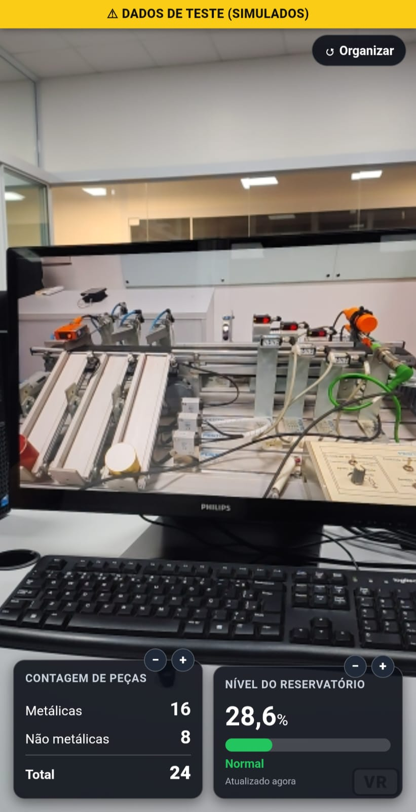</p>

*Figura 21 — Aplicativo de RA reconhecendo a esteira e exibindo contagem e nível. Fonte: Elaborado pelos autores (2026).*

Na Figura 21, o app reconhece a foto de referência da esteira exibida em um monitor, o modo de teste descrito na seção 4.7.1. Aparecem o selo de dados simulados no topo, o botão **↺ Organizar**, o painel de contagem (16 metálicas, 8 não metálicas, 24 no total) e o painel de nível em 28,6%, na faixa verde "Normal", com o texto "Atualizado agora" e os botões − / + de tamanho em cada painel.

### 4.7.3 Origem dos Dados e Restrição de Rede

A API e a bancada ficam na rede do SENAI, que o celular não alcança (seção 4.4). Por isso a RA **não consome a API diretamente**. A função `obterDados()` (`js/dados.js`) gera os dados no próprio celular, com as mesmas informações que `GET /api/v1/esteira/status` devolve, e os mesmos valores de status. O endpoint já está implementado e testado no back-end (seção 4.5.4), e a solução foi aceita pelo professor. Os nomes de alguns campos diferem:

| **Campo na RA (`obterDados`)** | **Campo na API (`/esteira/status`)** |
|---|---|
| `metalicas` | `totalMetalicas` |
| `naoMetalicas` | `totalNaoMetalicas` |
| `nivelReservatorio` | `nivelReservatorioPercentual` |
| `status` (`ALERTA_BAIXO`, `NORMAL`, `ALERTA_ALTO`, `CRITICO`) | `statusReservatorio` (mesmos valores) |
| `exibirAlerta` | `exibirAlerta` |
| `motivos` (ex.: `["ENCHIMENTO_RAPIDO"]`) | `tiposAlertaAtivos` |
| `ultimaLeitura` | `ultimaLeitura` |

A simulação é feita para passar por todos os estados da tela durante uma demonstração curta:

- as contagens só crescem (0 a 4 metálicas e 0 a 3 não metálicas por atualização);
- o nível sobe de 0,5 a 2 pontos por atualização e, a cada 8 a 10 atualizações, dá um salto acima de 5 pontos, que dispara a faixa de enchimento acima do padrão;
- ao passar de 97%, o reservatório "esvazia" e recomeça perto de 20%. Assim, o painel percorre verde, amarelo e vermelho.

**Diferença em relação ao back-end:** o critério de enchimento rápido da RA é uma versão simplificada do critério da Ciência de Dados. O back-end compara o nível atual com o de até 3 minutos antes e alerta acima de 5 %/min. A RA compara apenas duas atualizações consecutivas (3 s) e alerta acima de 5 pontos. Quando a RA passar a consumir a API, essa lógica sai do app, que passará a usar o `exibirAlerta` e os `tiposAlertaAtivos` calculados pelo servidor.

**Como ligar a dados reais:** na arquitetura de produção (seção 4.4), a API fica pública por HTTPS. Basta trocar o corpo de `obterDados()` por um `fetch` a `https://<api>/api/v1/esteira/status`, converter os nomes dos campos conforme a tabela acima e desligar o selo de dados simulados (`MODO_TESTE = false`). Como toda a tela lê os dados por essa única função, o restante do app não muda.

# 5. Resultados e Discussão

## 5.1 Funcionamento Integrado do Sistema

O fluxo da automação até a visualização web funciona de ponta a ponta:

- **Sensores e gateway:** na bancada, cada peça que passa pelos sensores gera uma linha de log no *gateway*, por exemplo `classificada: METALICA (na janela: indutivo=True capacitivo=True)` seguida de `enviado: METALICA | nivel ... | HTTP 201`. A API persiste a leitura, recalcula o tipo e o status e gera os alertas cabíveis.
- **Dashboard:** atualiza as contagens em até 4 s, sem recarregar a página.
- **Ciência de Dados:** as 9.965 leituras do dataset simulado foram enviadas à mesma API e relidas dela. Os indicadores calculados pela API coincidiram com os do pandas em **23 de 23 verificações**. Isso confirma que o caminho Ciência de Dados → API → banco → API → Ciência de Dados preserva os dados sem perda.
- **Contêineres:** sobem com `docker compose up -d`, ficam `healthy` e são acessados por outros computadores da rede pelo IP do servidor.

- **Realidade Aumentada:** o app publicado no GitHub Pages abre no celular pelo QR code do dashboard, reconhece a esteira pela câmera e mostra contagem e nível com alerta visual, atualizados a cada 3 s. Por causa da restrição de rede, os valores são simulados no formato da API (seção 4.7.3).

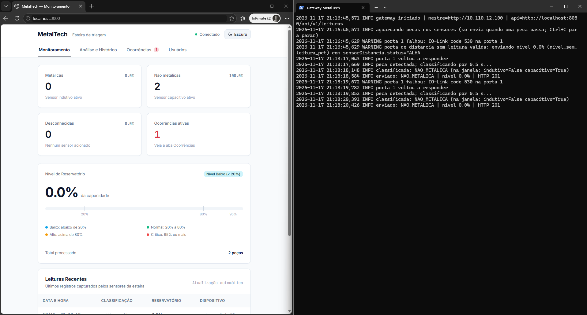

*Figura 22 — Sistema em operação, do sensor à visualização: à direita, o log do gateway; à esquerda, o dashboard. Fonte: Elaborado pelos autores (2026).*

Na Figura 22 (teste de 17/11/2026), duas peças não metálicas passaram pela bancada. Para cada uma, o gateway registrou `peca detectada`, `classificada: NAO_METALICA (na janela: indutivo=False capacitivo=True)` e `enviado: NAO_METALICA | nivel 0.0% | HTTP 201`. Em seguida, o dashboard mostrou 2 peças não metálicas (100%), o total de 2 peças processadas e 1 ocorrência ativa. A API confirmou exatamente 2 leituras gravadas, sem duplicidade. O log também mostra a falha intermitente da porta X01 (`IO-Link code 530`) e a recuperação dela (`porta 1 voltou a responder`). O nível de 0% vem de distâncias medidas (70,5 e 86,5 cm) acima do ponto "vazio" da calibração, e por isso gerou o alerta de reservatório baixo.

## 5.2 Testes de Integração

| **\#** | **Teste**       | **UCs envolvidas** | **Resultado esperado** | **Resultado obtido** | **Status** |
|--------|-----------------|--------------------|------------------------|----------------------|------------|
| 1      | Passar peças reais na bancada com o *gateway* enviando à API | Automação, Back-end | Uma leitura por peça, classificada corretamente e aceita com HTTP 201 | Log `classificada: ...` e `enviado: ... HTTP 201` para cada peça; contagem atualizada em `/leituras/estatisticas` | ✓ |
| 2      | Derrubar a API por alguns segundos durante a passagem de peças (12/11/2026) | Automação, Back-end, Nuvem | Leituras guardadas na fila e reenviadas quando a API voltar | API fora por 15 s; todas as leituras reenviadas, **nenhuma peça perdida** | ✓ |
| 3      | Enviar o dataset completo à API (`enviar_para_api.py`) | Ciência de Dados, Back-end | Todas as leituras aceitas e status recalculado igual ao do CSV | 9.965 `POST` com **HTTP 201** (100%) em 134,4 s (~74 leituras/s); 0 status divergentes | ✓ |
| 4      | Comparar os indicadores da API com os do pandas | Ciência de Dados, Back-end | Mesmos totais, média, mediana, desvio, quartis, distribuição por status e alertas por tipo | **23 / 23** verificações aprovadas (incluindo 15 alertas de enchimento rápido nos dois lados) | ✓ |
| 5      | Persistência e consultas em MySQL 8.0 real (Testcontainers) | Back-end, Nuvem | Gravação, consulta por período e estatísticas iguais às do H2 | Testes `LeituraSensoresMySqlIntegracaoTest` aprovados | ✓ |
| 6      | Subir a pilha com Docker Compose e acessar de outro computador da rede | Nuvem, Back-end, Front-end | `db`, `backend` e `frontend` `healthy`; dashboard e API acessíveis pelo IP do servidor | Contêineres `healthy` em `docker compose ps`; dashboard aberto em `http://<ip>:3000` | ✓ |
| 7      | Dashboard consumindo a API durante a passagem de peças e resolvendo um alerta | Front-end, Back-end | Contagens e nível atualizados sozinhos; alerta resolvido some da lista | Atualização em até 4 s; alerta resolvido via `PUT` e contador da barra de navegação atualizado | ✓ |
| 8      | Abrir o app de RA pelo QR code do dashboard e apontar para a esteira | Eletiva I (RA), Front-end | Câmera abre por HTTPS; painéis aparecem ao reconhecer a esteira e somem ~1,5 s depois de perdê-la | Esteira reconhecida e painéis de contagem e nível exibidos, com "Atualizado agora" (Figura 21) | ✓ |
| 9      | Alertas visuais da RA | Eletiva I (RA), Ciência de Dados | Barra amarela a partir de 80%, vermelha a partir de 95% e faixa piscando no enchimento acima do padrão | Cores e textos mudam conforme a faixa; a faixa de enchimento aparece e some na atualização seguinte *\[confirmar\]* | ✓ |
| 10     | Subir a pilha do zero com os comandos da dockerização (`docker compose up -d --build`) | Nuvem | Imagens, rede `rede_interna`, volume `mysql_data` e contêineres criados; migrações V1–V3 aplicadas | Dashboard aberto com o indicador **Conectado** (Figuras 15 a 18) | ✓ |

## 5.3 Dificuldades Encontradas

- **Capacitivo reagindo a metal.** O modelo inicial tratava indutivo + capacitivo acionados juntos como conflito (`AMBAS`). Na bancada, os dois sensores ficam sobrepostos, e toda peça metálica acionava os dois. A regra foi revista em conjunto: o indutivo decide. A mudança foi aplicada no *gateway* e no back-end, e a migração Flyway V2 reclassificou as leituras antigas. **Lição:** validar hipóteses com o hardware real o quanto antes.
- **Falha intermitente da porta X01 (`IO-Link code 530`).** O sensor de distância respondeu com esse código várias vezes por minuto, e o nível medido pulou entre 0% e 95%. O código indica dado de processo inválido, caso típico de sensor óptico sem alvo dentro da faixa. A causa é física, no equipamento do laboratório. Do lado do software, a solução foi:
  - manter o último valor válido;
  - filtrar o nível pela mediana de 5 amostras;
  - isolar a falha da porta para não derrubar as outras.
- **Mestre IO-Link com IP alterado.** No teste final de 17/11/2026, o endereço `10.110.12.41` passou a pertencer a outro computador do laboratório, e o gateway não conseguia ler os sensores. Uma varredura na rede encontrou o mestre pelo prefixo de MAC da ifm (`00-02-01`) em `10.110.12.100`. Bastou ajustar `mestre_url` no `config.json`. **Lição:** fixar o IP do mestre (ou reservá-lo no DHCP).
- **Gateway travado sem a porta de distância.** Com a porta X01 sem nenhuma leitura válida, o gateway aguardava indefinidamente e não enviava nenhuma peça. Foi criada a opção `nivel_sem_leitura_pct`: com ela, o gateway envia as peças com um nível de reserva e marca o sensor de distância com status `FALHA`, voltando ao valor medido assim que a porta responde.
- **Calibração do nível.** A conversão do valor bruto em percentual depende das leituras com o reservatório vazio e cheio. Valores fora da faixa real travam o nível em 0% ou 100% e geram alertas falsos. Por isso, a calibração foi documentada passo a passo no README da automação.
- **Comunicação com o mestre IO-Link.** A biblioteca `requests` codifica os colchetes da URL (`port[1]` vira `port%5B1%5D`), e o servidor embarcado do mestre não os decodifica. O *gateway* passou a usar `http.client` para essas leituras.
- **Codificação de caracteres.** Mensagens de alerta foram gravadas com acentuação corrompida por classes compiladas sem UTF-8. O *build* foi corrigido, e a migração V2 consertou os textos já gravados.
- **Rede isolada do laboratório.** A bancada e o servidor ficam na rede do SENAI, à qual a equipe não tem acesso administrativo e que não é acessível de fora. Isso impediu publicar a API na internet e orientou a separação entre a implantação local e a arquitetura de produção.
- **RA sem acesso à API.** O celular não alcança a rede do SENAI, então a RA não pôde consumir `/esteira/status`, embora o endpoint tenha sido criado para ela. A equipe confirmou a restrição com o professor e optou por uma simulação local com as mesmas informações e os mesmos limiares, deixando a troca para a API isolada em uma única função (`obterDados`).
- **Reconhecimento da esteira na RA.** Usar a própria esteira como alvo, em vez de um marcador impresso, torna o reconhecimento sensível ao ângulo e à iluminação. A equipe ajustou as tolerâncias do MindAR (`warmupTolerance` e `missTolerance`), acrescentou 1,5 s de tolerância antes de esconder os painéis e documentou uma foto-guia de posicionamento.
- **Integração entre frentes.** Manter o contrato da API estável enquanto quatro frentes evoluíam em paralelo exigiu combinar as mudanças antes de cada *merge*. Os testes de controller e a validação API × pandas detectaram divergências cedo.

## 5.4 Análise Crítica

**O que funcionou bem:**

- O contrato único da API permitiu que todas as frentes trabalhassem em paralelo.
- A regra de negócio fica no back-end, que recalcula tipo e status em vez de confiar no dispositivo.
- O critério de alerta veio da análise de dados e foi validado estatisticamente antes de virar código.
- A cobertura de testes é alta (90,8% das linhas, incluindo integração com MySQL real).
- O *gateway* é resiliente: fila, reenvio e falha parcial de sensor.
- A implantação é reproduzível com um único `docker compose up`.

**O que poderia ter sido feito de forma diferente:**

- Testar mais cedo com os sensores reais teria evitado a revisão da regra de classificação.
- A autenticação deveria ter entrado junto com o cadastro de usuários, e não ficado para depois.

**Limitações atuais:**

- **Dados simulados na RA:** a RA mostra valores fictícios, com selo de aviso permanente, e o critério de enchimento rápido dela é uma simplificação do critério do back-end (seção 4.7.3). O critério de avaliação "integração com dados reais" só é atendido plenamente com a API pública da arquitetura de produção.
- **Dados simulados na análise:** a análise estatística usa um dataset sintético. Os parâmetros são plausíveis, mas precisam ser recalibrados com dados reais quando o sensor de distância da bancada estiver estável.
- **Segurança:**
  - os perfis de usuário existem, mas não são exigidos nas rotas, porque não há login;
  - o tráfego na rede local é HTTP;
  - a `X-API-Key` está implementada e testada, mas não foi ativada na implantação do laboratório.
- **Nuvem:** a arquitetura AWS foi projetada e justificada, mas não contratada. A implantação atual tem um único servidor, ou seja, um ponto único de falha, e a fila do *gateway* fica em memória.
- **Desempenho e escalabilidade:** o volume atual (cerca de 1.500 leituras por dia) é baixo. A API e o banco já separam os dados por dispositivo e têm índices, mas a escala horizontal só é viável no cenário de nuvem.
- **Política de alertas:** o alerta de reservatório baixo dispara ao fim de quase todo esvaziamento, que é um evento esperado, e gera ruído para o operador. A análise recomenda rebaixá-lo para informativo.

## 5.5 Verificação dos Entregáveis

| **Entregável**                                              | **Entregue** | **Localização (link / apêndice)** |
|-------------------------------------------------------------|--------------|-----------------------------------|
| Repositório Git com back-end (API REST) e front-end (React) | ✓            | <https://github.com/rafarubia7/manufatura-metaltech> — [backend/](backend/) e [frontend/](frontend/) |
| Firmware da camada de Automação Industrial                  | ✓            | [automacao/gateway.py](automacao/gateway.py) e [automacao/README.md](automacao/README.md) — Apêndice A.1 |
| Aplicativo/projeto de Realidade Aumentada funcional         | ✓ (dados simulados) | <https://rafarubia7.github.io/manufatura-metaltech/realidade-aumentada/> — [realidade-aumentada/](realidade-aumentada/), seção 4.7 e Apêndice A.4 |
| Relatório de Ciência de Dados com gráficos e conclusões     | ✓            | Seção 4.3, [docs/relatorio_ciencia_dados.md](docs/relatorio_ciencia_dados.md) e Apêndice A.5 |
| Documento de arquitetura de nuvem com justificativa técnica | ✓            | Seção 4.4 e [docs/arquitetura_nuvem.md](docs/arquitetura_nuvem.md) |
| Apresentação final demonstrando o fluxo completo de dados   | ✓ / ✗        | *\[Link da apresentação\]* |

# 6. Conclusão

## 6.1 Considerações Finais

A equipe construiu uma plataforma de monitoramento industrial que leva o dado do sensor físico até a tela do usuário, passando por uma API única. Os objetivos propostos foram alcançados nas seis frentes:

- **Automação Industrial:** sensores IO-Link reais classificam as peças com uma regra validada na bancada e enviam uma leitura por peça, sem perda quando a API cai.
- **Desenvolvimento Back-end:**
  - API REST com modelagem orientada a objetos (herança, polimorfismo e encapsulamento);
  - CRUD de leituras e usuários;
  - alertas automáticos e estatísticas;
  - 72 testes automatizados com 90,8% de cobertura;
  - documentação Swagger.
- **Ciência de Dados:** a análise de uma semana simulada descreveu o processo, explicou padrões (o turno mais rápido tem mais tempo crítico; as peças desconhecidas vêm de desalinhamento) e chegou a um critério de alerta com 96,9% de precisão, que foi incorporado ao back-end.
- **Computação em Nuvem:** a plataforma roda conteinerizada no servidor do laboratório, com imagens *multi-stage*, rede e volume próprios, recuperação automática e segredos fora do código, e sobe do zero com um único comando. A arquitetura PaaS na AWS foi justificada para produção.
- **Frameworks Front-end:** o dashboard React é responsivo, organizado em componentes e rotas, e atualiza os dados automaticamente.
- **Realidade Aumentada:** o app WebAR reconhece a própria esteira, sem marcador impresso, e sobrepõe contagem e nível com os alertas de capacidade e de enchimento acima do padrão. Pela restrição da rede do laboratório, usa dados simulados no formato da API, e a ligação com os dados reais está isolada em uma única função.

A principal lição do projeto foi que **a integração é o desafio central**. As decisões mais importantes surgiram na fronteira entre as frentes: o contrato da API, a regra de classificação revista com o hardware real e o critério de alerta que saiu da análise de dados para o back-end. O projeto mostrou, em escala acadêmica, como uma solução de Indústria 4.0 depende de sensoriamento confiável, dados bem modelados e interfaces que transformam esses dados em decisão.

## 6.2 Trabalhos Futuros

- Integração com controladores (CLP) industriais e operação contínua em uma linha de produção real, recalibrando a análise com dados reais;

- Login com token (Spring Security + JWT ou Amazon Cognito), com os perfis de usuário exigidos em cada rota;

- Migração para a arquitetura AWS proposta (Elastic Beanstalk, RDS Multi-AZ, CloudFront), com HTTPS e `X-API-Key` obrigatória;

- RA consumindo `GET /api/v1/esteira/status` da API pública, com o critério de enchimento rápido calculado pelo servidor, e alvos de outros ângulos da esteira compilados no `target.mind`;

- Alertas automáticos por e-mail ou SMS ao detectar valores anômalos;

- Previsão do tempo até o transbordo a partir da taxa de enchimento e modelo de aprendizado de máquina para detecção de anomalias;

- Escalabilidade automática e monitoramento da infraestrutura em nuvem (CloudWatch);

- Revisão da política de alertas (rebaixar o alerta de reservatório baixo e agrupar alertas repetidos) e indicador de disponibilidade da esteira (OEE) a partir dos gargalos detectados;

- Persistência da fila do *gateway* em disco, para não perder leituras se o próprio *gateway* reiniciar.

# 7. Referências Bibliográficas

A-FRAME. **A-Frame Documentation**. Disponível em: <https://aframe.io/docs/1.6.0/>. Acesso em: 16 nov. 2026.

AMAZON WEB SERVICES. **AWS Well-Architected Framework**. Disponível em: <https://docs.aws.amazon.com/wellarchitected/latest/framework/welcome.html>. Acesso em: 16 nov. 2026.

AZUMA, Ronald T. A survey of augmented reality. **Presence: Teleoperators and Virtual Environments**, Cambridge, v. 6, n. 4, p. 355-385, 1997.

BOOTSTRAP. **Bootstrap 5.3 Documentation**. Disponível em: <https://getbootstrap.com/docs/5.3/>. Acesso em: 16 nov. 2026.

DOCKER. **Docker Compose Documentation**. Disponível em: <https://docs.docker.com/compose/>. Acesso em: 16 nov. 2026.

FIELDING, Roy Thomas. **Architectural styles and the design of network-based software architectures**. 2000. Tese (Doutorado em Information and Computer Science) — University of California, Irvine, 2000.

FLYWAY. **Flyway Documentation**. Disponível em: <https://documentation.red-gate.com/flyway>. Acesso em: 16 nov. 2026.

IFM ELECTRONIC. **Fichas técnicas AL1300, O5D150, IF6123 e KI5309**. Disponível em: <https://www.ifm.com/br/pt>. Acesso em: 16 nov. 2026.

IGLEWICZ, Boris; HOAGLIN, David C. **How to detect and handle outliers**. Milwaukee: ASQC Quality Press, 1993.

INTERNATIONAL ELECTROTECHNICAL COMMISSION. **IEC 61131-9**: programmable controllers — part 9: single-drop digital communication interface for small sensors and actuators (SDCI). Geneva: IEC, 2022.

KAGERMANN, Henning; WAHLSTER, Wolfgang; HELBIG, Johannes. **Recommendations for implementing the strategic initiative INDUSTRIE 4.0**. Frankfurt: acatech, 2013.

MATPLOTLIB. **Matplotlib Documentation**. Disponível em: <https://matplotlib.org/stable/>. Acesso em: 16 nov. 2026.

MELL, Peter; GRANCE, Timothy. **The NIST definition of cloud computing**. Gaithersburg: National Institute of Standards and Technology, 2011. (NIST Special Publication 800-145).

MILGRAM, Paul; KISHINO, Fumio. A taxonomy of mixed reality visual displays. **IEICE Transactions on Information and Systems**, Tóquio, v. E77-D, n. 12, p. 1321-1329, 1994.

MINDAR. **MindAR Documentation**. Disponível em: <https://hiukim.github.io/mind-ar-js-doc/>. Acesso em: 16 nov. 2026.

MORETTIN, Pedro A.; BUSSAB, Wilton O. **Estatística básica**. 9. ed. São Paulo: Saraiva, 2017.

MYSQL. **MySQL 8.0 Reference Manual**. Disponível em: <https://dev.mysql.com/doc/refman/8.0/en/>. Acesso em: 16 nov. 2026.

PANDAS. **pandas Documentation**. Disponível em: <https://pandas.pydata.org/docs/>. Acesso em: 16 nov. 2026.

REACT. **React Documentation**. Disponível em: <https://react.dev>. Acesso em: 16 nov. 2026.

RECHARTS. **Recharts**. Disponível em: <https://recharts.org>. Acesso em: 16 nov. 2026.

SCHWAB, Klaus. **A quarta revolução industrial**. São Paulo: Edipro, 2016.

SPRING. **Spring Boot**. Disponível em: <https://spring.io/projects/spring-boot>. Acesso em: 16 nov. 2026.

SPRINGDOC. **springdoc-openapi**. Disponível em: <https://springdoc.org>. Acesso em: 16 nov. 2026.

TESTCONTAINERS. **Testcontainers for Java**. Disponível em: <https://java.testcontainers.org>. Acesso em: 16 nov. 2026.

THOMAZINI, Daniel; ALBUQUERQUE, Pedro Urbano Braga de. **Sensores industriais**: fundamentos e aplicações. 8. ed. São Paulo: Érica, 2011.

TUKEY, John W. **Exploratory data analysis**. Reading: Addison-Wesley, 1977.

VITE. **Vite Documentation**. Disponível em: <https://vite.dev>. Acesso em: 16 nov. 2026.

# Apêndices

Os apêndices trazem os trechos principais do código. A versão completa está no repositório Git.

## Apêndice A — Código-Fonte

### A.1 Firmware de Automação Industrial

Arquivo completo: [automacao/gateway.py](automacao/gateway.py). Trechos: histerese, cálculo do nível, classificação e envio com reenvio.

```python
def liga_capacitivo(ativo, v, c):
    """Histerese: valor ALTO = objeto presente."""
    if v >= c["liga_acima"]:
        return True
    if v < c["desliga_abaixo"]:
        return False
    return ativo


def liga_indutivo(ativo, v, c):
    """Histerese: valor BAIXO = metal presente (livre = valor alto, ex. 32736)."""
    if v <= c["liga_abaixo"]:
        return True
    if v > c["desliga_acima"]:
        return False
    return ativo


def nivel_percentual(raw, vazio_raw, cheio_raw):
    pct = (vazio_raw - raw) / (vazio_raw - cheio_raw) * 100.0
    return max(0.0, min(100.0, pct))  # a API rejeita negativo (@PositiveOrZero)


def classificar(viu_metal, viu_nao_metal):
    # O capacitivo tambem reage a metal, entao quem decide "metalica" e o indutivo.
    if viu_metal:
        return "METALICA"
    if viu_nao_metal:
        return "NAO_METALICA"
    return "DESCONHECIDA"


class Enviador(threading.Thread):
    """Envia a fila para a API sem travar a leitura dos sensores."""

    MAX_TENTATIVAS_5XX = 5

    def run(self):
        espera = 1.0
        while True:
            payload = self.fila.get()
            tentativas_5xx = 0
            while True:
                try:
                    r = self.sessao.post(self.url, json=payload, headers=self.headers, timeout=5)
                    if r.status_code < 300:
                        log.info("enviado: %s | nivel %.1f%% | HTTP %s", payload["peca"]["tipo"],
                                 payload["nivelReservatorio"]["percentual"], r.status_code)
                        espera = 1.0
                        break
                    if r.status_code < 500:  # 4xx: reenviar nao resolve
                        log.error("API recusou (%s): %s", r.status_code, r.text[:300])
                        break
                    tentativas_5xx += 1
                    if tentativas_5xx >= self.MAX_TENTATIVAS_5XX:
                        log.error("descartando payload apos %d erros 5xx", tentativas_5xx)
                        break
                except requests.RequestException as e:  # rede fora: tenta para sempre
                    log.warning("falha ao enviar: %s", e)
                time.sleep(espera)
                espera = min(espera * 2, 30.0)
```

Trecho do laço principal (máquina de estados livre → coletando → aguardando):

```python
        if estado == "livre" and detectando:
            estado, t_ini, ts_ini = "coletando", t0, agora_iso()
            viu_m, viu_n = ind, cap
        elif estado == "coletando":
            viu_m |= ind
            viu_n |= cap
            if t0 - t_ini >= janela:                      # janela de 0,5 s
                tipo = classificar(viu_m, viu_n)
                enfileirar(montar_payload(cfg, ts_ini, tipo, dist_cm, viu_m, viu_n, pct))
                estado = "aguardando"
        elif estado == "aguardando" and not detectando:  # uma peça = uma leitura
            estado = "livre"
```

### A.2 Código do Back-end (Java / Spring Boot)

Hierarquia de sensores e classificador (`domain/sensor/`):

```java
/** Sensor de material: quando acionado, indica o tipo de peça que ele detecta. */
public abstract class Sensor {

    private final boolean acionado;
    private final Double intensidade;

    protected Sensor(boolean acionado, Double intensidade) {
        this.acionado = acionado;
        this.intensidade = intensidade;
    }

    public boolean isAcionado() { return acionado; }

    public Double getIntensidade() { return intensidade; }

    /** Tipo de peça que o acionamento deste sensor indica. Cada subclasse define o seu. */
    public abstract TipoPeca tipoIndicado();
}

/** Detecta apenas materiais condutores (metal). */
public class SensorIndutivo extends Sensor {

    public SensorIndutivo(Boolean acionado, Double intensidade) {
        super(Boolean.TRUE.equals(acionado), intensidade);
    }

    @Override
    public TipoPeca tipoIndicado() {
        return TipoPeca.METALICA;
    }
}

/** Combina os sensores de material para classificar a peça. Não conhece as subclasses. */
public final class ClassificadorPeca {

    public static TipoPeca classificar(List<? extends Sensor> sensores) {
        Set<TipoPeca> indicados = sensores.stream()
                .filter(Sensor::isAcionado)
                .map(Sensor::tipoIndicado)
                .collect(Collectors.toCollection(() -> EnumSet.noneOf(TipoPeca.class)));

        if (indicados.contains(TipoPeca.METALICA)) {
            return TipoPeca.METALICA;
        }
        if (indicados.isEmpty()) {
            return TipoPeca.DESCONHECIDA;
        }
        return indicados.iterator().next();
    }
}
```

Controller de leituras (`api/controller/LeituraSensoresController.java`, trecho):

```java
@RestController
@RequestMapping("/api/v1/leituras")
@RequiredArgsConstructor
@Tag(name = "Leituras da esteira", description = "Recebimento de leituras dos sensores, alertas e estatísticas operacionais")
public class LeituraSensoresController {

    private final LeituraSensoresService leituraService;
    private final LeituraSensoresMapper mapper;
    private final EstatisticasService estatisticasService;

    @PostMapping
    @Operation(summary = "Registra uma leitura dos sensores",
            description = "O status do reservatório é recalculado pelo backend a partir do percentual "
                    + "(baixo < 20%, alto > 80%, crítico >= 95%). Alertas são gerados automaticamente.")
    public ResponseEntity<LeituraSensoresRespostaDTO> criarLeitura(@Valid @RequestBody LeituraSensoresDTO dto) {
        LeituraSensores salva = leituraService.salvarLeitura(mapper.paraEntidade(dto));
        return ResponseEntity.status(HttpStatus.CREATED).body(mapper.paraRespostaDto(salva));
    }
    // ... GET /leituras, /{id}, PUT, DELETE, /alertas, /alertas/{id}/resolver, /estatisticas
}
```

Critério de enchimento rápido da Ciência de Dados no serviço (`application/service/LeituraSensoresService.java`, trecho):

```java
    static final Duration JANELA_TAXA = Duration.ofMinutes(3);
    static final Duration JANELA_MINIMA = Duration.ofMinutes(1);
    static final double LIMITE_ENCHIMENTO_PCT_POR_MIN = 5.0;

    private Double calcularTaxaEnchimento(LeituraSensores leitura) {
        Instant agora = leitura.getDataHora();
        if (agora == null) {
            return null;
        }
        List<LeituraSensores> janela = leituraRepository.buscarJanelaAnterior(
                leitura.getDispositivoId(), agora.minus(JANELA_TAXA), agora, PageRequest.of(0, 1));
        if (janela.isEmpty()) {
            return null;
        }
        LeituraSensores base = janela.get(0);
        Duration decorrido = Duration.between(base.getDataHora(), agora);
        if (decorrido.compareTo(JANELA_MINIMA) < 0) {
            return null;
        }
        double minutos = decorrido.toMillis() / 60000.0;
        return (leitura.getNivelReservatorioPercentual() - base.getNivelReservatorioPercentual()) / minutos;
    }
```

### A.3 Código do Front-end (React)

Consumo da API (`src/services/api.js`, trecho):

```javascript
// Sem VITE_API_URL, usa o mesmo host em que a página foi aberta, na porta 8080.
const API_URL = import.meta.env.VITE_API_URL || `${window.location.protocol}//${window.location.hostname}:8080`;
const BASE_URL = `${API_URL}/api/v1`;

export const buscarEstatisticas = async () => {
  const resposta = await fetch(`${BASE_URL}/leituras/estatisticas`);
  if (!resposta.ok) throw new Error('Erro ao buscar estatísticas');
  const dados = await resposta.json();
  return normalizarEstatisticas(dados);
};

export const resolverAlerta = async (id) => {
  const resposta = await fetch(`${BASE_URL}/leituras/alertas/${id}/resolver`, {
    method: 'PUT',
  });
  if (!resposta.ok) {
    throw new Error('Erro ao resolver alerta');
  }
  // ... a API responde 204 (sem corpo)
};
```

Estado e atualização periódica do painel ao vivo (`src/pages/PainelAoVivo.jsx`, trecho):

```jsx
// Faixas do reservatório (mesmas regras do back-end).
const LIMITES_NIVEL = [
  { valor: 20, rotulo: '20%' },
  { valor: 80, rotulo: '80%' },
  { valor: 95, rotulo: '95%' },
];

function PainelAoVivo() {
  const [estatisticas, setEstatisticas] = useState(null);
  const [ultimasLeituras, setUltimasLeituras] = useState([]);
  const [carregando, setCarregando] = useState(true);

  const carregarDados = async () => {
    try {
      const [dadosEst, dadosLeit] = await Promise.all([
        buscarEstatisticas(),
        buscarLeituras(0, 5),
      ]);
      setEstatisticas(dadosEst);
      setUltimasLeituras(dadosLeit.slice(0, 5)); // (simplificado: o original também aceita outros formatos de lista)
    } catch (err) {
      console.error('Erro ao atualizar painel ao vivo:', err);
    } finally {
      setCarregando(false);
    }
  };

  useEffect(() => {
    carregarDados();
    const intervalo = setInterval(carregarDados, 4000);
    return () => clearInterval(intervalo);
  }, []);
  // ... renderização dos KPIs, da barra de nível e das últimas leituras
}
```

Rotas (`src/App.jsx`, trecho):

```jsx
<Routes>
  <Route path="/" element={<PainelAoVivo />} />
  <Route path="/analise" element={<GraficosHistorico tema={tema} />} />
  <Route path="/ocorrencias" element={<TabelaManutencoes aoAlterarAlertas={verificarStatusSistema} />} />
  <Route path="/usuarios" element={<GestaoUsuarios />} />
  <Route path="*" element={<Navigate to="/" replace />} />
</Routes>
```

### A.4 Aplicativo de Realidade Aumentada

Código completo em [realidade-aumentada/](realidade-aumentada/), com instruções de teste no [README do app](realidade-aumentada/README.md).

Cena de RA e alvo rastreado (`index.html`, trecho):

```html
<script src="https://aframe.io/releases/1.6.0/aframe.min.js"></script>
<script src="https://cdn.jsdelivr.net/npm/mind-ar@1.2.5/dist/mindar-image-aframe.prod.js"></script>

<a-scene
  id="cena"
  mindar-image="imageTargetSrc: ./assets/target.mind; uiScanning: no; uiLoading: yes; uiError: no; warmupTolerance: 2; missTolerance: 15"
  color-space="sRGB"
  renderer="colorManagement: true"
  vr-mode-ui="enabled: false"
  device-orientation-permission-ui="enabled: false">
  <a-camera position="0 0 0" look-controls="enabled: false"></a-camera>
  <!-- Uma entidade por foto da esteira compilada no target.mind -->
  <a-entity class="alvo" mindar-image-target="targetIndex: 0"></a-entity>
</a-scene>
```

Limiares (`js/config.js`):

```javascript
const MODO_TESTE = true;              // exibe o selo de dados simulados
const INTERVALO_MS = 3000;            // atualização dos dados
const TOLERANCIA_PERDA_MS = 1500;     // painéis ficam na tela após perder a esteira
const LIMITE_ALERTA_ALTO = 80;        // amarelo
const LIMITE_CRITICO = 95;            // vermelho
const LIMITE_ALERTA_BAIXO = 20;       // apenas informativo
const SALTO_ENCHIMENTO_RAPIDO = 5;    // pontos percentuais entre duas atualizações
```

Status e simulação dos dados (`js/dados.js`, trecho):

```javascript
function calcularStatus(nivel) {
  if (nivel >= LIMITE_CRITICO) return "CRITICO";
  if (nivel >= LIMITE_ALERTA_ALTO) return "ALERTA_ALTO";
  if (nivel < LIMITE_ALERTA_BAIXO) return "ALERTA_BAIXO";
  return "NORMAL";
}

function gerarDadosSimulados() {
  simulacao.metalicas += numeroAleatorio(0, 4);
  simulacao.naoMetalicas += numeroAleatorio(0, 3);

  const nivelAnterior = simulacao.nivelReservatorio;
  let nivel;
  if (nivelAnterior > NIVEL_ESVAZIAR) {
    nivel = NIVEL_REINICIO + decimalAleatorio(-2, 2);          // esvaziou: recomeça perto de 20%
  } else {
    simulacao.atualizacoesAteSalto--;
    if (simulacao.atualizacoesAteSalto <= 0) {                 // salto acima do padrão
      nivel = nivelAnterior + SALTO_ENCHIMENTO_RAPIDO + decimalAleatorio(1, 3);
      simulacao.atualizacoesAteSalto = numeroAleatorio(8, 10);
    } else {
      nivel = nivelAnterior + decimalAleatorio(0.5, 2);
    }
  }
  nivel = Math.min(100, arredondar(nivel));
  simulacao.nivelReservatorio = nivel;

  const motivos = nivel - nivelAnterior > SALTO_ENCHIMENTO_RAPIDO ? ["ENCHIMENTO_RAPIDO"] : [];
  return {
    metalicas: simulacao.metalicas,
    naoMetalicas: simulacao.naoMetalicas,
    nivelReservatorio: nivel,
    status: calcularStatus(nivel),
    exibirAlerta: motivos.length > 0,
    motivos: motivos,
    ultimaLeitura: new Date().toISOString(),
  };
}

// Única porta de entrada dos dados: com a API pública, vira um fetch a /api/v1/esteira/status.
async function obterDados() {
  return gerarDadosSimulados();
}
```

Eventos de rastreamento (`js/main.js`, trecho):

```javascript
// Esteira fora da câmera: espera um pouco e, se não voltar,
// esconde os painéis e para a atualização
function aoPerderEsteira() {
  alvosVisiveis = Math.max(0, alvosVisiveis - 1);
  if (alvosVisiveis > 0) return; // outro alvo da esteira ainda está visível
  clearTimeout(temporizadorPerda);
  temporizadorPerda = setTimeout(() => {
    alvoVisivel = false;
    pararAtualizacao();
    el.paineis.hidden = true;
    mostrarStatus(TEXTO_PROCURANDO, false);
  }, TOLERANCIA_PERDA_MS);
}

el.alvos.forEach((alvo) => {
  alvo.addEventListener("targetFound", aoEncontrarEsteira);
  alvo.addEventListener("targetLost", aoPerderEsteira);
});

// Falha ao iniciar a RA (câmera negada, sem câmera, sem HTTPS...)
el.cena.addEventListener("arError", () => {
  clearTimeout(temporizadorPerda);
  alvoVisivel = false;
  pararAtualizacao();
  el.paineis.hidden = true;
  mostrarStatus("Não foi possível acessar a câmera. Verifique a permissão e se o site está em HTTPS.", true);
});
```

### A.5 Scripts / Notebook de Ciência de Dados

Scripts em [dados/scripts/](dados/scripts/): `gerar_dataset.py` (geração do dataset), `analise_estatistica.py` (estatística, outliers e gráficos) e `enviar_para_api.py` (envio e validação com a API). Trechos de `analise_estatistica.py`:

```python
def taxa_variacao(df: pd.DataFrame) -> pd.Series:
    """%/min contra a primeira leitura dentro da janela, para que uma parada não dilua a rajada seguinte."""
    base = df[["timestamp", "nivel_reservatorio_percentual"]].rename(
        columns={"timestamp": "instante_anterior", "nivel_reservatorio_percentual": "nivel_anterior"})
    alvo = pd.DataFrame({"referencia": df["timestamp"] - pd.Timedelta(minutes=JANELA_TAXA_MIN)})
    anterior = pd.merge_asof(alvo, base, left_on="referencia", right_on="instante_anterior", direction="forward")
    minutos = (df["timestamp"] - anterior["instante_anterior"]).dt.total_seconds() / 60
    taxa = (df["nivel_reservatorio_percentual"] - anterior["nivel_anterior"]) / minutos
    return taxa.where(minutos >= 1).round(3)


def descrever(serie: pd.Series, casas_moda: int = 0) -> dict:
    valores = serie.dropna()
    q1, q2, q3 = valores.quantile([0.25, 0.5, 0.75])
    return {
        "n": int(valores.size), "media": round(valores.mean(), 3), "mediana": round(q2, 3),
        "moda": moda(valores, casas_moda),
        "desvio_padrao": round(valores.std(), 3), "minimo": round(valores.min(), 3), "q1": round(q1, 3),
        "q3": round(q3, 3), "iqr": round(q3 - q1, 3), "maximo": round(valores.max(), 3),
        "assimetria": round(float(stats.skew(valores)), 3), "curtose": round(float(stats.kurtosis(valores)), 3),
        "cv_pct": round(100 * valores.std() / valores.mean(), 2) if valores.mean() else None,
    }


def detectar_outliers(df, vazao_10min):
    sinais = pd.DataFrame(index=df.index)
    sinais["R1_enchimento_acima_5pct_min"] = df["taxa_nivel_pct_min"] > TAXA_ENCHIMENTO_ANOMALA
    sinais["R2_esvaziamento_acima_3pct_min"] = df["taxa_nivel_pct_min"] < TAXA_ESVAZIAMENTO_ANOMALA
    # Peça não metálica já tem indutivo baixo; falha de conexão exige os DOIS sensores sem sinal.
    sinais["R3_sinal_nulo_nos_sensores"] = ((df["indutivo_intensidade"] < INTENSIDADE_FALHA)
                                            & (df["capacitivo_intensidade"] < INTENSIDADE_FALHA))
    sinais["R4_conflito_ambas"] = df["tipo_peca"] == "AMBAS"

    # z-score robusto: mediana e MAD escalado
    taxa = df["taxa_nivel_pct_min"]
    mediana = taxa.median()
    mad = (taxa - mediana).abs().median() * 1.4826
    df["z_robusto_taxa"] = ((taxa - mediana) / mad).round(2)
    sinais["Z_taxa_nivel_robusto"] = df["z_robusto_taxa"].abs() > Z_ROBUSTO_LIMITE  # 3,5

    # IQR da vazão em janelas de 10 min, por turno
    for turno, grupo in vazao_10min.groupby("turno"):
        q1, q3 = grupo["pecas"].quantile([0.25, 0.75])
        inferior, superior = q1 - 1.5 * (q3 - q1), q3 + 1.5 * (q3 - q1)
        vazao_10min.loc[grupo.index[grupo["pecas"] < max(inferior, 0.5)], "outlier_iqr"] = "BAIXO"
        vazao_10min.loc[grupo.index[grupo["pecas"] > superior], "outlier_iqr"] = "ALTO"
    # ...
```

Reprodução:

```powershell
cd dados
python -m venv .venv
.\.venv\Scripts\python -m pip install -r requirements.txt
.\.venv\Scripts\python scripts\gerar_dataset.py          # mesmo CSV a cada execução (seed 42)
.\.venv\Scripts\python scripts\analise_estatistica.py    # gráficos e resultados
.\.venv\Scripts\python scripts\enviar_para_api.py        # com o back-end rodando
```

## Apêndice B — Scripts SQL

DDL das migrações Flyway ([backend/src/main/resources/db/migration/](backend/src/main/resources/db/migration/)).

`V1__criar_tabelas_iniciais.sql`:

```sql
-- Tabela de leituras de sensores
CREATE TABLE leituras_sensores (
    id BIGINT NOT NULL AUTO_INCREMENT PRIMARY KEY,
    timestamp_leitura TIMESTAMP(6) NOT NULL,
    distancia_cm DOUBLE NOT NULL,
    indutivo_detectou_metal TINYINT(1) NOT NULL,
    indutivo_intensidade DOUBLE NULL,
    capacitivo_detectou_nao_metal TINYINT(1) NOT NULL,
    capacitivo_intensidade DOUBLE NULL,
    tipo_peca VARCHAR(20) NOT NULL,
    nivel_reservatorio_percentual DOUBLE NOT NULL,
    status_reservatorio VARCHAR(20) NOT NULL,
    dispositivo_id VARCHAR(50) NOT NULL,
    versao_firmware VARCHAR(20) NULL,
    criado_em TIMESTAMP(6) NOT NULL DEFAULT CURRENT_TIMESTAMP(6),
    atualizado_em TIMESTAMP(6) NOT NULL DEFAULT CURRENT_TIMESTAMP(6) ON UPDATE CURRENT_TIMESTAMP(6)
) ENGINE=InnoDB;

-- Tabela de alertas
CREATE TABLE alertas_nivel (
    id BIGINT NOT NULL AUTO_INCREMENT PRIMARY KEY,
    leitura_id BIGINT NOT NULL,
    timestamp_alertado TIMESTAMP(6) NOT NULL,
    tipo_alerta VARCHAR(20) NOT NULL,
    mensagem TEXT NOT NULL,
    resolvido TINYINT(1) NOT NULL DEFAULT 0,
    criado_em TIMESTAMP(6) NOT NULL DEFAULT CURRENT_TIMESTAMP(6),
    CONSTRAINT fk_alertas_leitura FOREIGN KEY (leitura_id) REFERENCES leituras_sensores(id) ON DELETE CASCADE
) ENGINE=InnoDB;

-- Índices para performance
CREATE INDEX idx_leituras_timestamp ON leituras_sensores(timestamp_leitura);
CREATE INDEX idx_leituras_tipo_peca ON leituras_sensores(tipo_peca);
CREATE INDEX idx_leituras_status_reservatorio ON leituras_sensores(status_reservatorio);
CREATE INDEX idx_leituras_dispositivo ON leituras_sensores(dispositivo_id);
CREATE INDEX idx_alertas_leitura ON alertas_nivel(leitura_id);
CREATE INDEX idx_alertas_tipo ON alertas_nivel(tipo_alerta);
CREATE INDEX idx_alertas_resolvido ON alertas_nivel(resolvido);
```

`V3__criar_tabela_usuarios.sql`:

```sql
-- Usuários da plataforma (operadores da esteira, técnicos e administradores).
CREATE TABLE usuarios (
    id BIGINT NOT NULL AUTO_INCREMENT PRIMARY KEY,
    nome VARCHAR(100) NOT NULL,
    email VARCHAR(150) NOT NULL,
    perfil VARCHAR(20) NOT NULL,
    ativo TINYINT(1) NOT NULL DEFAULT 1,
    criado_em TIMESTAMP(6) NOT NULL DEFAULT CURRENT_TIMESTAMP(6),
    CONSTRAINT uk_usuarios_email UNIQUE (email)
) ENGINE=InnoDB;
```

Exemplos de DML equivalentes ao que a aplicação executa (as inserções são feitas pela API via JPA, e as consultas abaixo correspondem às consultas JPQL dos repositórios):

```sql
-- Inserção de uma leitura e do alerta gerado por ela
INSERT INTO leituras_sensores (timestamp_leitura, distancia_cm, indutivo_detectou_metal, indutivo_intensidade,
    capacitivo_detectou_nao_metal, capacitivo_intensidade, tipo_peca, nivel_reservatorio_percentual,
    status_reservatorio, dispositivo_id, versao_firmware)
VALUES ('2026-11-03 08:00:00', 9.5, 1, 0.82, 0, 0.06, 'METALICA', 97.0, 'CRITICO', 'gateway-lab-01', 'gateway-0.2');

INSERT INTO alertas_nivel (leitura_id, timestamp_alertado, tipo_alerta, mensagem)
VALUES (LAST_INSERT_ID(), '2026-11-03 08:00:00', 'RESERVATORIO_CRITICO',
        'Nível do reservatório crítico: 97.00% - risco de transbordo, esvaziar imediatamente');

-- Contagem por tipo de peça (estatísticas)
SELECT tipo_peca, COUNT(*) AS total FROM leituras_sensores GROUP BY tipo_peca;

-- Leituras de um período, em ordem cronológica (GET /leituras?inicio=&fim=)
SELECT * FROM leituras_sensores
WHERE timestamp_leitura BETWEEN '2026-11-02 00:00:00' AND '2026-11-08 23:59:59'
ORDER BY timestamp_leitura;

-- Leitura mais recente (nível atual)
SELECT * FROM leituras_sensores ORDER BY timestamp_leitura DESC, id DESC LIMIT 1;

-- Alertas não resolvidos, do mais recente ao mais antigo (GET /leituras/alertas)
SELECT a.*, l.dispositivo_id FROM alertas_nivel a
JOIN leituras_sensores l ON l.id = a.leitura_id
WHERE a.resolvido = 0
ORDER BY a.timestamp_alertado DESC;

-- Existe alerta ativo deste tipo para o dispositivo? (deduplicação)
SELECT COUNT(*) > 0 FROM alertas_nivel a
JOIN leituras_sensores l ON l.id = a.leitura_id
WHERE a.tipo_alerta = 'ENCHIMENTO_RAPIDO' AND a.resolvido = 0 AND l.dispositivo_id = 'gateway-lab-01';

-- Resolver um alerta (PUT /leituras/alertas/{id}/resolver)
UPDATE alertas_nivel SET resolvido = 1 WHERE id = 1;
```

## Apêndice C — Documentação da API

Documentação interativa (Swagger UI): `http://<servidor>:8080/swagger-ui.html`. Especificação OpenAPI em JSON: `http://<servidor>:8080/v3/api-docs`. Contrato completo, com enums, critérios de alerta e consumidores: [backend/README.md](backend/README.md#contrato-da-api-v1). A lista de endpoints está na seção 4.5.3.

**`POST /api/v1/leituras`** — cabeçalhos: `Content-Type: application/json` e, se configurado, `X-API-Key: <chave>`.

Requisição:

```json
{
  "timestamp": "2026-11-03T08:00:00Z",
  "sensorDistancia": { "valor": 9.5, "unidade": "cm", "status": "OK" },
  "sensorIndutivo": { "detectouMetal": true, "intensidade": 0.82, "status": "OK" },
  "sensorCapacitivo": { "detectouNaoMetal": false, "intensidade": 0.06, "status": "OK" },
  "peca": { "id": "peca-1", "tipo": "METALICA", "timestampDetectado": "2026-11-03T08:00:00Z" },
  "nivelReservatorio": { "nivelAtual": 97.0, "capacidadeMaxima": 100.0, "percentual": 97.0, "status": "CRITICO" },
  "dispositivoId": "gateway-lab-01",
  "versaoFirmware": "gateway-0.2"
}
```

Resposta `201 Created`: a leitura persistida, com `id`, `dataHora`, os mesmos blocos de sensores, peça e nível (tipo e status recalculados pelo back-end), `dispositivoId`, `versaoFirmware` e a lista `alertas` gerados. Cada alerta traz `id`, `leituraId`, `dispositivoId`, `dataHoraAlerta`, `tipoAlerta`, `mensagem` e `resolvido`.

**`GET /api/v1/esteira/status`** — resposta `200 OK`:

```json
{
  "ultimaLeitura": "2026-11-08T23:58:41Z",
  "dispositivoId": "gateway-lab-01",
  "nivelReservatorioPercentual": 82.5,
  "statusReservatorio": "ALERTA_ALTO",
  "totalMetalicas": 6000,
  "totalNaoMetalicas": 3303,
  "totalDesconhecidas": 613,
  "totalAmbas": 0,
  "alertasAtivos": 2,
  "tiposAlertaAtivos": ["ENCHIMENTO_RAPIDO", "RESERVATORIO_ALTO"],
  "exibirAlerta": true
}
```

**`POST /api/v1/usuarios`** — requisição:

```json
{ "nome": "Ana Souza", "email": "ana@metaltech.com", "perfil": "OPERADOR", "ativo": true }
```

Resposta `201 Created` com `id`, `criadoEm` e as permissões derivadas do perfil (`podeResolverAlertas`, `podeGerenciarUsuarios`). E-mail repetido → `400 REQUISICAO_INVALIDA`.

**Formato de erro** (todos os endpoints):

```json
{
  "dataHora": "2026-11-03T08:00:00Z",
  "codigoErro": "ERRO_VALIDACAO",
  "mensagem": "Falha na validação dos dados de entrada",
  "caminho": "uri=/api/v1/leituras",
  "detalhes": ["peca.tipo: deve corresponder a ..."]
}
```

Códigos: `ERRO_VALIDACAO` (400), `REQUISICAO_INVALIDA` (400), `NAO_AUTORIZADO` (401), `NAO_ENCONTRADO` (404), `ERRO_INTERNO` (500).
