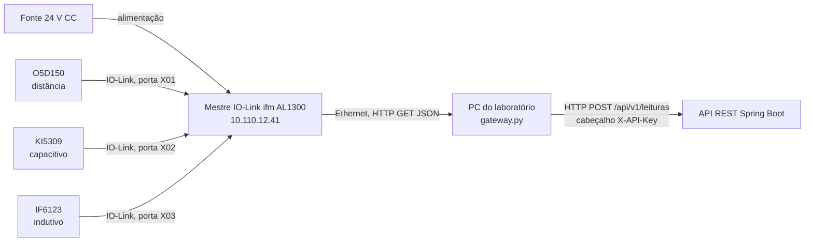

# Automação Industrial — Gateway IO-Link

Camada de Automação Industrial da esteira de triagem MetalTech: os sensores e onde estão ligados, como os sinais viram dados e como esses dados chegam à API REST. O programa que faz a aquisição e o envio é o [`gateway.py`](gateway.py).

Os modelos e as versões abaixo foram lidos do próprio mestre IO-Link (`/deviceinfo/...` e `/iolinkmaster/port[n]/iolinkdevice/productname`) em 12/11/2026.

## 1. Componentes

| Item | Modelo (fabricante ifm) | Função na esteira |
|---|---|---|
| Mestre IO-Link | **AL1300** (firmware `AL1x0x_cn_pn_v2.0.35`, série 000174910031) | Concentra os sensores e expõe os dados por HTTP/JSON na rede local |
| Sensor de distância (óptico) | **O5D150** — porta **X01** | Mede a distância até o topo da pilha de peças no reservatório → nível (%) |
| Sensor capacitivo | **KI5309** — porta **X02** | Detecta a presença de peça de qualquer material |
| Sensor indutivo | **IF6123** — porta **X03** | Detecta peça metálica |
| PC do laboratório | Windows + Python 3 | Executa o `gateway.py` |

Todos os sensores se comunicam por **IO-Link** (vendor id 310 = ifm). As especificações elétricas e de alcance estão nas folhas de dados da ifm de cada modelo.

## 2. Ligações



- **Sensores → mestre:** cada sensor usa um cabo M12 de 3 fios no padrão IO-Link: pino 1 = L+ (24 V), pino 3 = L− (0 V), pino 4 = C/Q (dados IO-Link). O mestre alimenta os sensores pela própria porta.
- **Mestre → PC:** Ethernet na rede do laboratório. O mestre tem IP fixo `10.110.12.41`, e o PC precisa estar na mesma sub-rede.
- **PC → API:** HTTP na rede local (`api_url` no `config.json`). Em produção, HTTPS até a nuvem (ver [arquitetura_nuvem.md](../docs/arquitetura_nuvem.md)).

**Disposição na bancada:**
- O **indutivo** e o **capacitivo** ficam no mesmo ponto da esteira, com os campos de detecção sobrepostos. Por isso uma peça metálica aciona os dois ao mesmo tempo (seção 4).
- O **sensor de distância** fica sobre o reservatório de saída, apontado para baixo: quanto mais peças acumuladas, menor a distância medida.

## 3. Do sinal ao dado

O gateway lê os três sensores a cada 0,1 s (`intervalo_leitura_s`) com `GET /iolinkmaster/port[n]/iolinkdevice/pdin/getdata`. O valor de processo (PDin) vem em hexadecimal e é convertido para inteiro.

| Sensor | Valor bruto | Regra de conversão (`config.json`) |
|---|---|---|
| Indutivo (X03) | ~32736 (`0x7FE0`) sem metal; cai com metal próximo | Liga em ≤ 20000 e desliga em > 25000 (histerese) |
| Capacitivo (X02) | Sobe com peça presente | Liga em ≥ 1500 e desliga em < 1000 (histerese) |
| Distância (X01) | 833 = reservatório vazio, 80 = cheio (unidade do sensor), na calibração de 12/11 | `nível % = (vazio − bruto) / (vazio − cheio) × 100`, limitado a 0–100, sobre a mediana das últimas 5 leituras |

A histerese evita que o sensor fique ligando e desligando quando o valor oscila perto do limite. A mediana de 5 amostras filtra leituras isoladas erradas do sensor de distância.

## 4. Classificação e envio

1. Quando o indutivo ou o capacitivo liga, o gateway abre uma **janela de 0,5 s** e registra tudo o que cada sensor viu nesse intervalo.
2. No fim da janela, classifica a peça:
   - indutivo acionado → `METALICA`. O capacitivo também reage a metal, então quem decide é o indutivo;
   - só o capacitivo → `NAO_METALICA`;
   - nenhum → `DESCONHECIDA`.
3. Monta o JSON do [contrato da API](../backend/README.md#2-enviar-leitura) e coloca na fila de envio. Só envia de novo depois que os sensores liberam, ou seja, **uma peça gera uma leitura**.
4. Uma thread separada faz o `POST`. Se a API estiver fora do ar, as leituras ficam na fila (até 5000) e são reenviadas quando ela voltar. Isso aconteceu no teste de 12/11, quando o back-end ficou 15 s fora e nenhuma peça foi perdida.

O back-end refaz a classificação a partir dos sensores e recalcula o status do reservatório (20 / 80 / 95 %), então o resultado não depende só do gateway.

## 5. Instalação e configuração

Só funciona num PC ligado à rede do mestre IO-Link e com o back-end no ar.

```powershell
cd automacao
python -m venv .venv
.\.venv\Scripts\python -m pip install -r requirements.txt
Copy-Item .\config.example.json .\config.json    # só se o config.json não existir
```

Rode sempre com `.\.venv\Scripts\python`. Com `py` ou `python` direto, o `requests` não é encontrado, porque está instalado só no `.venv`.

Campos principais do `config.json` (modelo em [config.example.json](config.example.json)):

| Campo | O que é |
|---|---|
| `mestre_url` | Endereço do mestre IO-Link (`http://10.110.12.41`) |
| `api_url` | `http://localhost:8080/api/v1/leituras` quando o gateway roda no mesmo PC do back-end |
| `api_key` | Mesmo valor do `API_KEY` do `.env` do back-end. Vai no cabeçalho `X-API-Key`. Chave diferente ou ausente → `API recusou (401)` |
| `portas` | Porta de cada sensor. No laboratório: distância `1`, capacitivo `2`, indutivo `3` |
| `sensores` | Limiares com histerese do capacitivo e do indutivo |
| `distancia.vazio_raw` / `cheio_raw` | Calibração do nível. Os valores do exemplo são só ilustrativos: meça na bancada (seção 7) |
| `nivel` | Limiares de status (80 / 95 / 20 %), iguais aos do back-end |
| `heartbeat_s` | `0` = envia só quando uma peça passa |

**Conferir as portas.** Com a esteira vazia, rode `--sondar`. O indutivo livre lê um valor alto (cerca de `32736`) e o capacitivo livre lê um valor baixo (abaixo de `1000`). Se aparecer o contrário, as portas estão trocadas no `config.json`. Nesse caso, o gateway enxerga "metal e não metal ao mesmo tempo" mesmo sem peça e envia uma leitura falsa ao iniciar.

## 6. Execução

```powershell
.\.venv\Scripts\python gateway.py --sondar              # valor bruto de cada porta (comece por aqui)
.\.venv\Scripts\python gateway.py --sondar --continuo   # repete a cada segundo: aproxime uma peça e veja os valores mudarem
.\.venv\Scripts\python gateway.py --dry-run             # fluxo completo, imprime o JSON em vez de enviar
.\.venv\Scripts\python gateway.py                       # envio real, em loop (Ctrl+C para parar)
```

Ao iniciar, o gateway mostra `gateway iniciado` e `aguardando pecas` e fica quieto até uma peça passar. Aí aparecem `peca detectada`, `classificada: METALICA (na janela: indutivo=True capacitivo=True)` e `enviado: METALICA | nivel ... | HTTP 201`.

**Como confirmar que funcionou:** passe uma peça, rode `curl.exe http://localhost:8080/api/v1/leituras/estatisticas` e veja a contagem subir no dashboard.

### Em contêiner (servidor do laboratório)

O gateway pode rodar como o serviço `gateway` do `compose.yaml` da raiz (profile `esteira`). Ele religa sozinho se cair ou se o servidor reiniciar.

```powershell
# na raiz do repositório
Copy-Item automacao\config.example.json automacao\config.json   # ajuste mestre_url, portas e calibração
docker compose --profile esteira up -d --build
docker compose logs -f gateway
docker compose --profile esteira run --rm gateway --sondar       # diagnóstico das portas
```

- Crie o `automacao/config.json` **antes** de subir. Se ele não existir, o Docker cria uma pasta com esse nome e o gateway não inicia. Nesse caso, apague a pasta e crie o arquivo.
- Para o gateway subir junto com o `docker compose up -d`, coloque `COMPOSE_PROFILES=esteira` no `.env` do servidor.
- A fila de reenvio fica na memória: protege contra a API fora do ar, mas se perde se o próprio contêiner do gateway reiniciar.

Variáveis de ambiente preenchidas têm prioridade sobre o `config.json`:

| Variável | Substitui | No compose |
|---|---|---|
| `GATEWAY_API_URL` | `api_url` | `http://backend:8080/api/v1/leituras` |
| `GATEWAY_API_KEY` | `api_key` | `API_KEY` do `.env` |
| `GATEWAY_MESTRE_URL` | `mestre_url` | `GATEWAY_MESTRE_URL` do `.env` (vazio = usa o arquivo) |

## 7. Calibração

- **Indutivo e capacitivo:** passe peças metálicas e plásticas com `--sondar --continuo`, anote os valores e ajuste `sensores` no `config.json`.
- **Nível:** com o reservatório vazio, leia a porta 1 no `--sondar` e anote em `distancia.vazio_raw`. Com ele cheio, anote em `distancia.cheio_raw`. Se a leitura real ficar fora dessa faixa, o nível trava em 0% (ou 100%) e a API gera alertas de reservatório baixo ou alto sem motivo.

### Problema conhecido: porta X01 com `IO-Link code 530`

Nos testes de 12/11, a porta do sensor de distância respondeu com `code 530` várias vezes por minuto, e o nível medido pulou entre 0% e 95% em leituras próximas. Na API JSON dos mestres ifm, esse código indica que o dado de processo do sensor não é válido no momento. É o caso típico de sensor óptico sem alvo dentro da faixa (feixe sem reflexo ou peça fora do alcance).

Enquanto a porta falha, o gateway mantém a última leitura válida, e a falha de uma porta não derruba as outras. A causa, porém, é física. Verifique:

- o alinhamento do O5D150 com o fundo do reservatório;
- se a distância vazia está dentro do alcance do sensor;
- o cabo M12 da porta X01;
- se há superfícies brilhantes ou inclinadas que desviam o feixe.

## 8. Solução de problemas

| Sintoma | Causa provável | Solução |
|---|---|---|
| `FileNotFoundError: ... 'config.json'` | Arquivo de configuração não criado | `Copy-Item .\config.example.json .\config.json` |
| `config: preencha distancia.vazio_raw e distancia.cheio_raw` | Calibração vazia | Preencha os dois valores (seção 7) |
| `No module named 'requests'` | Rodou com o Python global | Use `.\.venv\Scripts\python gateway.py` |
| Porta com erro no `--sondar` | Sensor desconectado, porta errada ou mestre fora da rede | Confira cabo, porta no `config.json` e `ping 10.110.12.41` |
| Leitura `METALICA` com a esteira vazia | Portas do indutivo e do capacitivo trocadas | Confira com `--sondar` (seção 5) |
| Parado em `aguardando pecas` | Normal: só envia quando uma peça passa | Passe uma peça |
| Nível sempre 0% e alerta de reservatório baixo | `vazio_raw`/`cheio_raw` fora da faixa real | Recalibre (seção 7) |
| `falha ao enviar` | API inacessível | Back-end no ar? Firewall liberando a porta 8080? |
| `API recusou (401)` | `api_key` diferente do `API_KEY` do back-end | Use o mesmo valor nos dois |
