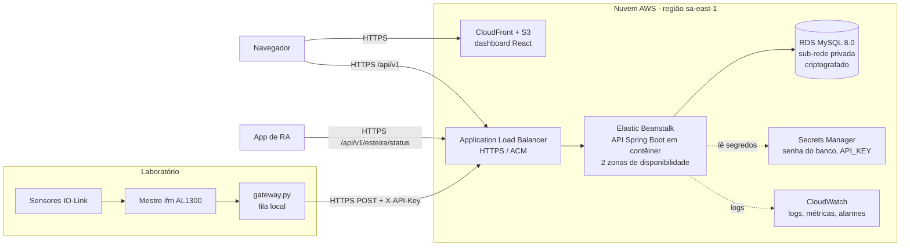

# Arquitetura de Nuvem — MetalTech

Este documento define onde e como a plataforma MetalTech é hospedada: o modelo de serviço escolhido e por quê, as práticas de segurança e a estratégia de disponibilidade e escalabilidade. A implementação de referência usa a **AWS**. A tabela da seção 3 mostra os equivalentes no Azure, caso a equipe use outra conta.

## 1. Visão geral

| Camada | Onde roda | Observação |
|---|---|---|
| Aquisição (gateway) | PC do laboratório (borda) | Precisa estar na mesma rede do mestre IO-Link. Envia para a nuvem por HTTPS |
| API REST | AWS Elastic Beanstalk (plataforma Docker) | Usa o mesmo `backend/Dockerfile` do ambiente local |
| Banco de dados | Amazon RDS for MySQL 8.0 | As migrations Flyway rodam sozinhas quando a API sobe |
| Dashboard | Amazon S3 + CloudFront | Arquivos estáticos do `npm run build`, com `VITE_API_URL` apontando para a API |
| RA | Dispositivo móvel | Consome a mesma API por HTTPS |

## 2. Modelo de serviço: PaaS

| Modelo | Como seria | Por que não / por que sim |
|---|---|---|
| IaaS (EC2 + MySQL instalado na VM) | A equipe instala Java, MySQL, proxy e certificado na VM | Dá controle total, mas a equipe passa a cuidar de patches do SO, backup, failover e TLS. É muita operação para uma equipe de 4 pessoas |
| **PaaS (Elastic Beanstalk + RDS)** | A equipe entrega o contêiner, e a AWS cuida de SO, balanceador, escala, backup e failover do banco | **Escolhido.** A aplicação já é empacotada em Docker, e a API é *stateless*, então pode escalar horizontalmente. O banco gerenciado já vem com backup, criptografia e Multi-AZ |
| SaaS | Usar um produto pronto de IoT/dashboard | Não atende: a regra de negócio (classificação, alertas, critério da CIDA) e a API comum entre as disciplinas são próprias do projeto |

Por que PaaS em resumo: é o modelo com menor esforço de operação que ainda roda o código próprio da equipe sem alteração. A mesma imagem Docker roda no `docker compose` local e na nuvem.

## 3. Serviços e equivalentes

| Função | AWS (referência) | Azure (alternativa) |
|---|---|---|
| Hospedar a API | Elastic Beanstalk (Docker) | App Service for Containers |
| Banco MySQL gerenciado | RDS for MySQL | Azure Database for MySQL — Flexible Server |
| Front-end estático + CDN | S3 + CloudFront | Static Web Apps |
| Certificado TLS | AWS Certificate Manager | Certificado gerenciado do App Service |
| Segredos | Secrets Manager | Key Vault |
| Logs e alarmes | CloudWatch | Azure Monitor / Application Insights |
| Identidade da equipe | IAM (com MFA) | Microsoft Entra ID |

## 4. Segurança

### 4.1 Controle de usuários e de acesso

- **Equipe na nuvem:** cada integrante tem um usuário IAM próprio, com MFA obrigatório e permissões mínimas (quem só publica a API não altera o banco). A conta raiz não é usada no dia a dia.
- **Usuários da plataforma:** a API tem cadastro de usuários com perfis (`ADMINISTRADOR`, `OPERADOR`, `VISUALIZADOR`) em `/api/v1/usuarios`. Cada perfil define o que o usuário pode fazer (resolver alertas, gerenciar usuários).
- **Dispositivo:** o `POST /api/v1/leituras` exige o cabeçalho `X-API-Key` quando a variável `API_KEY` está definida. A chave fica no Secrets Manager, não no código.
- **Rede:**
  - o RDS fica em sub-rede privada, sem IP público;
  - o *security group* do banco só aceita a porta 3306 vinda do *security group* da API;
  - a API só recebe tráfego do balanceador.
- **CORS:** `CORS_ORIGENS` restringe as chamadas do navegador ao domínio do dashboard (em produção, nunca `*`).

> **Próximo passo de segurança (fora do escopo desta entrega):** login dos usuários com token (Amazon Cognito ou Spring Security + JWT), para que os perfis passem a ser exigidos em cada endpoint. Hoje os perfis estão modelados e expostos pela API, mas as rotas de consulta são abertas.

### 4.2 Criptografia

| Onde | Como |
|---|---|
| Em trânsito | HTTPS em tudo que sai do laboratório (gateway → API, navegador → API/CloudFront, RA → API), com certificado do ACM. O balanceador redireciona HTTP para HTTPS. Entre API e RDS, TLS na conexão JDBC (`useSSL=true` em produção) |
| Em repouso | RDS com criptografia AES-256 via KMS (inclui backups e snapshots). Bucket S3 com criptografia padrão. Segredos no Secrets Manager, também criptografados com KMS |

### 4.3 Configuração da API em produção

| Variável | Valor em produção |
|---|---|
| `DB_URL` | Endpoint do RDS com `useSSL=true` |
| `DB_USERNAME` / `DB_PASSWORD` | Usuário próprio da aplicação (não o root), lido do Secrets Manager |
| `API_KEY` | Chave longa e aleatória. A mesma vai no `api_key` do `config.json` do gateway |
| `CORS_ORIGENS` | `https://<domínio-do-dashboard>` |

## 5. Disponibilidade

- **API:** Elastic Beanstalk com balanceador e no mínimo 2 instâncias em zonas de disponibilidade diferentes. O balanceador verifica `GET /actuator/health` e tira do ar a instância que falhar.
- **Banco:**
  - RDS Multi-AZ, com réplica síncrona e failover automático em outra zona;
  - backups automáticos diários, retidos por 7 dias, com restauração para qualquer ponto no tempo nesse período.
- **Borda:** se a nuvem ou a internet cair, o gateway guarda as leituras numa fila local (até 5000) e reenvia quando a API voltar. Isso foi testado em 12/11/2026: a API ficou fora por cerca de 15 s e nenhuma peça foi perdida.
- **Front-end:** servido pelo CloudFront a partir do S3, sem servidor próprio para cair. O CloudFront deve devolver `index.html` para as rotas do React (`/analise`, `/ocorrencias`, `/usuarios`).
- **Monitoramento:** alarmes do CloudWatch para instância sem saúde, CPU acima de 80%, conexões do RDS perto do limite e erros 5xx no balanceador.

## 6. Escalabilidade

- **Horizontal na API:** a API não guarda sessão em memória, então qualquer instância atende qualquer requisição. O *auto scaling* aumenta de 2 para até 4 instâncias quando a CPU média passa de 70%.
- **Banco:**
  - escala vertical (tipo de instância maior) quando necessário;
  - réplica de leitura para as consultas do dashboard e da RA, se o volume crescer;
  - as tabelas já têm índices por data, tipo de peça, status e dispositivo.
- **Mais esteiras:** cada esteira é um gateway com `dispositivo_id` próprio. A API e o banco já separam leituras e alertas por dispositivo.
- **Volume esperado:** uma esteira gera cerca de 60 peças por hora (relatório da CIDA), ou seja, cerca de 1.500 leituras por dia. Isso é baixo para uma instância pequena. A escala é uma reserva para mais esteiras, não uma necessidade atual.

## 7. Aspectos econômicos

- **Pagamento por uso, sem investimento inicial em servidores.** O custo vem das horas de instância (API e banco), do armazenamento do RDS e do tráfego de saída.
- **Fase acadêmica / piloto:** 1 instância pequena da API e RDS *Single-AZ* de classe *micro*, que cabem no nível gratuito da AWS para contas novas (confira as condições atuais na AWS). Custo próximo de zero.
- **Produção:** 2 instâncias, RDS Multi-AZ e CloudFront. O Multi-AZ praticamente dobra o custo do banco: é o preço da disponibilidade. Estime os valores na [AWS Pricing Calculator](https://calculator.aws/) antes de contratar.
- **Redução de custo:**
  - desligar os ambientes de teste fora do horário de aula;
  - *Savings Plans* ou instâncias reservadas, se o uso for contínuo;
  - alarmes de orçamento (AWS Budgets) para não haver surpresas na fatura.
- **Contrato:** o modelo de responsabilidade compartilhada vale aqui. A AWS responde pela infraestrutura física, pelo SO e pela plataforma gerenciada. A equipe responde pelo código, pelos dados, pelos usuários IAM e pela configuração de segurança.

## 8. Passo a passo da implantação

1. Criar o RDS MySQL 8.0 (sub-rede privada, criptografia ligada, backup de 7 dias) e um usuário próprio para a aplicação.
2. Guardar a senha do banco e a `API_KEY` no Secrets Manager.
3. Criar o ambiente Elastic Beanstalk com plataforma Docker, enviando o conteúdo de `backend/` (com o `Dockerfile`). Configurar as variáveis da seção 4.3 e o *health check* em `/actuator/health`.
4. Emitir o certificado no ACM e ativar HTTPS no balanceador.
5. Gerar o front com `VITE_API_URL=https://<api>`, executar `npm run build`, enviar `dist/` para o S3 e publicar pelo CloudFront.
6. No laboratório, trocar `api_url` e `api_key` no `automacao/config.json` e reiniciar o gateway.
7. Validar: `GET https://<api>/actuator/health`, passar uma peça na esteira e conferir no dashboard e na RA.
