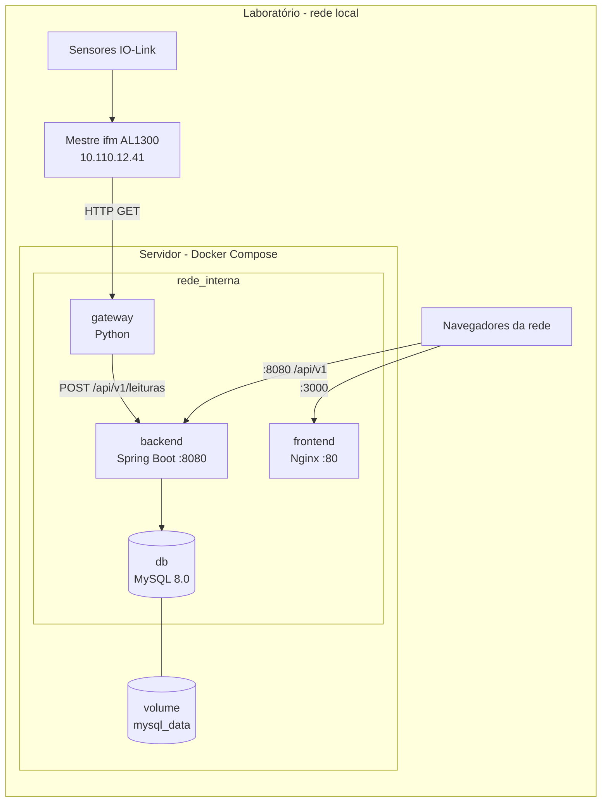
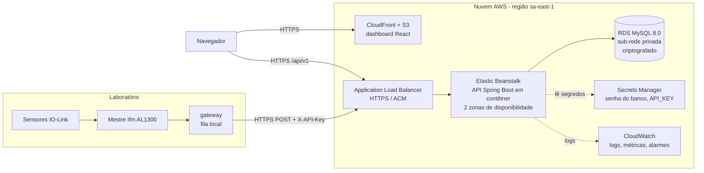

# Arquitetura de Nuvem — MetalTech

Este documento define onde e como a plataforma MetalTech é hospedada, com o modelo de serviço escolhido e o motivo, as práticas de segurança e a estratégia de disponibilidade e escalabilidade. Ele trata de dois cenários:

| Cenário | Situação | Seção |
|---|---|---|
| **Implantação atual:** servidor local em Docker, na rede do laboratório | **Em operação.** É o que roda na demonstração | [2](#2-implantação-atual-servidor-local-em-docker) |
| **Arquitetura proposta para produção:** AWS, modelo PaaS | Projetada e justificada, ainda não contratada | [3](#3-arquitetura-proposta-para-produção-aws-paas) |

Os dois cenários usam **as mesmas imagens Docker** (`backend/Dockerfile`, `frontend/Dockerfile`, `automacao/Dockerfile`). Migrar do servidor local para a nuvem não exige mudar o código, só onde os contêineres rodam e de onde vêm os segredos.

## 1. Visão geral

| Camada | Onde roda hoje (servidor local) | Onde rodaria em produção (AWS) |
|---|---|---|
| Aquisição (gateway IO-Link) | Contêiner `gateway` no servidor | Servidor ou PC do laboratório (borda), enviando para a nuvem por HTTPS |
| API REST (Spring Boot) | Contêiner `backend` | Elastic Beanstalk (plataforma Docker) |
| Banco de dados | Contêiner `db` (MySQL 8.0) com volume `mysql_data` | Amazon RDS for MySQL 8.0 |
| Dashboard (React) | Contêiner `frontend` (Nginx) | Amazon S3 + CloudFront |
| Ciência de Dados | Contêiner `dados`, sob demanda | PC da equipe, consumindo a API |
| App de RA | Página estática no celular. É independente e usa **dados simulados**: não consome a API | Igual (hospedagem estática) |

O gateway fica sempre no laboratório, nos dois cenários: ele precisa estar na mesma rede do mestre IO-Link (`10.110.12.41`), que não é acessível pela internet.

## 2. Implantação atual: servidor local em Docker

A plataforma roda num servidor (PC) da rede do laboratório com Docker Compose (`compose.yaml` na raiz). Qualquer computador ou celular da rede acessa o dashboard pelo IP do servidor.



### 2.1 Serviços

| Serviço | Imagem | Porta publicada | Função |
|---|---|---|---|
| `db` | `mysql:8.0` | `127.0.0.1:3307`, **só no próprio servidor** | Banco. O `db/init.sql` roda na primeira subida (charset `utf8mb4`). As tabelas vêm das migrações Flyway da API |
| `backend` | `backend/Dockerfile` (Java 17, JRE Alpine, usuário sem root) | `8080` | API REST e health check em `/actuator/health` |
| `frontend` | `frontend/Dockerfile` (build Node 22, Nginx) | `3000` | Dashboard. Chama a API no mesmo host, porta 8080 |
| `gateway` | `automacao/Dockerfile` (Python 3.13 slim, usuário sem root) | nenhuma | Lê os sensores e envia para a API pela rede interna (`http://backend:8080`). Profile `esteira` |
| `dados` | `dados/Dockerfile` | nenhuma | Scripts de análise, rodados sob demanda (`docker compose run --rm dados ...`). Profile `dados` |

### 2.2 Modelo de serviço e virtualização

No servidor local, a equipe opera **toda a pilha**: hardware, sistema operacional, Docker, banco e aplicação. Na prática é um ambiente **on-premise autogerenciado**, o mesmo nível de responsabilidade de um **IaaS**, mas em máquina própria. Foi escolhido para a fase acadêmica porque tem custo zero, fica na mesma rede dos sensores e não depende de contratar uma conta de nuvem.

A **virtualização de recursos** é feita por **contêineres**, que virtualizam no nível do sistema operacional:

- cada serviço roda isolado, com seu próprio sistema de arquivos, processos e rede, mas compartilhando o kernel do host. Por isso sobe em segundos e usa bem menos memória que uma máquina virtual por serviço;
- a rede `rede_interna` (bridge) é uma rede virtual: os contêineres se encontram pelo nome do serviço (`db`, `backend`) sem expor portas internas;
- o volume `mysql_data` separa os dados do ciclo de vida do contêiner: o banco pode ser recriado ou atualizado sem perder as leituras;
- no Windows, o Docker Desktop roda esses contêineres dentro de uma máquina virtual Linux leve (WSL 2). Há, portanto, as duas camadas: VM (hipervisor) e contêineres por cima.

Na nuvem (seção 3), a mesma ideia continua: o Elastic Beanstalk roda os mesmos contêineres em instâncias EC2, que são máquinas virtuais gerenciadas pela AWS.

### 2.3 Segurança aplicada

| Prática | Como está no servidor local |
|---|---|
| Banco isolado da rede | O MySQL só é publicado em `127.0.0.1:3307`. Outras máquinas não alcançam o banco. A API fala com ele pela rede interna |
| Credenciais fora do código | Senhas do banco e `API_KEY` ficam no `.env`, que não vai para o Git. O compose recusa subir sem as senhas |
| Usuário próprio da aplicação | A API usa `MYSQL_USER` com acesso só ao banco `metaltech`. O root fica só para administração |
| Contêineres sem root | API e gateway rodam com usuário sem privilégios dentro do contêiner |
| Chave do dispositivo | Com `API_KEY` preenchida no `.env`, o `POST /api/v1/leituras` exige o cabeçalho `X-API-Key`. O compose entrega a mesma chave ao gateway (`GATEWAY_API_KEY`) |
| Superfície mínima | Gateway e `dados` não publicam portas. Só `3000` (dashboard) e `8080` (API) ficam visíveis na rede |
| Usuários da plataforma | Cadastro com perfis (`ADMINISTRADOR`, `OPERADOR`, `VISUALIZADOR`) em `/api/v1/usuarios` |

**Limitações conhecidas (e como a produção resolve):**

- **Controle de acesso por usuário ainda não é exigido nas rotas.** Os perfis existem, mas não há login: qualquer máquina da rede do laboratório pode consultar e alterar dados pela API. No servidor local, o risco fica restrito à rede interna do laboratório. Próximo passo: login com token (Spring Security + JWT, ou Amazon Cognito em produção).
- **Sem criptografia em trânsito na rede local:** o tráfego é HTTP dentro da LAN. Em produção, HTTPS em tudo (seção 3.4).
- **Sem criptografia em repouso própria:** o volume do MySQL fica no disco do servidor. Mitigação local: criptografia de disco do sistema operacional (BitLocker). Em produção, RDS com KMS.
- **Recomendado antes da demonstração:** preencher `API_KEY` no `.env` com uma chave longa e aleatória e rodar `docker compose up -d` (a API e o gateway passam a usar a mesma chave).

### 2.4 Disponibilidade

| Mecanismo | O que garante |
|---|---|
| `restart: unless-stopped` em todos os serviços | Se um contêiner cair, ou se o servidor reiniciar com o Docker ligado, ele volta sozinho |
| Healthchecks | `db`: `mysqladmin ping`. `backend`: `/actuator/health` precisa responder `UP`. `frontend`: Nginx respondendo. `docker compose ps` mostra `healthy` |
| Ordem de subida | A API só sobe com o banco `healthy`, e o gateway só sobe com a API `healthy` (`depends_on: condition: service_healthy`) |
| Volume persistente `mysql_data` | Os dados sobrevivem a `docker compose down`, a reinícios e à recriação dos contêineres. Só `docker compose down -v` apaga o banco |
| Fila no gateway | Se a API ficar fora do ar, o gateway guarda até 5000 leituras na memória e reenvia quando ela voltar (testado em 12/11/2026: 15 s fora, nenhuma peça perdida). A fila se perde se o próprio contêiner do gateway reiniciar |
| Falha parcial de sensor | Se uma porta do mestre falhar, o gateway mantém o último valor válido e as outras portas continuam |

**Backup manual** (recomendado antes da apresentação e periodicamente):

```powershell
docker exec metaltech-db sh -c 'mysqldump -uroot -p"$MYSQL_ROOT_PASSWORD" metaltech' > backup_metaltech.sql
# restaurar:
Get-Content backup_metaltech.sql | docker exec -i metaltech-db sh -c 'mysql -uroot -p"$MYSQL_ROOT_PASSWORD" metaltech'
```

**Limitação:** há **um único servidor**. Se ele desligar, a plataforma para (as leituras feitas nesse intervalo se perdem, porque o gateway roda no mesmo servidor). Alta disponibilidade de verdade exige mais de uma máquina, o que é o papel da arquitetura de produção.

### 2.5 Escalabilidade

- **Volume atual:** cerca de 60 peças por hora (relatório da CIDA), ou seja, ~1.500 leituras por dia. Um único servidor atende com folga.
- **Escala vertical:** aumentar CPU, memória ou disco do servidor.
- **Mais esteiras:** cada esteira ganha um gateway com `dispositivo_id` próprio. A API e o banco já separam leituras e alertas por dispositivo, e as tabelas têm índices por data, tipo de peça, status e dispositivo.
- **Limite:** escalar horizontalmente (várias instâncias da API atrás de um balanceador) não faz sentido em uma só máquina. Esse é o ponto em que a migração para a nuvem compensa.

### 2.6 Operação

```powershell
Copy-Item .env.example .env            # uma vez; defina as senhas (e COMPOSE_PROFILES=esteira)
docker compose up -d --build           # sobe tudo
docker compose ps                      # todos "Up" e "healthy"
docker compose logs -f backend         # logs da API (idem gateway, db, frontend)
docker compose stop / up -d            # parar e voltar sem perder dados
```

Acesso pela rede: dashboard em `http://<ip-do-servidor>:3000` e API em `http://<ip-do-servidor>:8080/api/v1`. Se outro computador não abrir, libere as portas 3000 e 8080 no firewall do Windows do servidor (rede privada).

## 3. Arquitetura proposta para produção: AWS (PaaS)

Quando a plataforma precisar ficar disponível fora do laboratório, com alta disponibilidade, a proposta é migrar API, banco e dashboard para a **AWS** no modelo **PaaS**. A tabela da seção 3.2 mostra os equivalentes no Azure.



### 3.1 Modelo de serviço: PaaS

| Modelo | Como seria | Por que não / por que sim |
|---|---|---|
| IaaS (EC2 + MySQL instalado na VM) | A equipe instala Java, MySQL, proxy e certificado na VM | Dá controle total, mas a equipe passa a cuidar de patches do SO, backup, failover e TLS. É o que já fazemos no servidor local, e não escala bem para uma equipe de 4 pessoas |
| **PaaS (Elastic Beanstalk + RDS)** | A equipe entrega o contêiner, e a AWS cuida de SO, balanceador, escala, backup e failover do banco | **Escolhido.** A aplicação já é empacotada em Docker, e a API é *stateless*, então pode escalar horizontalmente. O banco gerenciado já vem com backup, criptografia e Multi-AZ |
| SaaS | Usar um produto pronto de IoT/dashboard | Não atende: a regra de negócio (classificação, alertas, critério da CIDA) e a API comum entre as disciplinas são próprias do projeto |

Por que PaaS, em resumo: é o modelo com menor esforço de operação que ainda roda o código próprio da equipe sem alteração. A mesma imagem Docker do servidor local roda na nuvem.

### 3.2 Serviços e equivalentes

| Função | AWS (referência) | Azure (alternativa) |
|---|---|---|
| Hospedar a API | Elastic Beanstalk (Docker) | App Service for Containers |
| Banco MySQL gerenciado | RDS for MySQL | Azure Database for MySQL — Flexible Server |
| Front-end estático + CDN | S3 + CloudFront | Static Web Apps |
| Certificado TLS | AWS Certificate Manager | Certificado gerenciado do App Service |
| Segredos | Secrets Manager | Key Vault |
| Logs e alarmes | CloudWatch | Azure Monitor / Application Insights |
| Identidade da equipe | IAM (com MFA) | Microsoft Entra ID |

### 3.3 Controle de usuários e de acesso

- **Equipe na nuvem:** cada integrante tem um usuário IAM próprio, com MFA obrigatório e permissões mínimas (quem só publica a API não altera o banco). A conta raiz não é usada no dia a dia.
- **Usuários da plataforma:** os perfis (`ADMINISTRADOR`, `OPERADOR`, `VISUALIZADOR`) passam a ser exigidos em cada rota com login por token (Amazon Cognito ou Spring Security + JWT). Esse é pré-requisito para expor a API na internet, porque hoje as rotas de consulta e alteração são abertas.
- **Dispositivo:** o `POST /api/v1/leituras` exige `X-API-Key`. A chave fica no Secrets Manager, não no código.
- **Rede:**
  - o RDS fica em sub-rede privada, sem IP público;
  - o *security group* do banco só aceita a porta 3306 vinda do *security group* da API;
  - a API só recebe tráfego do balanceador.
- **CORS:** `CORS_ORIGENS` restringe as chamadas do navegador ao domínio do dashboard (em produção, nunca `*`).
- **Actuator:** em produção, expor só `health` (sem `metrics`) para não vazar informação interna.

### 3.4 Criptografia

| Onde | Como |
|---|---|
| Em trânsito | HTTPS em tudo que sai do laboratório (gateway → API, navegador → API/CloudFront), com certificado do ACM. O balanceador redireciona HTTP para HTTPS. Entre API e RDS, TLS na conexão JDBC (`useSSL=true`) |
| Em repouso | RDS com criptografia AES-256 via KMS (inclui backups e snapshots). Bucket S3 com criptografia padrão. Segredos no Secrets Manager, também criptografados com KMS |

### 3.5 Configuração da API em produção

| Variável | Valor em produção |
|---|---|
| `DB_URL` | Endpoint do RDS com `useSSL=true` |
| `DB_USERNAME` / `DB_PASSWORD` | Usuário próprio da aplicação (não o root), lido do Secrets Manager |
| `API_KEY` | Chave longa e aleatória. A mesma vai para o gateway (`GATEWAY_API_KEY` ou `api_key` no `config.json`) |
| `CORS_ORIGENS` | `https://<domínio-do-dashboard>` |

### 3.6 Disponibilidade

- **API:** Elastic Beanstalk com balanceador e no mínimo 2 instâncias em zonas de disponibilidade diferentes. O balanceador verifica `GET /actuator/health` e tira do ar a instância que falhar.
- **Banco:**
  - RDS Multi-AZ, com réplica síncrona e failover automático em outra zona;
  - backups automáticos diários, retidos por 7 dias, com restauração para qualquer ponto no tempo nesse período.
- **Borda:** se a internet cair, o gateway guarda as leituras na fila e reenvia quando a API voltar.
- **Front-end:** servido pelo CloudFront a partir do S3, sem servidor próprio para cair. O CloudFront deve devolver `index.html` para as rotas do React (`/analise`, `/ocorrencias`, `/usuarios`).
- **Monitoramento:** alarmes do CloudWatch para instância sem saúde, CPU acima de 80%, conexões do RDS perto do limite e erros 5xx no balanceador.

### 3.7 Escalabilidade

- **Horizontal na API:** a API não guarda sessão em memória, então qualquer instância atende qualquer requisição. O *auto scaling* aumenta de 2 para até 4 instâncias quando a CPU média passa de 70%.
- **Banco:** escala vertical (instância maior) e réplica de leitura para as consultas do dashboard, se o volume crescer.
- **Mais esteiras:** cada esteira é um gateway com `dispositivo_id` próprio, todos enviando para a mesma API.

### 3.8 Aspectos econômicos

| | Servidor local (atual) | AWS (proposta) |
|---|---|---|
| Investimento inicial | Nenhum (PC já existente) | Nenhum: pagamento por uso |
| Custo mensal | Energia do PC | Horas de instância (API e banco), armazenamento do RDS e tráfego de saída |
| Quem opera | A equipe, tudo (hardware, SO, Docker, backup) | A AWS cuida da infraestrutura e da plataforma; a equipe cuida do código, dos dados e da configuração de segurança (responsabilidade compartilhada) |
| Disponibilidade | Um servidor: se ele desligar, para | Multi-AZ, failover automático |

- **Fase piloto na AWS:** 1 instância pequena da API e RDS *Single-AZ* classe *micro*, que cabem no nível gratuito para contas novas (confira as condições atuais). Custo próximo de zero.
- **Produção:** 2 instâncias, RDS Multi-AZ e CloudFront. O Multi-AZ praticamente dobra o custo do banco: é o preço da disponibilidade. Estime na [AWS Pricing Calculator](https://calculator.aws/) antes de contratar.
- **Redução de custo:** desligar ambientes de teste fora do horário de aula, *Savings Plans* ou instâncias reservadas para uso contínuo, e alarmes de orçamento (AWS Budgets).

### 3.9 Passo a passo da migração

1. Criar o RDS MySQL 8.0 (sub-rede privada, criptografia ligada, backup de 7 dias) e um usuário próprio para a aplicação. Migrar os dados do servidor local com o `mysqldump` da seção 2.4.
2. Guardar a senha do banco e a `API_KEY` no Secrets Manager.
3. Criar o ambiente Elastic Beanstalk com plataforma Docker, enviando o conteúdo de `backend/` (com o `Dockerfile`). Configurar as variáveis da seção 3.5 e o *health check* em `/actuator/health`.
4. Emitir o certificado no ACM e ativar HTTPS no balanceador.
5. Gerar o front com `VITE_API_URL=https://<api>` (`npm run build` ou `docker build --build-arg VITE_API_URL=...`), enviar `dist/` para o S3 e publicar pelo CloudFront.
6. No laboratório, apontar o gateway para a nuvem (`GATEWAY_API_URL=https://<api>/api/v1/leituras` e a mesma `API_KEY`) e reiniciá-lo.
7. Validar: `GET https://<api>/actuator/health`, passar uma peça na esteira e conferir no dashboard.
