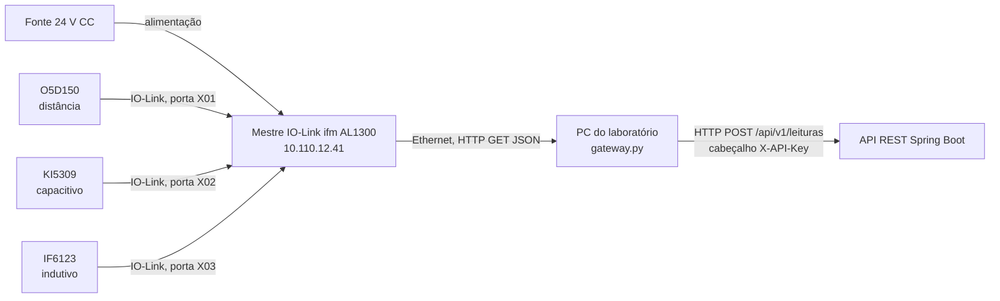

# Documentação do Circuito — Automação Industrial

Este documento descreve a camada de Automação Industrial da esteira de triagem MetalTech: os sensores e onde estão ligados, como os sinais viram dados e como esses dados chegam à API REST.

Os modelos e as versões abaixo foram lidos do próprio mestre IO-Link (`/deviceinfo/...` e `/iolinkmaster/port[n]/iolinkdevice/productname`) em 12/11/2026.

## 1. Componentes

| Item | Modelo (fabricante ifm) | Função na esteira |
|---|---|---|
| Mestre IO-Link | **AL1300** (firmware `AL1x0x_cn_pn_v2.0.35`, série 000174910031) | Concentra os sensores e expõe os dados por HTTP/JSON na rede local |
| Sensor de distância (óptico) | **O5D150** — porta **X01** | Mede a distância até o topo da pilha de peças no reservatório → nível (%) |
| Sensor capacitivo | **KI5309** — porta **X02** | Detecta a presença de peça de qualquer material |
| Sensor indutivo | **IF6123** — porta **X03** | Detecta peça metálica |
| PC do laboratório | Windows + Python 3 | Executa o `automacao/gateway.py`, que faz a aquisição e o envio |

Todos os sensores se comunicam por **IO-Link** (vendor id 310 = ifm). As especificações elétricas e de alcance estão nas folhas de dados da ifm de cada modelo.

## 2. Ligações



- **Sensores → mestre:** cada sensor usa um cabo M12 de 3 fios no padrão IO-Link: pino 1 = L+ (24 V), pino 3 = L− (0 V), pino 4 = C/Q (dados IO-Link). O mestre alimenta os sensores pela própria porta.
- **Mestre → PC:** Ethernet na rede do laboratório. O mestre tem IP fixo `10.110.12.41`, e o PC precisa estar na mesma sub-rede.
- **PC → API:** HTTP na rede local (`api_url` no `config.json`). Em produção, HTTPS até a nuvem (ver [arquitetura_nuvem.md](arquitetura_nuvem.md)).

### Disposição na bancada

- O **indutivo** e o **capacitivo** ficam no mesmo ponto da esteira, com os campos de detecção sobrepostos. Por isso uma peça metálica aciona os dois sensores ao mesmo tempo (seção 4).
- O **sensor de distância** fica sobre o reservatório de saída, apontado para baixo: quanto mais peças acumuladas, menor a distância medida.

## 3. Do sinal ao dado

O gateway lê os três sensores a cada 0,1 s (`intervalo_leitura_s`) com `GET /iolinkmaster/port[n]/iolinkdevice/pdin/getdata`. O valor de processo (PDin) vem em hexadecimal e é convertido para inteiro.

| Sensor | Valor bruto | Regra de conversão (`config.json`) |
|---|---|---|
| Indutivo (X03) | ~32736 (`0x7FE0`) sem metal; cai com metal próximo | Liga em ≤ 20000 e desliga em > 25000 (histerese) |
| Capacitivo (X02) | Sobe com peça presente | Liga em ≥ 1500 e desliga em < 1000 (histerese) |
| Distância (X01) | 833 = reservatório vazio, 80 = cheio (unidade do sensor) | `nível % = (833 − bruto) / (833 − 80) × 100`, limitado a 0–100, sobre a mediana das últimas 5 leituras |

A histerese evita que o sensor fique ligando e desligando quando o valor oscila perto do limite. A mediana de 5 amostras filtra leituras isoladas erradas do sensor de distância.

## 4. Classificação e envio

1. Quando o indutivo ou o capacitivo liga, o gateway abre uma **janela de 0,5 s** e registra tudo o que cada sensor viu nesse intervalo.
2. No fim da janela, classifica a peça:
   - indutivo acionado → `METALICA`. O capacitivo também reage a metal, então quem decide é o indutivo;
   - só o capacitivo → `NAO_METALICA`;
   - nenhum → `DESCONHECIDA`.
3. Monta o JSON do [contrato da API](contrato_api.md) e coloca na fila de envio. Só envia de novo depois que os sensores liberam, ou seja, **uma peça gera uma leitura**.
4. Uma thread separada faz o `POST`. Se a API estiver fora do ar, as leituras ficam na fila (até 5000) e são reenviadas quando ela voltar. Isso aconteceu no teste de 12/11, quando o back-end ficou 15 s fora e nenhuma peça foi perdida.

O back-end refaz a classificação a partir dos sensores e recalcula o status do reservatório (20 / 80 / 95 %), então o resultado não depende só do gateway.

## 5. Calibração e diagnóstico

```powershell
cd automacao
py .\gateway.py --sondar             # leitura crua de cada porta
py .\gateway.py --sondar --continuo  # repete a cada 1 s: passe uma peça e veja os valores mudarem
py .\gateway.py --dry-run            # roda tudo, mas imprime o JSON em vez de enviar
```

- **Limiares do indutivo e do capacitivo:** passe peças metálicas e plásticas com `--sondar --continuo`, anote os valores e ajuste `sensores` no `config.json`.
- **Nível:** com o reservatório vazio, anote o valor da porta 1 em `distancia.vazio_raw`. Com ele cheio, anote em `distancia.cheio_raw`.

### Problema conhecido: porta X01 com `IO-Link code 530`

Nos testes de 12/11, a porta do sensor de distância respondeu com `code 530` várias vezes por minuto, e o nível medido pulou entre 0% e 95% em leituras próximas. Na API JSON dos mestres ifm, esse código indica que o dado de processo do sensor não é válido no momento. É o caso típico de sensor óptico sem alvo dentro da faixa (feixe sem reflexo ou peça fora do alcance).

Enquanto a porta falha, o gateway mantém a última leitura válida, e a falha de uma porta não derruba as outras. A causa, porém, é física. Para resolver, verifique:

- o alinhamento do O5D150 com o fundo do reservatório;
- se a distância vazia está dentro do alcance do sensor;
- o cabo M12 da porta X01;
- se há superfícies brilhantes ou inclinadas que desviam o feixe.
