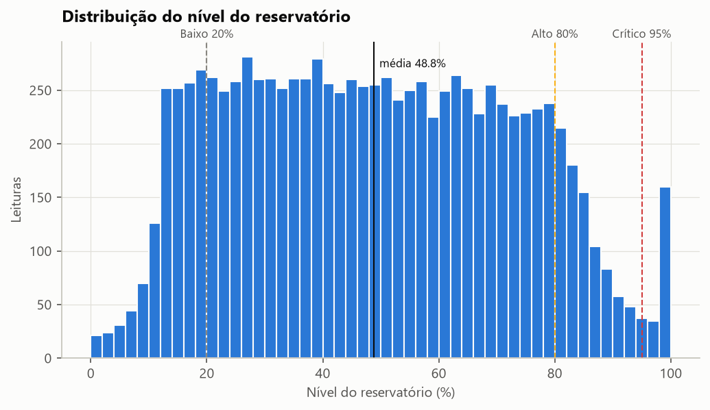
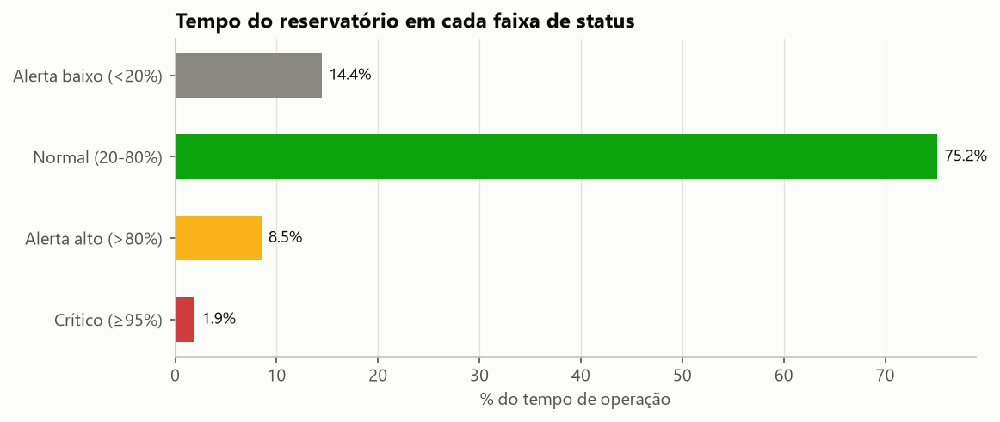
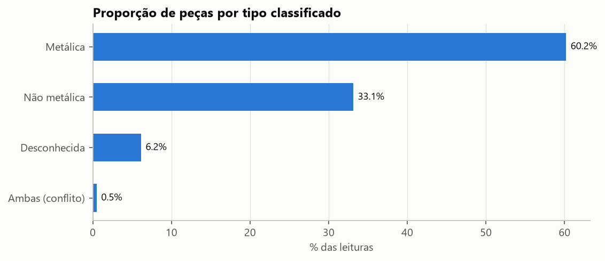
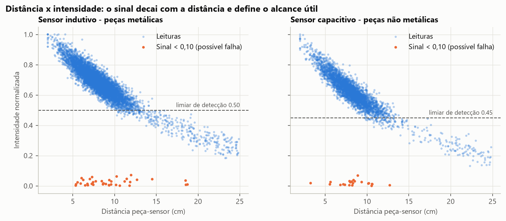
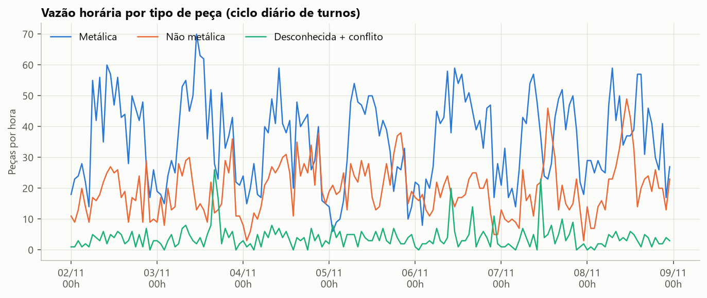
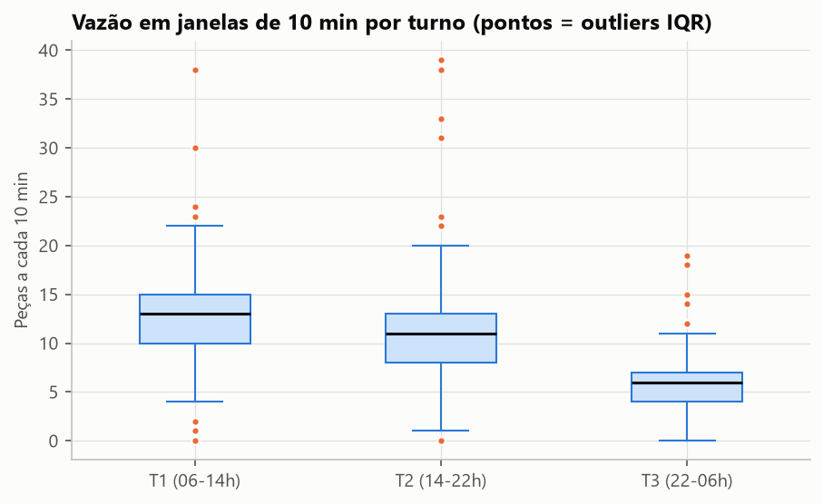
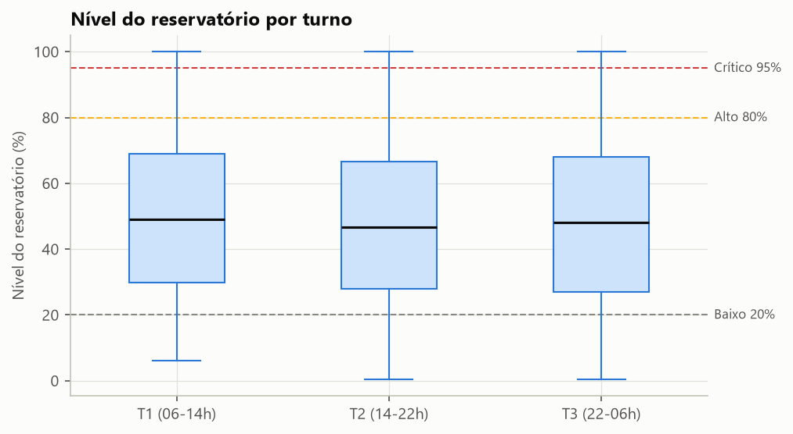
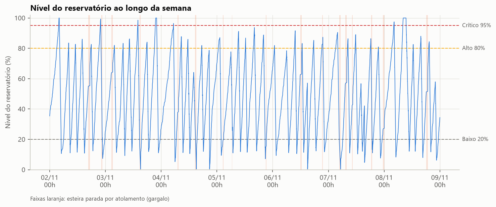
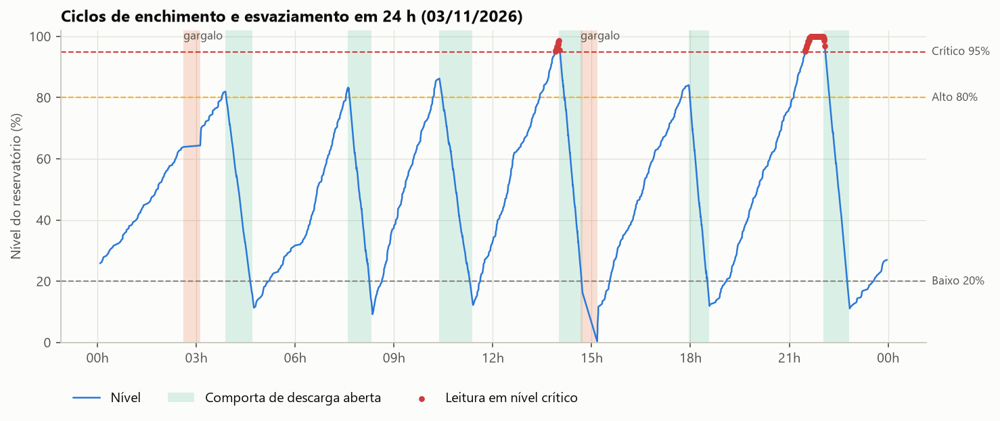
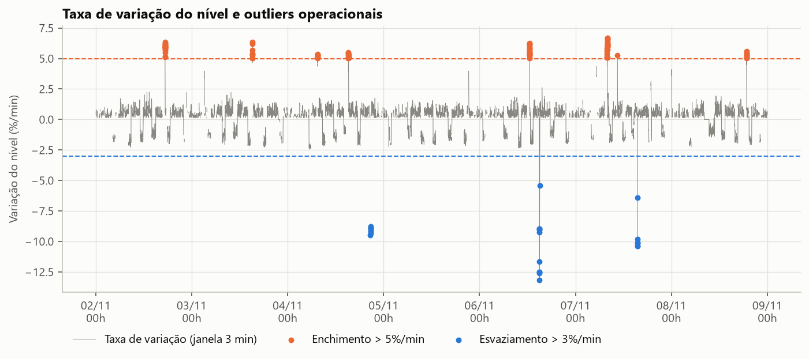

# Relatório Técnico de Ciência de Dados — MetalTech

**Projeto Integrador II — Monitoramento Industrial da Esteira de Triagem**
Frente: Ciência de Dados (CIDA) · Versão 1.0 · Novembro de 2026

---

## Resumo

Este relatório apresenta a análise estatística de uma semana simulada de operação da esteira de triagem MetalTech (9.965 leituras de sensores entre 02/11/2026 e 08/11/2026). Os dados foram gerados por uma simulação orientada a eventos, que reproduz turnos de produção, lotes, a física dos sensores e o ciclo de enchimento e esvaziamento do reservatório, além de cinco tipos de anomalia com rótulo conhecido. A análise calcula estatísticas descritivas, identifica padrões por turno e por ciclo, aplica quatro famílias de detectores de outliers (avaliados contra a verdade-terreno da simulação) e relaciona os achados com os alertas gerados pelo back-end. O dataset completo foi enviado à API REST real (MySQL 8.0) por requisições POST, e os indicadores calculados pela API coincidiram com os do pandas em 22 de 22 verificações.

Principais conclusões:

- O reservatório fica **75,2% do tempo em faixa normal** e **1,9% em faixa crítica**. Houve **3 episódios de transbordo** (nível em 100%).
- O turno T1, apesar de reagir mais rápido aos alertas, é o que mais tempo passa em nível crítico (**2,83%**, contra 1,48% em T2 e 1,49% em T3). A causa é a taxa de enchimento mais alta. Isso indica que o limiar fixo de 80% para acionar o esvaziamento é insuficiente nos horários de pico.
- **6,15% das peças** saem como DESCONHECIDA, e 79% delas passaram a mais de 12 cm dos sensores. É um problema de alinhamento mecânico, não de sensor.
- Os detectores por regra identificaram **100%** dos episódios de falha de conexão, deriva do capacitivo e esvaziamento brusco. O IQR da vazão de peças encontrou **15 de 17** gargalos.
- A regra de alerta do back-end produz ~21 alertas por dia. Quase metade são de **reservatório baixo** ao fim de cada esvaziamento, que é um evento esperado e gera ruído para o operador.

---

## 1. Introdução e objetivo

A esteira de triagem separa peças metálicas e não metálicas usando três sensores: **distância** (posição da peça), **indutivo** (detecta metal) e **capacitivo** (detecta não metal). As peças triadas caem em um reservatório cujo nível é monitorado continuamente. O back-end recebe cada leitura, classifica o status do reservatório (baixo < 20%, normal, alto > 80%, crítico ≥ 95%) e gera alertas.

O objetivo desta etapa é:

1. produzir um dataset sintético **reproduzível e plausível**, com padrões operacionais (e não ruído aleatório);
2. descrever estatisticamente o processo (nível, sensores, vazão de peças, classificação);
3. identificar outliers e interpretar o que cada um significa para a operação;
4. relacionar os achados com os alertas do sistema;
5. validar a integração da CIDA com a API REST.

---

## 2. Metodologia

### 2.1 Geração dos dados (`dados/gerar_dataset.py`)

Cada linha do dataset é uma peça passando pela estação de sensores. A simulação avança evento a evento (chegada de peças) com semente fixa (`seed = 42`), o que garante o mesmo CSV a cada execução.

| Componente | Modelo adotado | Justificativa operacional |
|---|---|---|
| Chegada de peças | Processo de Poisson com taxa por turno: T1 (06–14h) 1,30/min, T2 (14–22h) 1,10/min, T3 (22–06h) 0,60/min | Produção plena de dia e reduzida à noite |
| Mix de peças | Lotes de 2 a 6 h; fração metálica de cada lote ~ Beta(12, 7), média ≈ 63% | O mix muda conforme a ordem de produção |
| Distância peça–sensor | Normal(8 cm; 2 cm); 4% das peças desalinhadas, Uniforme(14; 25) cm | Peças tortas ou deslocadas na esteira |
| Intensidade dos sensores | Indutivo: 0,98·e^(−0,06·(d−2)) + ruído; capacitivo: 0,95·e^(−0,07·(d−2)) + ruído | Sensores de proximidade perdem sinal com a distância |
| Limiar de detecção | Indutivo ≥ 0,50; capacitivo ≥ 0,45 | Define o alcance útil (~13 cm) |
| Reservatório | Cada peça soma 0,40% (metálica) ou 0,46% (não metálica) do volume | O nível sobe gradativamente com a produção |
| Esvaziamento | Comporta controlada a ~2%/min até 12%. Aberta pelo operador após o alerta alto, com atraso exponencial de média 15 min (T1), 20 min (T2) ou 45 min (T3), e na troca de turno se o nível passar de 50% | Reação humana variável; equipe noturna menor |

**Anomalias injetadas** (rotuladas na coluna `evento_simulado` e listadas em `eventos_simulados.csv`):

| Anomalia | Ocorrências | Efeito nos dados |
|---|---|---|
| Gargalo (atolamento) | 17 episódios, 11–39 min (total de 7,7 h) | Nenhuma leitura durante a parada; depois, rajada de ~80% das peças represadas a ~12 peças/min |
| Deriva do capacitivo | 2 episódios, 127 e 146 min | O capacitivo passa a "ver" metal em 40% das peças metálicas → AMBAS |
| Falha de conexão | 7 episódios, 6–13 min | Os dois sensores com intensidade ≈ 0 → DESCONHECIDA |
| Esvaziamento brusco | 3 episódios | Descarga manual fora do procedimento, a 10–15%/min |

### 2.2 Análise (`dados/analise_estatistica.py`)

- **Descritiva:** média, mediana, desvio padrão amostral, quartis (interpolação linear), IQR, assimetria, curtose e coeficiente de variação.
- **Tempo em cada status:** cada leitura é ponderada pelo intervalo até a próxima. Isso evita superestimar períodos de produção intensa, que têm mais leituras por minuto.
- **Taxa de variação do nível:** inclinação em %/min dentro de uma janela móvel de 3 min, usando apenas leituras dentro da janela.
- **Ciclos do reservatório:** máquina de estados pico → vale com histerese (queda mínima de 25 pontos). Ela identificou 44 ciclos, exatamente o número de aberturas reais da comporta na simulação.
- **Outliers:** regras de negócio (R1–R4) do plano técnico, IQR da vazão de peças em janelas de 10 min (por turno) e z-score robusto (mediana/MAD) da taxa de variação.
- **Avaliação:** precisão por leitura e recall por episódio, comparados com `evento_simulado`.

---

## 3. Qualidade dos dados

| Verificação | Resultado |
|---|---|
| Valores ausentes | 0 |
| Nível fora de 0–100% / intensidade fora de 0–1 | 0 / 0 |
| Status inconsistente com a regra 20/80/95 | 0 |
| Intervalo mediano entre leituras | 37 s |
| Maior intervalo sem leituras | 39 min (gargalo) |
| Timestamps repetidos (mesmo segundo) | 122. São peças em rajada, não duplicatas: cada uma tem distância e nível próprios |

O dataset está consistente com o contrato da API e com as regras de domínio do back-end.

---

## 4. Estatística descritiva

### 4.1 Nível do reservatório

| Métrica | Valor |
|---|---|
| Média | 48,77% |
| Mediana | 47,94% |
| Desvio padrão | 23,64 p.p. |
| Q1 / Q3 (IQR) | 28,80% / 68,00% (39,20) |
| Mínimo / Máximo | 0,37% / 100,00% |
| Assimetria / Curtose | 0,14 / −0,97 |

Média e mediana próximas e curtose negativa indicam uma distribuição **achatada e quase simétrica**, típica de um processo de "dente de serra" que percorre toda a faixa de operação em vez de se concentrar num ponto de equilíbrio.



### 4.2 Status do reservatório

| Status | Leituras | % das leituras | % do tempo |
|---|---|---|---|
| Alerta baixo (< 20%) | 1.346 | 13,51% | 14,44% |
| Normal (20–80%) | 7.544 | 75,70% | 75,15% |
| Alerta alto (> 80%) | 857 | 8,60% | 8,48% |
| Crítico (≥ 95%) | 218 | 2,19% | 1,93% |



### 4.3 Tipos de peça

| Tipo | Quantidade | % |
|---|---|---|
| Metálica | 5.999 | 60,20% |
| Não metálica | 3.303 | 33,15% |
| Desconhecida | 613 | 6,15% |
| Ambas (conflito) | 50 | 0,50% |



A **acurácia de classificação** frente ao material real foi de **93,32%**. Os erros quase todos são omissões (peça não reconhecida), não trocas: só 3 peças metálicas foram classificadas como não metálicas.

### 4.4 Sensores

| Variável | Média | Mediana | Desvio | Q1 | Q3 |
|---|---|---|---|---|---|
| Distância (cm) | 8,46 | 8,11 | 3,04 | 6,72 | 9,58 |
| Intensidade indutivo | 0,455 | 0,607 | 0,309 | 0,075 | 0,706 |
| Intensidade capacitivo | 0,316 | 0,188 | 0,238 | 0,135 | 0,568 |

A distância tem assimetria positiva (2,15) por causa da cauda de peças desalinhadas. As intensidades são **bimodais**: valores altos quando o sensor reconhece o material e próximos de zero quando não reconhece. Por isso média e mediana divergem tanto, e a média sozinha não descreve bem essas variáveis.

A correlação entre distância e intensidade é forte e negativa: **r = −0,89** para o indutivo (peças metálicas) e **r = −0,89** para o capacitivo (não metálicas).



### 4.5 Vazão de peças e turnos

| Turno | Leituras | Peças/hora (média ± desvio) | Nível médio | % do tempo crítico |
|---|---|---|---|---|
| T1 (06–14h) | 4.275 | 76,3 ± 8,4 | 50,0% | **2,83%** |
| T2 (14–22h) | 3.701 | 66,1 ± 10,8 | 47,6% | 1,48% |
| T3 (22–06h) | 1.989 | 35,5 ± 7,0 | 48,3% | 1,49% |





---

## 5. Padrões de comportamento

### 5.1 Ciclo do reservatório



| Indicador | Valor |
|---|---|
| Ciclos de esvaziamento | 44 (6,3 por dia) |
| Tempo médio de enchimento (vale → pico) | 180 min (mediana de 164 min) |
| Duração média do esvaziamento | 46 min |
| Nível médio no início / fim do esvaziamento | 84,0% / 9,3% |
| Esvaziamentos iniciados com nível ≥ 95% | 7 (16%) |
| Esvaziamentos preventivos (iniciados ≤ 80%) | 8 (troca de turno) |

O nível tem um padrão claro de **dente de serra**: sobe de forma gradual e quase linear (~0,5%/min) e cai mais rápido quando a comporta abre (~2%/min). Quando a reação do operador demora, o nível atravessa a faixa de alerta alto, chega ao crítico e, em 3 ocasiões, a 100%.



### 5.2 Por que o turno mais rápido tem mais tempo crítico

A margem entre o alerta alto (80%) e o crítico (95%) é de 15 pontos. No T1, a ~0,55%/min, essa margem dura cerca de **27 min**. Com atraso médio de reação de 15 min (distribuição exponencial), a probabilidade de o operador demorar mais que isso é e^(−27/15) ≈ **16%**. No T3, a margem dura ~60 min e, mesmo com reação média de 45 min, a probabilidade é parecida (≈ 27%), mas o turno passa menos tempo no topo porque o nível sobe devagar. **O risco depende da relação entre a taxa de enchimento e o tempo de reação, não só do nível.**

### 5.3 Platôs de gargalo seguidos de saltos

Durante os atolamentos o nível fica parado (platôs horizontais na série). Quando a esteira volta, a rajada de peças represadas gera saltos de 10 a 15 pontos em poucos minutos. Isso pode levar o reservatório do normal ao alerta alto sem passar pelo ritmo habitual de enchimento.

---

## 6. Outliers e interpretação operacional



### 6.1 Resultado dos detectores

| Detector | Leituras sinalizadas | Evento-alvo | Precisão | Episódios detectados |
|---|---|---|---|---|
| R1 — enchimento > 5%/min | 97 | Rajada pós-gargalo | 96,9% | 8 / 16 |
| R2 — esvaziamento > 3%/min | 24 | Esvaziamento brusco | 79,2% | 3 / 3 |
| R3 — indutivo **e** capacitivo < 0,10 | 61 | Falha de conexão | 100% | 7 / 7 |
| R4 — tipo AMBAS | 50 | Deriva do capacitivo | 100% | 2 / 2 |
| IQR vazão alta (10 min) | 25 janelas | Rajada pós-gargalo | 54,6%* | 13 / 16 |
| IQR vazão baixa (10 min) | 34 janelas | Gargalo | 88,2% | 15 / 17 |
| Z robusto da taxa (\|z\| > 3,5) | 1.528 | Rajada ou esvaziamento brusco | 11,4% | — |

\* Precisão por leitura: a janela de 10 min também inclui peças normais antes e depois da rajada.

### 6.2 O que cada outlier significa para a esteira

| Outlier | Leitura operacional | Ação recomendada |
|---|---|---|
| **Enchimento > 5%/min (R1)** | Liberação em massa de peças represadas após um atolamento. O reservatório pode sair do normal para o alto em poucos minutos. Só gargalos longos (≳ 20 min) geram rajadas fortes o suficiente; por isso o recall é de 50%. | Após destravar a esteira, liberar o acúmulo de forma gradual ou abrir a comporta preventivamente. |
| **Esvaziamento > 3%/min (R2)** | Descarga fora do procedimento: comporta forçada ou retirada manual. Os 20,8% de "falsos positivos" são leituras logo após o evento, ainda dentro da janela de 3 min. | Registrar quem descarregou e por quê; checar travamento da comporta. |
| **Sinal nulo nos dois sensores (R3)** | Falha elétrica: cabo, conector ou alimentação. É diferente de peça fora de alcance, que mantém sinal residual de 0,2 a 0,4. | Manutenção imediata do chicote dos sensores. Cada minuto de falha classifica peças como DESCONHECIDA. |
| **Conflito AMBAS (R4)** | Deriva de sensibilidade do capacitivo, que passa a responder a metal. Na simulação, os 50 conflitos se concentram em 2 janelas. Concentração temporal de AMBAS indica descalibração, não acaso. | Recalibrar o capacitivo quando surgirem 3 ou mais conflitos em 30 min. |
| **Vazão baixa (IQR)** | Esteira parada ou alimentação interrompida. Os gargalos somaram 7,7 h na semana (**4,6% do tempo disponível**). | Indicador de disponibilidade (OEE); investigar causas recorrentes de atolamento. |
| **Z robusto** | Sem contexto de processo, o método estatístico marca também os esvaziamentos **legítimos**, que são raros mas normais. | Usar só como triagem; a decisão operacional deve vir das regras R1–R4. |

**Observação metodológica:** o plano técnico propunha "intensidade < 0,10" como sinal de falha de conexão. Aplicada a um sensor isolado, essa regra marcaria toda peça não metálica, porque o indutivo fica naturalmente perto de zero nesses casos. A regra adotada exige **os dois sensores** sem sinal ao mesmo tempo.

---

## 7. Relação com os alertas do back-end

O back-end mantém **um alerta ativo por tipo e dispositivo**, resolve automaticamente o alerta quando a condição muda e gera um alerta para **cada** conflito AMBAS. Aplicando a mesma regra ao dataset:

| Tipo de alerta | Gerados na semana | Duração média ativa |
|---|---|---|
| RESERVATORIO_BAIXO | 46 | 31,6 min |
| RESERVATORIO_ALTO | 44 | 19,4 min |
| RESERVATORIO_CRITICO | 7 | 27,8 min |
| CONTAGEM_ANOMALA | 50 | — (resolução manual) |
| **Total** | **147 (~21 por dia)** | |

Esses números foram confirmados pela API real (seção 8).

Interpretação:

- Sem a deduplicação, cada leitura em faixa de alerta abriria um alerta novo: seriam **2.421 alertas** (1.346 + 857 + 218) em vez de 97. A regra reduz o volume em 96%.
- **RESERVATORIO_BAIXO** dispara ao fim de quase todo esvaziamento. Para um reservatório de coleta, nível baixo é o estado desejado depois da descarga, então esse alerta é **ruído operacional**. Recomenda-se rebaixá-lo para informativo ou disparar apenas se o nível ficar baixo por mais de 60 min com a esteira produzindo (sinal de falta de alimentação).
- Os 7 alertas críticos correspondem aos 7 esvaziamentos iniciados acima de 95%. Os 3 episódios de transbordo ocorreram dentro deles.
- **CONTAGEM_ANOMALA** gera 50 alertas a partir de apenas 2 episódios de deriva. Agrupar conflitos próximos num único alerta de "possível descalibração" reduziria a carga sobre o operador.

---

## 8. Validação da integração com a API REST

O script `dados/enviar_para_api.py` enviou as 9.965 leituras por `POST /api/v1/leituras`, no contrato JSON do plano técnico, para o back-end conectado ao MySQL 8.0 (Docker).

| Item | Resultado |
|---|---|
| Requisições | 9.965, todas com **HTTP 201** |
| Tempo total | 52,5 s (~190 leituras/s) |
| Status recalculado pelo back-end diferente do CSV | 0 |
| Verificações API × pandas | **22 / 22 aprovadas** |

As verificações cobrem total de leituras, contagem por tipo de peça, média, mediana, desvio padrão, quartis, mínimo e máximo do nível, distribuição por status, número de alertas por tipo e alertas ativos. Detalhes em `dados/resultados/validacao_integracao.json`.

A análise também roda diretamente sobre os dados persistidos (`analise_estatistica.py --fonte api`) e reproduz os mesmos indicadores. Isso confirma que o pipeline CIDA → API → banco → API → CIDA preserva os dados sem perda.

---

## 9. Conclusões e implicações operacionais

1. **Acionar o esvaziamento por tempo até o transbordo, e não só por nível fixo.** Com a taxa de enchimento já disponível nos dados, o back-end pode estimar quanto falta para chegar a 95% e alertar quando o prazo for menor que o tempo típico de reação. Alternativa simples: limiar de 75% no turno T1.
2. **Corrigir o alinhamento das peças.** 79% das DESCONHECIDAS passaram a mais de 12 cm dos sensores. Uma guia lateral que mantenha as peças a até 10 cm recuperaria cerca de 4,9% das peças e elevaria a acurácia de classificação de 93% para cerca de 98%, sem trocar sensores.
3. **Monitorar a concentração de conflitos AMBAS.** Conflitos isolados são raros; conflitos em sequência indicam deriva do capacitivo e pedem recalibração.
4. **Tratar a falha de conexão como alarme de manutenção.** A assinatura (dois sensores ≈ 0) é inequívoca e teve 100% de precisão.
5. **Gargalos custam 4,6% da disponibilidade** e, depois de destravados, provocam rajadas que aceleram o enchimento. Liberar o acúmulo de forma controlada reduz o risco de nível crítico.
6. **Revisar a política de alertas:** rebaixar RESERVATORIO_BAIXO e agrupar CONTAGEM_ANOMALA. Isso deixaria ~8 alertas acionáveis por dia, em vez de 21.

---

## 10. Limitações

- Os dados são **sintéticos**. Os parâmetros (taxas, atrasos, alcance dos sensores) foram escolhidos para serem plausíveis, mas precisam ser recalibrados com dados reais do ESP32 quando a linha física estiver disponível.
- A avaliação dos detectores usa a verdade-terreno da própria simulação, o que tende a favorecer métodos alinhados às hipóteses do gerador.
- Há um único dispositivo (ESP32-001) e uma única semana. Sazonalidade semanal e variação entre linhas não foram modeladas.
- A janela de 3 min da taxa de variação introduz um pequeno atraso na detecção (visível na precisão de 79% do R2).

---

## 11. Reprodutibilidade

```powershell
cd dados
python -m venv .venv
.venv\Scripts\pip install -r requirements.txt
.venv\Scripts\python gerar_dataset.py          # mesmo CSV a cada execução (seed 42)
.venv\Scripts\python analise_estatistica.py    # gráficos e resultados
.venv\Scripts\python enviar_para_api.py        # com o back-end rodando
```

Artefatos:

| Arquivo | Conteúdo |
|---|---|
| `dados/leituras_simuladas.csv` | Dataset completo (9.965 leituras) |
| `dados/eventos_simulados.csv` | Janelas das anomalias injetadas |
| `dados/resultados/estatisticas.json` | Todos os indicadores numéricos |
| `dados/resultados/outliers.csv` | Leituras sinalizadas e respectivos detectores |
| `dados/resultados/resumo.txt` | Resumo textual |
| `dados/resultados/validacao_integracao.json` | Validação API × pandas |
| `dados/graficos/*.png` | 10 gráficos técnicos |
